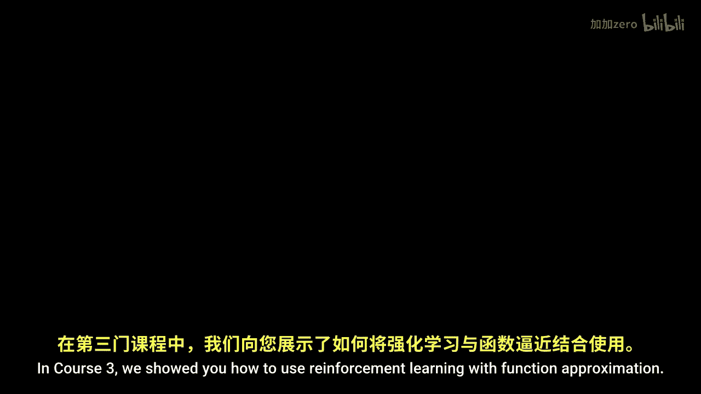

# 122：第4课介绍 🚀

在本节课中，我们将学习如何整合前三门课程的知识，构建一个完整的强化学习系统，并应用于一个实际挑战——控制月球着陆器着陆。

在课程3中，我们介绍了如何使用函数近似的强化学习方法。我们涵盖了如何使用神经网络和固定基函数（如瓦片编码）来近似价值函数和策略。我们讨论了函数近似如何实现**泛化**，这有助于智能体更快地学习。但我们也可能失去精确区分不同状态价值的能力。函数近似器可能无法准确获取所有状态的价值。此时，智能体必须决定如何在各状态间平衡准确性，即如何分配其有限的近似资源。为此，我们引入了**目标函数**来明确如何平衡近似误差，并讨论了基于梯度的算法来优化这些目标。

## 课程目标与实践项目 🌕

利用所有这些新知识，你已经准备好实现一个完整的强化学习系统。你将研究一个问题，该问题突显了在现实世界中应用强化学习时可能面临的一些挑战。

在课程4中，你将综合运用课程1、2和3的知识，完成一个任务：**控制一个月球着陆器在月球上安全着陆**。当我和Adam开始研究一个新问题时，我们通常会先召开会议，集思广益，讨论如何最好地构建问题框架，并收集关于潜在解决方案的想法。通常没有一个绝对正确的解决方案。在本课程中，我们将与你一同推理，探讨如何为这个问题设计一个智能体。

## 问题形式化与算法选择 🤔

我们将首先讨论如何将问题形式化为一个**马尔可夫决策过程**。如果有人只是告诉你“设计一个智能体来让这个月球着陆器着陆”，你必须弄清楚如何将这个目标转化为一个可计算的问题形式。这当然是我们开始的地方。

接着，我们将思考如何选择一个合适的学习算法。这其中很重要的一部分实际上是思考算法涉及的所有细节。这包括确定智能体如何进行探索、选择何种类型的函数近似架构，以及函数近似器内部的细节，例如它生成的特征数量等等。本课程的一大重点是理解所有这些细节的重要性，以及如何尝试洞察你的算法在不同选择下的行为表现。

## 从理解到实践 🛠️

实际的实现始于深入的理解。因此，我们不只是空谈理论，让我们直接深入其中，亲自动手实践——当然，是与“月球尘土”打交道。

---

本节课中，我们一起学习了如何将强化学习的理论知识整合起来，应用于一个具体的、具有挑战性的实际问题——月球着陆。我们回顾了函数近似的作用与权衡，并概述了将实际问题形式化、选择并调整算法的完整流程，为接下来的动手实践奠定了基础。