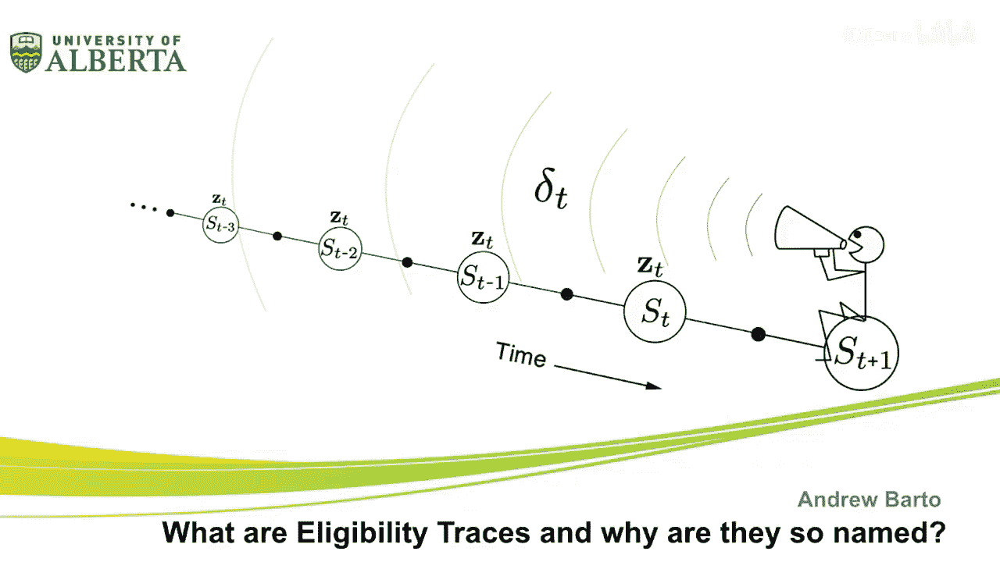
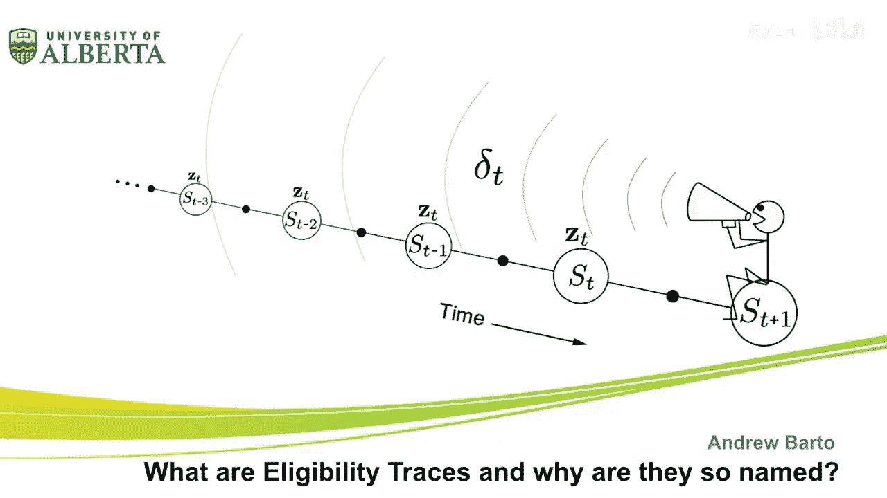

# 125：什么是资格迹及其命名由来 🧠

在本节中，我们将探讨强化学习中的一个核心概念——资格迹。我们将了解其思想起源、命名原因，以及它在算法和神经科学背景下的意义。通过本节学习，你将理解资格迹的基本原理，并认识到它其实一直隐含在你已学过的许多算法之中。

## 概述

资格迹的概念源于神经科学中的一个假说。理解其起源有助于我们把握其在强化学习算法设计中的核心作用。本节将首先介绍该假说，然后解释资格迹的两种类型，最后说明其在演员-评论家架构中的应用。

## 资格迹的思想起源

上一段我们提到了资格迹的概念，本节中我们来看看它的具体起源。资格迹的思想来源于哈里·克洛夫的假说，即“享乐主义神经元假说”。哈里曾是美国空军科学研究办公室航空电子学指挥部的高级科学家。

他在1972年发表的一篇专著以及1982年出版的《享乐主义神经元》一书中提出了这一观点。他的假说认为，神经元个体是享乐主义者，它们致力于最大化局部的“快乐”类似物，同时最小化局部的“痛苦”类似物。

换句话说，根据他的观点，每个神经元都是一个强化学习智能体，而大脑则是由众多相互作用的强化学习智能体组成的社会。

## 神经元与突触

为了理解克洛夫的假说，我们需要一些关于神经元的基础知识。

以下是关于神经元的关键点：
*   神经元的输出或动作称为“动作电位”。
*   动作电位通过神经元的轴突传递给其他神经元。当神经元产生动作电位时，我们称其为“放电”。
*   动作电位通过“突触”作用于其他神经元。
*   突触具有“效能”或“权重”、“强度”，这些会在学习过程中发生改变。

下图是一个突触的示意图。动作电位会通过顶部的“突触前末梢”到达，并影响底部的“突触后神经元”。我们通常认为突触权重或效能存在于这个连接中，而“资格”这个概念通常被认为是由轴突内部的生物化学过程实现的，可能就在这个突触前末梢。

## 克洛夫的具体假说

克洛夫的具体假说是：当神经元放电产生一个动作电位时，所有促成此次放电的突触都变得“有资格”改变其效能或权重。

如果在此动作电位之后的一个合适时间窗口内出现了奖励的增加，那么所有具备资格的突触的效能就会增加（如果是惩罚，则减少）。

这就引出了一个关键问题：资格迹的形状应该是怎样的？这里的资格迹指的是存储在突触处的、基于神经元先前活动的记忆记录。

克洛夫指出，神经元嵌入在许多持续时间各不相同的反馈回路中。有些反馈回路在神经系统内部，因此非常短；有些则通过环境延伸到生物体外部，再通过感觉器官返回，因此是更长的反馈回路。因此，神经元活动的后果会以不同的时间延迟返回给它。

资格迹的形状就是这些反馈回路持续时间的一种“直方图”。

下图展示了这种资格迹可能的样子。在神经元放电后，首先有一些非常短的反馈回路返回信息，可能在某个时间点（例如600毫秒，当然不同神经元会不同）达到最大数量，然后还有少数非常长的反馈回路。因此，克洛夫假设的资格迹形状大致如此。

## 两种类型的资格迹

现在，我们来看看资格迹的两种主要类型。

以下是两种资格迹的定义：
*   **关联性资格迹**：取决于突触前和突触后活动，正如克洛夫所假设的。突触前输入需要参与引发突触后活动。这导致了一个**三因素学习规则**：`学习信号 = f(突触前活动， 突触后活动， 后续的强化信号)`。
*   **非关联性资格迹**：仅由突触前活动触发。这导致了一个**两因素学习规则**：`学习信号 = f(突触前活动， 强化信号)`，而不依赖于突触后神经元的活动。

下图展示了这些概念。顶部曲线是几个突触前动作电位，下一行是几个突触后动作电位。可以看到，在两个实例中，它们大致同时发生，表明突触前动作电位有助于引发突触后动作。对于关联性资格迹，只有这两种情况会触发资格迹。而对于非关联性资格迹，最后一个仅由突触前脉冲触发的情况也会被计入，即使当时没有突触后脉冲。

## 在演员-评论家架构中的应用

观察你已经学过的演员-评论家架构，特别是策略梯度方法，我们会发现一个主要区别。

演员和评论家之间的主要区别在于：**演员使用关联性资格迹，而评论家使用非关联性资格迹**。因此，在第一种情况下，演员试图最大化强化信号，而在评论家的情况下，它试图预测强化信号。这主要就是由于这两种资格迹类型的差异造成的。

## 强化学习中的简化

在强化学习中，我们使用了克洛夫所建议的那种迹的简化版本，它看起来像这样：**一个指数衰减的迹** `λ^t`（其中λ是衰减率，t是时间步）。与我们之前展示的更复杂的迹相比，这种形式更容易实现和分析。但有时，更接近克洛夫原始设想的迹可能表现更好，不过目前还没有太多研究深入探讨这个问题。

## 你一直在使用资格迹

实际上，你一直在使用资格迹，尽管是最简单的一种。即使是仅考虑一个时间步延迟的情况，也可以被认为是用资格迹实现的。

例如，如果时间线上在时刻 `t` 发生了一个事件，那么在 `t+1` 时刻的迹就记录了它。这意味着反馈回路只花费一个时间步，并且这是唯一被考虑的情况。所以，这几乎是一种退化的情况。几乎所有你看过的强化学习算法，都将其作为其机制的一部分在使用。

## 总结

本节课中我们一起学习了资格迹的核心概念。以下是关键要点：
*   资格迹由哈里·克洛夫作为其“享乐主义神经元”假说的一部分提出。
*   资格迹记录了突触过去的活动，使得在该活动之后到达的反馈能够改变突触的强度。
*   在演员-评论家架构中，演员和评论家的主要区别在于：资格迹对演员是**关联性**的，对评论家是**非关联性**的。
*   资格迹对于在突触学习规则中考虑信号时序的作用至关重要。
*   最后，神经科学正在积累证据，表明神经系统确实存在非常类似资格迹的机制。