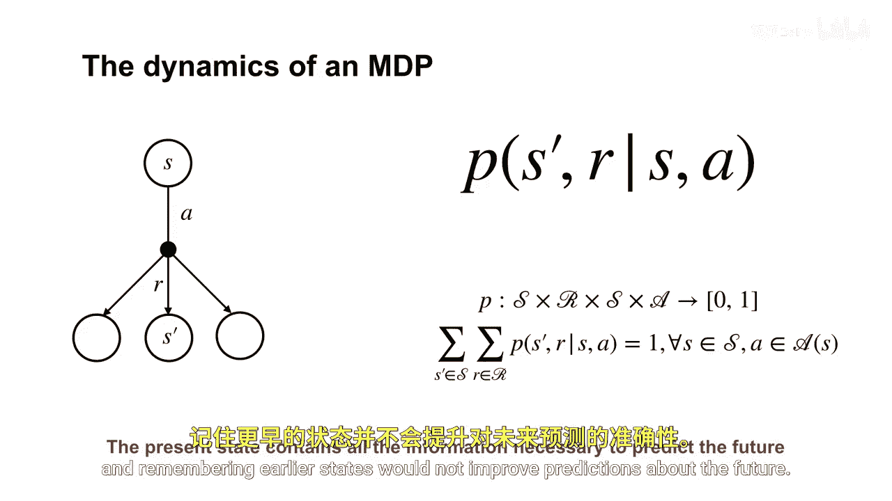

# 126：回顾马尔可夫决策过程

在本节课中，我们将要学习马尔可夫决策过程。我们将了解MDP如何作为序贯决策问题的通用框架，并详细描述其动态特性是如何定义的。

## 从老虎机问题到真实世界问题

上一节我们介绍了K臂老虎机问题，它引出了许多有趣的问题。然而，它并未包含现实世界问题的许多方面。

在老虎机问题中，智能体在每个时刻面临相同的情境，并且最优动作总是相同的。但在许多实际问题中，不同的情境需要不同的应对策略。此外，我们当前选择的动作会影响未来能获得的奖励量。

马尔可夫决策过程形式化地捕捉了现实世界问题的这两个关键方面。

## 一个简单的例子：兔子的困境

让我们从一个简单的例子开始，以突显老虎机问题与MDP之间的区别。

想象一只兔子在田野里游荡寻找食物。它发现自己处于一种情境：右边有一根胡萝卜，左边有一棵西兰花。兔子更喜欢胡萝卜，所以吃胡萝卜会产生+10的奖励。而吃西兰花只产生+3的奖励。

但是，如果后来兔子发现自己处于另一种情境：右边是西兰花，左边是胡萝卜。在这里，兔子显然会更倾向于向左走，而不是向右走。

K臂老虎机问题没有考虑到“不同情境需要不同动作”这一事实。它在另一个方面也存在局限。

## 考虑动作的长期影响

假设我们确实考虑了不同情境下的不同动作。在这里，兔子似乎想向右走以获得胡萝卜。然而，向右走也会影响兔子接下来看到的情境。

假设就在胡萝卜的右边，有一只老虎。如果兔子向右移动，它能吃到胡萝卜。但之后，它可能不够快以逃脱老虎。如果我们考虑到动作的长期影响，兔子应该向左走，选择西兰花，以给自己更好的逃脱机会。

一个只关心即时奖励的“老虎机兔子”会选择胡萝卜。但通过考虑我们决策的长期影响，可以做出更好的决定。

## 定义MDP的核心要素

现在让我们看看随着兔子采取行动，情境是如何变化的。我们将这些情境称为**状态**。

在每个状态，兔子选择一个**动作**。例如，兔子可以选择向右移动。基于这个动作，环境会转变到一个新的状态并产生一个**奖励**。在这个例子中，兔子吃了胡萝卜并获得+10的奖励。然而，兔子现在紧挨着老虎。

假设兔子选择了向左的动作。环境转变到一个新的状态，老虎吃掉了兔子，兔子获得-100的奖励。从原始状态，兔子也可以选择向左移动，那么环境会转变到一个新的状态，兔子获得+3的奖励。

图表现在显示了两条潜在的状态序列。实际发生的序列取决于兔子采取的动作。

## 形式化智能体与环境的交互

我们可以用一个通用框架来形式化这种交互。在这个框架中，智能体与环境在离散的时间步上进行交互。

在每个时间步 `t`，智能体从环境接收一个状态 `S_t`，该状态来自一组可能的状态集合 `𝒮`。幻灯片上显示的配置就是一个状态的例子。

基于这个状态，智能体从一组可能的动作集合中选择一个动作 `A_t`。`𝒜(S_t)` 是在状态 `S_t` 下的有效动作集合。向右移动就是一个动作的例子。

一个时间步之后，部分基于智能体的动作，智能体发现自己处于一个新的状态 `S_{t+1}`。例如，这个状态是兔子紧挨着老虎的状态。

环境还提供一个标量奖励 `R_{t+1}`，它来自一组可能的奖励集合 `ℛ`。在这个例子中，吃胡萝卜的奖励是+10。

下图总结了MDP框架中的智能体-环境交互。这种交互产生了一条由状态、动作和奖励组成的经验轨迹。动作既影响即时奖励，也通过影响未来状态进而影响未来的奖励。

## 用概率描述动态特性

那么，我们如何表示这种交互的动态特性呢？与老虎机问题一样，结果是随机的，因此我们使用概率的语言。

当智能体在一个状态下采取一个动作时，存在许多可能的下一个状态和奖励。

**转移动态函数 P** 形式化了这个概念。给定一个状态 `s` 和一个动作 `a`，`P` 告诉我们下一个状态 `s‘` 和奖励 `r` 的联合概率。

在本课程中，我们通常假设状态、动作和奖励的集合是有限的，但别担心，您也将学习能够处理无限集和不可数集的算法。

由于 `P` 是一个概率分布，它必须是非负的，并且对所有可能的下一个状态和奖励求和必须等于1。

`P(s‘, r | s, a) = Pr{S_{t+1}=s‘, R_{t+1}=r | S_t=s, A_t=a}`

注意，未来的状态和奖励仅取决于当前的状态和动作。这被称为**马尔可夫性**。这意味着当前状态是充分的，记住更早的状态不会改善对未来的预测。

## 总结与预告

本节课中我们一起学习了马尔可夫决策过程。MDP为序贯决策制定提供了一个通用框架，其动态特性由一个概率分布定义。

在下一个视频中，我们将讨论几种决策制定任务，并将每一种形式化为一个MDP。