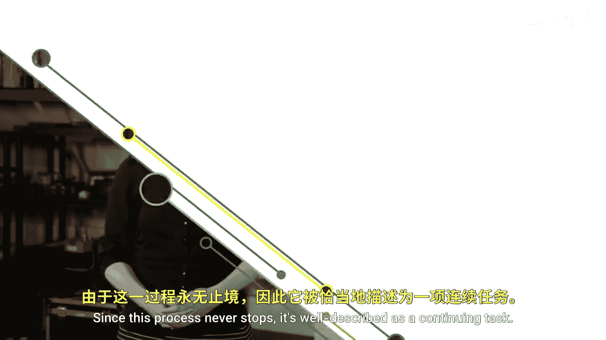

# 127：回顾分幕式任务与持续性任务的示例 🎮

在本节中，我们将通过更多具体示例，深入理解分幕式任务与持续性任务的区别。学习结束后，你将能够判断何时应将一个问题建模为分幕式任务，何时应建模为持续性任务。

## 分幕式任务示例 🎯

上一节我们介绍了分幕式任务的基本概念，本节中我们来看看一个具体的分幕式任务例子。

考虑一个智能体学习玩一个简单的视频游戏。玩家（用蓝色方块表示）通过收集白色的宝藏方块来获得分数。当玩家触碰到绿色的敌人方块时，游戏结束。

这个游戏很自然地可以被建模为一个分幕式马尔可夫决策过程。智能体的目标是在游戏结束前，通过收集尽可能多的宝藏来获得高分。

以下是该任务的关键要素：

*   **状态**：一个与当前游戏屏幕像素值对应的数组。
*   **动作**：四个方向的动作：上、下、左、右。
*   **奖励**：每当智能体收集到一个宝藏方块时，获得+1的奖励。
*   **幕的终止**：当智能体触碰到任意一个绿色敌人时，当前幕结束。无论上一幕如何结束，下一幕都会从智能体位于屏幕中央且没有敌人出现的状态重新开始。

顺便一提，你现在看到的这个智能体是通过Q学习算法训练的，它在这个游戏中表现得相当不错。在课程的第二部分，你将学习这个算法并亲自实现它。

## 持续性任务示例 🔄

看完了分幕式任务的例子，接下来我们转向持续性任务。我们将探讨一个服务器作业调度的场景。

假设我们有三台服务器，供强化学习研究人员运行实验使用。研究人员将具有不同优先级的作业提交到一个单一的队列中。

以下是该任务的关键要素：

*   **状态**：空闲服务器的数量，以及队列顶部作业的优先级。
*   **动作**：拒绝或接受队列顶部的作业（如果有空闲服务器）。
*   **奖励**：
    *   接受一个作业会运行它，并产生一个等于该作业优先级的正奖励。
    *   拒绝一个作业会产生一个与优先级成比例的负奖励，并将该作业送回队列末尾。
*   **任务特性**：智能体需要谨慎调度低优先级作业，因为这可能会妨碍后续高优先级作业的调度。服务器在完成当前作业后会变得可用。研究人员会持续地向队列中添加新作业，而智能体则不断地决定接受或拒绝它们。

由于这个过程永远不会停止，因此它非常适合被描述为一个持续性任务。

## 总结 📝

本节课中，我们一起学习了分幕式任务与持续性任务的具体示例。

*   **分幕式任务**：能够自然地分解为独立的、可重复的片段（幕），例如一局游戏。
*   **持续性任务**：假设会无限期地持续下去，没有自然的终止点，例如一个持续运行的调度系统。

现在，你应该能够根据问题的特性，判断哪种任务形式化方法更为合适。