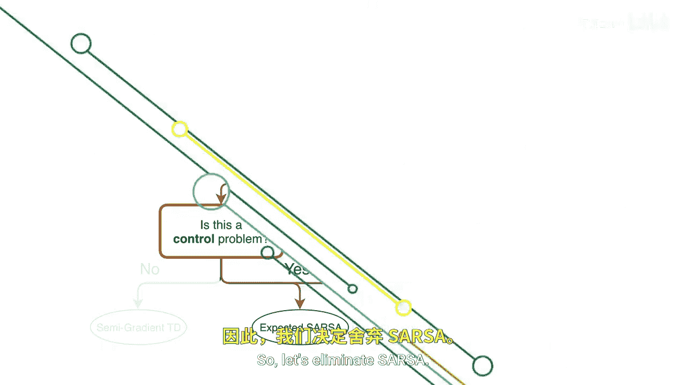

强化学习专项课程：P128：选择学习算法 🚀

在本节课中，我们将为“月球着陆器”项目选择合适的学习算法。我们将回顾问题的形式化定义，并利用课程三中的算法地图，系统地筛选出最适合本项目的算法。

到目前为止，我们已经讨论了一个有趣的问题——让航天器在月球上着陆。我们将此问题形式化为一个马尔可夫决策过程。本周，我们将开始讨论如何解决这个MDP，即从你学过的众多算法中，决定哪些算法适合这个问题。

你可能还记得课程三中帮助我们梳理所有算法的课程地图。让我们用它来决定在这个毕业设计项目中使用什么算法。

**第一步：我们能否仅用表格来表示价值函数？**

让我们回顾一下月球着陆器问题的状态空间。智能体观测到登月舱的位置、方向、速度和接触传感器信息。八个状态变量中有六个是连续的，这意味着我们无法用表格来表示它们。无论如何，我们都希望利用泛化能力来加速学习。

因此，我们排除了仅使用表格表示法的分支，需要使用函数近似方法。

**第二步：这能否很好地表述为一个平均奖励问题？**

思考一下这个问题的动态特性。登月舱从低轨道开始下降，直到在月球表面静止。然后这个过程重复进行，每次新的着陆尝试都独立于前一次的结果而开始。这正是我们对分幕式任务的定义。

平均奖励公式适用于持续性任务，因此在这里不是最佳选择。所以，我们排除了算法地图中的那个分支。

**第三步：思考是否可能且有益于在每个时间步更新策略和价值函数。**

我们可以使用蒙特卡洛法或时序差分法。但请思考在月球上着陆模块的情景。如果在幕中我们的任何传感器受损，我们希望能在幕结束前更新策略。这类似于我们在“开车回家”例子中讨论的情况。我们预计时序差分方法在这类问题中表现更好。

因此，我们选择时序差分方法。

**最后，不要忘记我们的目标。** 我们希望在模拟器中学习一个安全且稳健的策略，以便能在月球上使用。我们希望学习一个能最大化奖励的策略，因此这是一个控制任务。

这为我们留下了三种算法：SARSA、期望SARSA和Q学习。

由于我们使用函数近似，学习一个ε-软策略将比学习一个确定性策略更稳健。请记住那个由于状态混叠导致确定性策略次优的例子。期望SARSA和SARSA都允许我们学习最优的ε-软策略，但Q学习不行。

现在，我们需要在期望SARSA和SARSA之间做出选择。我们在之前的视频中提到，期望SARSA通常比SARSA表现更好，因此我们排除SARSA。

本周内容到此结束。我们现在已经选择了一个算法，它将为我们智能体的构建奠定基础。下周见。