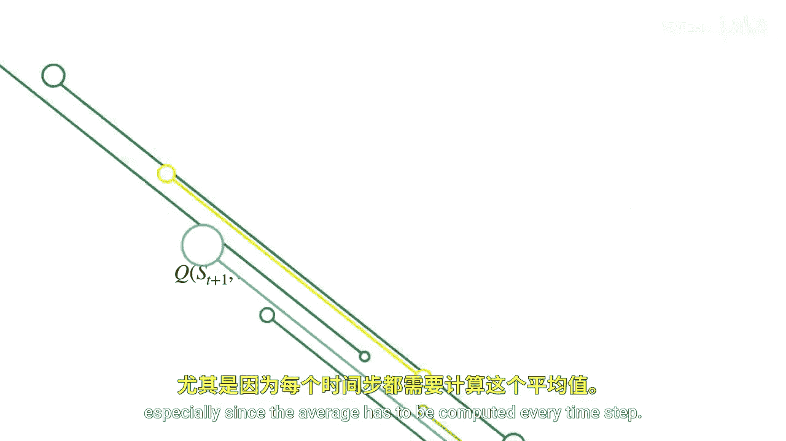

# 129：回顾期望SARSA算法 📚

在本节课中，我们将学习另一种时序差分控制方法——期望SARSA算法。我们将了解其核心思想、更新规则，并分析它与SARSA和Q学习算法的区别与联系。

## 概述

上一节我们讨论了SARSA和Q学习这两种时序差分控制方法。本节中，我们将介绍第三种方法：期望SARSA。通过本视频的学习，你将能够解释期望SARSA算法的工作原理。

## 期望SARSA的核心思想

我们首先回顾动作值函数的贝尔曼方程。方程中包含了对下一个“状态-动作”对值的期望。

将这个期望分解，我们可以看到它包含了对可能的下一个状态以及可能的下一个动作的求和。

SARSA算法通过从环境中采样下一个状态，并从其策略中采样下一个动作来估计这个期望。

但智能体已经知道自己的策略，为什么还需要对下一个动作进行采样呢？相反，它应该直接计算这个期望。在这种情况下，我们可以对所有可能的下一个动作值进行加权求和。

权重是智能体策略下采取每个动作的概率。

显式地计算下一个动作的期望，是期望SARSA算法背后的主要思想。

## 期望SARSA的学习更新

由于期望SARSA仍然基于动作值函数的贝尔曼方程，它使用了我们熟悉的学习更新形式。

该算法与SARSA几乎完全相同，除了时序差分误差使用的是下一个动作值的期望估计，而不是下一个动作值的样本。

这意味着在每一个时间步，智能体都必须根据策略下每个动作的可能性，对下一个状态的动作值进行平均。

例如，给定以下动作值和策略，期望SARSA会使用值1.4作为其对期望下一个动作值的估计。

然而，显式计算期望有一个巨大的优势：期望SARSA比SARSA拥有更稳定的更新目标。

让我们看一个例子来更清楚地说明这一点。在这个例子中，中间奖励是确定性的。SARSA和期望SARSA都从下一个状态的**真实**动作值开始。

即使在这种理想情况下，SARSA所做的下一个动作采样也可能导致其向错误的方向更新值。它依赖于这样一个事实：在多次更新的期望中，方向是正确的。

相比之下，期望SARSA的更新目标是完全正确的，并且不会将估计值从真实值改变。

总的来说，期望SARSA的更新目标方差比SARSA低得多。

不过，较低的方差也带来了一个缺点。随着动作数量的增加，计算下一个动作的平均值会变得更加昂贵。当存在许多动作时，计算平均值可能需要很长时间，尤其是因为每个时间步都必须计算这个平均值。

## 总结

本节课中，我们一起学习了期望SARSA算法。我们了解到，该算法显式计算了其策略下的期望值，这虽然比采样更昂贵，但具有更低的方差。