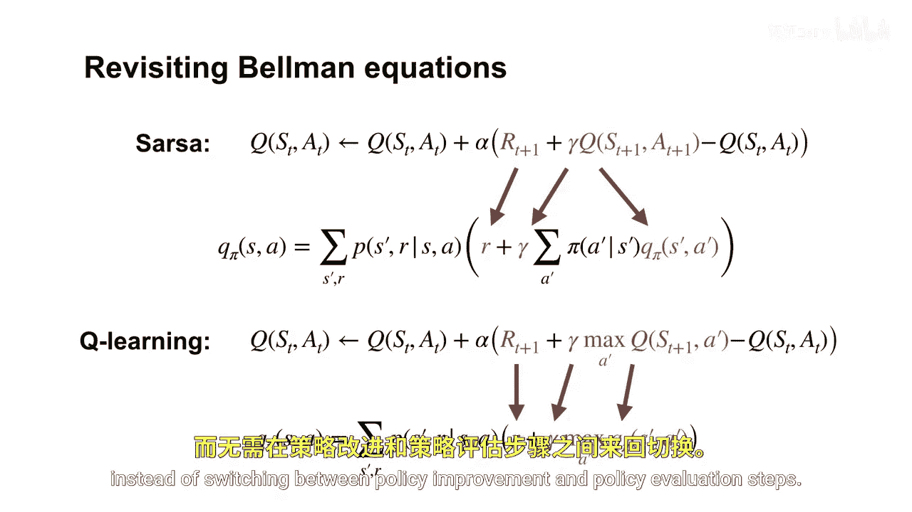

# 130：回顾Q学习算法

在本节课中，我们将学习Q学习算法。这是一种在强化学习领域具有里程碑意义的算法，已被成功应用于玩雅达利游戏、控制交通信号灯乃至自动配置网络系统等多个领域。课程结束时，你将能够描述Q学习算法，并解释它与贝尔曼最优方程之间的关系。

## Q学习算法简介

Q学习算法于1989年被提出，是最早的重要在线强化学习算法之一。让我们先来看一下它的伪代码。

以下是Q学习算法的核心步骤：

1.  初始化Q(s, a)表。
2.  对每个回合（episode）：
    a. 初始化状态S。
    b. 当状态S不是终止状态时，循环：
        i. 根据当前Q值和探索策略（如ε-greedy）选择动作A。
        ii. 执行动作A，观察奖励R和下一个状态S‘。
        iii. 使用以下公式更新Q值：
            `Q(S, A) ← Q(S, A) + α [ R + γ * max_a Q(S‘, a) - Q(S, A) ]`
        iv. 将状态更新为S‘。

这个流程包含智能体在状态中选择动作、执行动作并观察结果、然后进行更新的循环。这与我们之前见过的算法框架相似。

## Q学习的核心更新机制

那么，Q学习的新颖之处在哪里？关键在于其动作价值函数的更新方式。

在更新公式 `Q(S, A) ← Q(S, A) + α [ R + γ * max_a Q(S‘, a) - Q(S, A) ]` 中，**目标值** 是 `R + γ * max_a Q(S‘, a)`。这与SARSA算法不同，SARSA使用的是下一个“状态-动作对”的价值，即 `R + γ * Q(S‘, A‘)`。

Q学习为何使用最大值 `max`，而不是下一个具体的动作价值呢？这需要追溯到动态规划的内容。

## 与贝尔曼方程的关联

如果你观察SARSA的更新方程，会发现它与动作价值的贝尔曼方程惊人地相似。实际上，SARSA是一种基于样本的算法，用于求解给定策略下的动作价值贝尔曼方程。

Q学习同样使用环境样本来求解一个贝尔曼方程。但它求解的不是标准的贝尔曼方程，而是**动作价值的贝尔曼最优方程**。

这个最优方程使得Q学习能够直接学习最优动作价值函数 `Q*`，而无需在策略改进和策略评估步骤之间来回切换。

## Q学习与SARSA的本质区别

尽管SARSA和Q学习都基于贝尔曼方程，但它们基于的是完全不同的方程。

*   **SARSA** 是**策略迭代**的样本化版本。它依赖于一个特定策略下的贝尔曼方程。
*   **Q学习** 是**价值迭代**的样本化版本。它迭代地应用**贝尔曼最优方程**。

应用贝尔曼最优方程会严格改进价值函数（除非它已经是最优的）。因此，价值迭代持续改进其对价值函数的估计，并最终收敛到最优解。同理，只要智能体持续探索并采样所有“状态-动作”空间，Q学习也能收敛到最优价值函数。

## 课程总结

本节课中，我们一起学习了Q学习算法，并描述了它与贝尔曼最优方程之间的紧密联系。我们了解到，Q学习通过使用下一个状态的最大Q值作为更新目标，直接近似最优动作价值函数，这是它与同策略算法SARSA的关键区别。