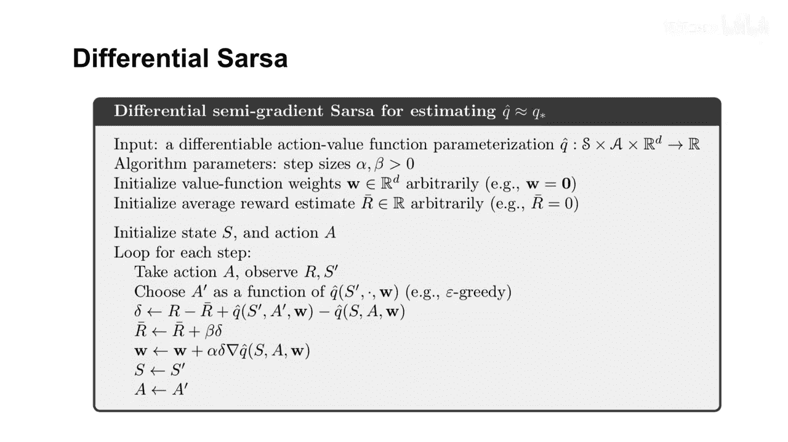

# 131：平均奖励与差分值函数

在本节课中，我们将学习一种处理持续性任务的新方法：平均奖励设定。我们将了解如何定义平均奖励，以及如何通过差分回报和差分值函数来评估策略和动作。最后，我们将看到如何将熟悉的算法（如SARSA）调整到这种新设定中。

## 概述：持续性任务的新视角

在持续性任务中，我们关注的是极长视野下的性能表现。到目前为止，我们使用折扣因子来平衡短期表现和长期收益。然而，这不是表述问题的唯一方式。本节将学习一种称为“平均奖励设定”的新方法来表述持续性任务。

## 近视MDP示例

为了理解平均奖励的必要性，让我们想象一个简单的任务，其状态排列在两个相交的环中，我们称之为“近视MDP”。在大多数状态下，只有一个可用动作，因此无需做出决策。只有一个状态可以做出决策：智能体可以决定遍历哪个环。这意味着存在两种确定性策略：遍历左环或遍历右环。

奖励在所有地方都为零，除了每个环中的一个转移。在左环中，奖励+1在状态S之后立即获得。在右环中，奖励+2在状态S之前立即获得。直观上，你会选择右边的动作，因为你知道会得到+2奖励。但值函数会告诉我们做什么呢？

如果我们使用折扣，在这两种不同策略下，状态S的值是多少？
*   选择左动作的策略的值为：`1 / (1 - γ^5)`。
*   选择右动作的策略的值为：`2 * γ^4 / (1 - γ^5)`。

让我们思考特定γ值下，状态S在这两种策略下的值：
*   如果γ=0.5，VL ≈ 1，VR ≈ 0.1。这意味着在这种更短视的折扣下，采取左动作的策略更优。
*   如果γ=0.9，VL ≈ 2.4，VR ≈ 3.2。所以现在我们更倾向于另一个策略。

事实上，我们可以计算出使智能体偏好向右策略所需的最小γ值。γ需要至少为0.841。这里的问题是，折扣的大小取决于具体问题。对于这个例子，0.85足够大，但如果每个环有1000个状态，这个折扣因子需要超过0.99。

一般来说，确保智能体行为能最大化长期奖励的唯一方法是不断将折扣因子向1增加。根据问题不同，我们可能需要γ非常大。记住，在持续性设定中我们不能将其设为1，因为那样回报可能是无限的。

那么，使用较大的γ有什么问题呢？大的γ值也会导致更大、更不稳定的求和，这可能难以学习。那么，有替代方案吗？

## 平均奖励目标

让我们讨论一个称为“平均奖励”的新目标。想象智能体与世界交互了H步。这是它在这些步骤中平均获得的奖励，换句话说，是它的奖励率。如果智能体的目标是最大化这个平均奖励，那么它对近期和远期奖励的关心程度是相等的。

我们用`r(π)`表示策略π的平均奖励。更一般地，我们可以使用状态访问分布`μ`来写平均奖励：
`r(π) = Σ_s μ_π(s) Σ_a π(a|s) Σ_s‘ p(s’|s,a) r(s,a,s‘)`
内层项是策略π下状态的期望奖励。外层求和取该状态被访问频率的期望。合起来，我们得到跨状态的期望奖励，即策略的平均奖励。

在近视示例中，两种可能的确定性策略会无限期地访问左环或右环。在这两种情况下，每个环中的五个状态被访问的次数相等。
*   在左环中，除了一个获得+1的状态外，所有状态的即时期望奖励为+0。这导致每五步平均奖励为1，即0.2。
*   在右环中，大多数状态的即时期望奖励也是+0，但这次最后一个状态获得+2。这给出每五步平均奖励为2，即0.4。

我们可以看到，平均奖励更倾向于获得总奖励更多的策略，而无需考虑越来越大的折扣因子。

## 差分回报

平均奖励的定义对于判断一个策略是否优于另一个很直观，但我们如何判断从一个状态出发的哪个动作更好呢？我们需要的是这个新设定下的动作值函数。

第一步是弄清楚回报是什么。在平均奖励设定中，回报是根据奖励与平均奖励`r(π)`之间的差值来定义的，这称为差分回报。

让我们看看近视MDP中的差分回报是什么。差分回报表示智能体从当前状态和动作开始，相比遵循该策略的平均奖励，将多获得多少奖励。

让我们看看从状态S开始，首先选择动作L，然后遵循策略π_L的差分回报。该策略的平均奖励是0.2。差分回报是未来奖励的总和，其中每个奖励都减去了平均奖励。这个求和从状态S和动作L开始。

我们可以通过求和到某个有限视野H，然后取H趋于无穷的极限来计算它。我们通过这个极限符号稍微简化了事情。虽然这个符号在许多情况下有效，但当环境是周期性时，我们需要使用不同的技术。在这种情况下，我们使用一种更一般的极限（称为Cesàro和）来计算回报，但这个技术细节并不关键，这里的主要点是其直观含义。

我们发现差分回报是0.4。现在让我们看看另一个动作。这次，我们可以将差分回报分成两部分。首先，通过右环的单次轨迹的求和，我们可以明确地写出这个和，它等于1。然后是无限期采取左动作的求和部分。这个和与我们刚刚计算的差分回报相同，即0.4。将两部分相加，我们发现差分回报是1.4。因此，如果智能体的策略总是采取左动作，它可以观察其差分回报并意识到应该切换到采取右动作。

现在让我们看看如果智能体的策略总是采取右动作，其差分回报是多少。该策略产生的平均奖励为0.4，在状态S下采取右动作的策略的差分项是-0.8。现在，在状态S下一次采取左动作，然后无限期采取右动作的差分回报是多少？和之前一样，我们将和分成两部分，遍历左环一次导致前五个时间步的和为-1。加上从状态S开始遵循π_R的差分项（我们之前发现是-0.8），得到答案-1.8。我们再次看到，右动作更受青睐。

你可能已经注意到，π_R的差分回报低于π_L的差分回报，尽管π_R的平均奖励更高。这是因为差分回报表示在特定策略下，在某个状态采取一个动作比该策略的平均情况好多少。只有在后续时间步遵循相同策略时，差分回报才能用于比较动作。要比较策略，应改用它们的平均奖励。

有趣的是，只有当减去的常数等于真实平均奖励时，差分回报才是一个收敛的和。如果减去一个更低或更高的数字，和将发散到正无穷或负无穷。

## 差分值函数与贝尔曼方程

现在我们有了平均奖励回报的有效定义，我们可以像往常一样将值函数定义为期望回报。类似地，我们也可以将差分值函数定义为在给定策略下，从给定状态或状态-动作对开始的期望差分回报。

这个量捕捉了智能体从特定状态开始，相比遵循固定策略在所有状态上的平均情况，将多获得多少奖励。

与折扣设定类似，差分值函数可以写成贝尔曼方程。方便的是，它们看起来像我们之前见过的方程，它们的不同之处仅在于从即时奖励中减去了`r(π)`，并且没有折扣。

折扣情况下的许多算法可以重写以适用于平均奖励情况。例如，差分SARSA与你之前见过的SARSA算法非常相似。

让我们逐步了解其差异。一个关键区别是，差分SARSA必须跟踪其策略下平均奖励的估计值，并在其更新中从样本奖励中减去它。这个实现使用了我们在整个课程中见过的增量平均技术。给定这个估计，它然后在更新中从采样的奖励中减去`r_bar`。

在实践中，我们可以通过对该算法稍作修改来获得更好的性能：我们使用方差更低的更新来计算`r_bar`，而不是奖励的指数平均。

## 总结

在本节课中，我们介绍了平均奖励目标，并为此设定定义了差分回报和差分值函数。我们了解到，当折扣因子需要设置得非常大以确保长期最优性时，平均奖励提供了一种替代方案，它平等地对待所有时间步的奖励。我们还看到了如何将值函数和算法（如SARSA）调整到这种无折扣的设定中。下周，我们将讨论优化这个平均奖励目标的另一种方法。