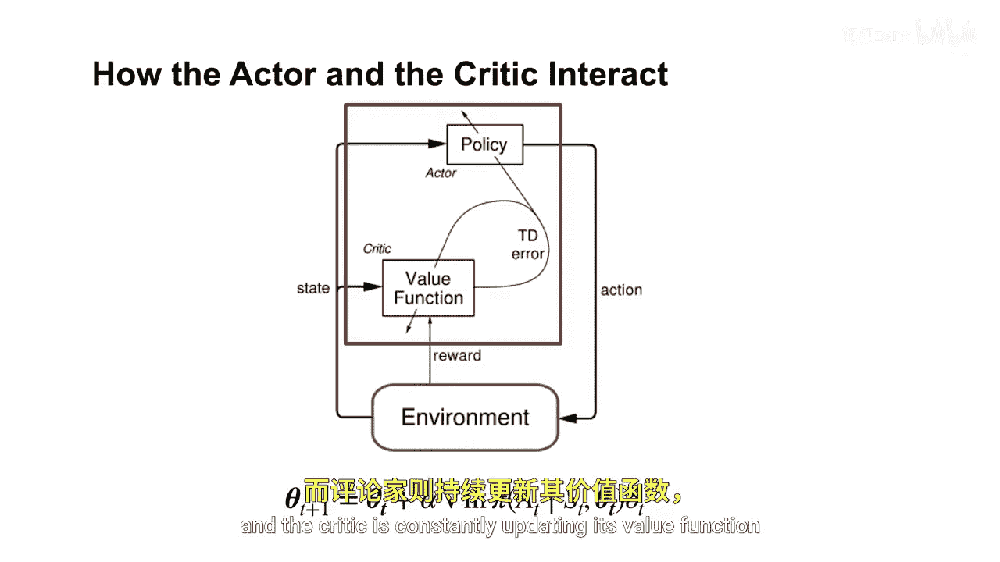
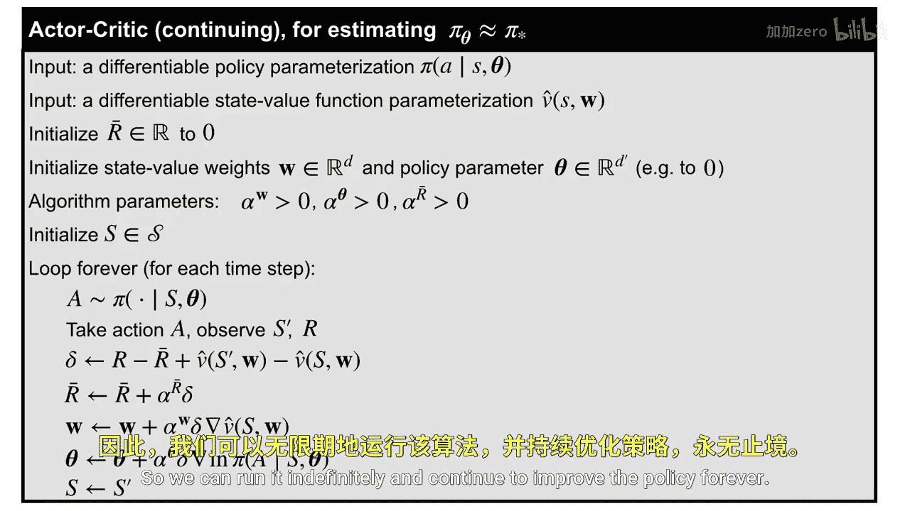

强化学习专项课程：04：回顾演员-评论家算法 🎭🤖

在本节课中，我们将学习演员-评论家算法。这是一种结合了策略梯度方法与价值函数学习的强化学习方法。我们将了解其核心思想、算法流程以及为何它能有效工作。

---

我们必须在直接学习策略参数和学习价值函数之间做出选择吗？答案是否定的。

即使在策略梯度方法内部，像时序差分这样的价值学习方法仍然扮演着重要角色。

在这种架构中，参数化的策略扮演着“演员”的角色，而价值函数则扮演着“评论家”的角色，负责评估演员选择的动作。这些所谓的演员-评论家方法，是强化学习中最早引入的基于时序差分的方法之一。

上一节我们介绍了策略梯度方法的基本框架，本节中我们来看看如何将价值函数学习融入其中，形成演员-评论家算法。

我们以上一个视频中的策略梯度学习规则表达式作为起点：

`Δθ ∝ ∇ log π(A|S, θ) * Q(S, A)`

但我们无法直接获得真实的动作价值函数 Q，因此需要对其进行近似。我们可以采用常用的时序差分方法，使用一步自助回报作为目标：

`R - R̄ + V̂(S')`

其中，`V̂` 是参数化的价值函数估计值，在这里特指差分价值函数。这就是演员-评论家算法中的“评论家”部分，它为演员提供即时反馈。

为了训练评论家，我们可以使用任何状态价值学习算法。这里我们将使用平均奖励版本的半梯度时序差分法。

参数化的策略是“演员”，它使用如下所示的策略梯度进行更新：

`Δθ = α * ∇ log π(A|S, θ) * (R - R̄ + V̂(S'))`

我们可以直接使用这种更新形式，但还可以做一项改进来优化算法：减去一个称为“基线”的值。我们不单独使用一步价值估计，而是减去状态 `S_t` 的价值估计，得到如下更新：

`Δθ = α * ∇ log π(A|S, θ) * [ (R - R̄ + V̂(S')) - V̂(S) ]`

这里的 `V̂(S_t)` 就是基线。注意，这个表达式等于时序差分误差 `δ`。

这个更新的期望值与之前的更新是相同的。原因如下：

让我们计算在给定特定状态 `S_t` 的条件下，这个更新的期望值。期望的和等于和的期望。我们可以利用这一点，将原始项的期望与涉及被减价值函数的期望分离开。结果证明，第二项的期望值为0。因此，我们可以在不改变更新期望值的情况下添加这个基线。你可以自行验证这一点：将期望写为动作概率的求和，并将 `V̂` 项从求和中提出。

那么，如果更新的期望值相同，我们为什么还要添加这个基线呢？减去基线有助于降低更新的方差，从而带来更快的学习速度。

从直观上理解，这个更新也很有道理：在我们执行一个动作后，我们使用时序差分误差来判断该动作相对于该状态的平均水平有多好。如果时序差分误差为正，意味着所选动作带来的价值高于预期，那么更频繁地采取该动作应该能改进我们的策略。这正是此更新所做的：它根据评论家的判断，改变策略参数以增加那些优于预期的动作的概率。相应地，如果评论家“失望”，时序差分误差为负，则该动作的概率会降低。

演员和评论家同时学习，不断交互。演员持续改变策略以超越评论家的期望，而评论家则不断更新其价值函数以评估演员变化中的策略。

---

在明确了策略更新规则后，我们现在可以梳理完整的平均奖励演员-评论家算法流程。

以下是算法的主要步骤：

1.  **初始化**：首先，我们需要指定策略的参数化和价值函数的参数化方式。例如，可以使用瓦片编码来构建近似价值函数，并使用柔性最大化策略参数化。我们还需要维护一个平均奖励的估计值，就像在差分SARSA算法中一样，初始化为零。权重和策略参数可以按喜好初始化。同时，初始化价值估计、策略和平均奖励的步长参数，它们可以各不相同。
2.  **与环境交互**：从环境中获取初始状态，然后开始行动和学习。
3.  **循环执行以下步骤**：
    *   根据当前策略选择动作。
    *   从环境中接收下一个状态和奖励。
    *   利用这些信息，计算差分时序差分误差 `δ = R - R̄ + V̂(S') - V̂(S)`。
    *   更新平均奖励的运行估计值 `R̄`。
    *   使用时序差分更新规则更新价值函数的权重 `w`。
    *   使用策略梯度更新规则更新策略参数 `θ`。

这个算法是为持续性任务设计的，因此我们可以无限期地运行它，并持续改进策略。

---

本节课中我们一起学习了演员-评论家算法。你现在应该理解，学习一个价值函数来估计策略参数的梯度是有用的，而演员-评论家算法通过一个为演员学习价值函数的评论家来实现这一思想。这种方法结合了策略学习和价值学习的优势，是强化学习中的一个重要框架。