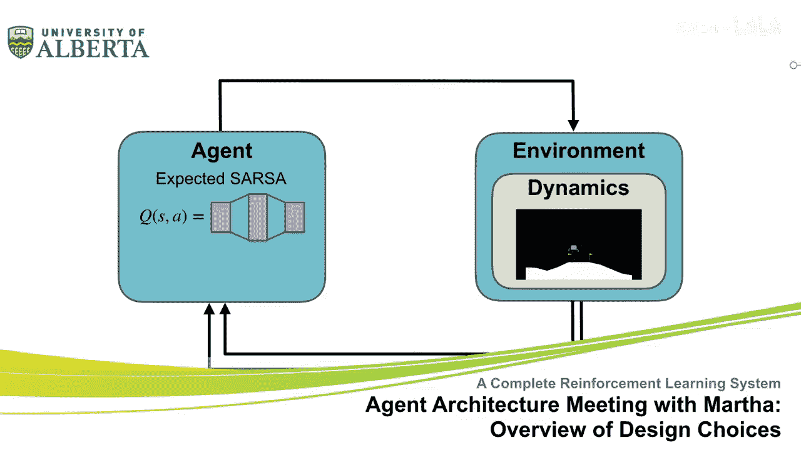

# 135：与Martha探讨设计选择概述 🧠

在本节课中，我们将一起探讨毕业项目第三周的核心任务：为智能体实现做出具体的元参数选择。我们将讨论函数近似器、优化器以及探索策略的设计决策。

## 概述

现在，你正处于毕业项目的第三周。这意味着我们已经完成了构建完整强化学习系统的一半工作。到目前为止，我们已经使用马尔可夫决策过程的形式化语言定义了“月球着陆器”问题。上周，我们讨论了使用哪种算法来解决该MDP。现在，让我们讨论为了完全实现智能体而必须做出的元参数选择。这意味着我们需要决定函数近似器的选择、用于更新动作值的优化器选择，以及如何进行探索。

## 函数近似器的选择

上一节我们讨论了算法选择，本节中我们来看看如何表示价值函数。我们需要决定使用哪种函数近似器。我的通用建议是，对于函数近似，始终从简单的开始。这意味着使用像瓦片编码这样的固定基函数。

然而，对于这个问题，如果不仔细设计瓦片编码器，这可能不是最佳选择。如果你将所有输入一起进行瓦片编码，特征数量会随着输入维度呈指数级增长。例如，对于这个八维问题，如果你想在每个维度上使用10个瓦片，你最终可能会得到1亿个特征。

因此，也许我们应该考虑使用神经网络。一个隐藏层应该足够强大来表示月球着陆器的价值函数，并且对你来说实现起来也更容易一些。

以下是关于神经网络设计的关键决策点：

*   **隐藏层大小**：你需要决定该层中隐藏单元的数量。请记住，你可以选择神经网络隐藏层的大小。随着向层中添加更多节点，你会增加更多的表示能力。然而，添加的节点越多，需要学习的参数也就越多。
*   **激活函数**：我们需要选择激活函数。我们可以使用像 `tanh` 这样的S型函数，但这些函数存在饱和问题。考虑当激活函数的输入幅度很大时（无论是正还是负），梯度是在激活函数的这些平坦区域计算的。这种接近零的梯度无法为改变我们的权重提供太多信号，并且会减慢学习速度。我们也可以使用线性阈值单元，但同样，这些平坦区域使得训练神经网络变得困难。一个非常有效且常见的选择是使用修正线性单元。因此，让我们继续使用ReLU。

## 优化器的选择

我们已经确定了函数近似器的结构，接下来需要决定如何训练它。使用普通的随机梯度下降对于这个项目来说可能太慢了，那么我们还有其他选择吗？

以下是几种优化器的考量：

*   **AdaGrad**：我们可以尝试名为AdaGrad的算法。这种方法的缺点是AdaGrad会将步长衰减到零，这对于非平稳学习来说可能是有问题的。
*   **RMSProp**：我们可以尝试RMSProp，它利用损失函数的曲率信息来改进下降步长。
*   **Adam**：然而，我们还希望结合动量来加速学习。一个不错的选择可能是Adam优化器，它结合了RMSProp的曲率信息和动量。

## 探索策略的选择

最后，我们需要讨论将使用哪种探索方法。乐观初始值怎么样？如果我们使用的是具有非负特征的线性函数近似器，这将是一个合理的选择。但由于我们使用的是神经网络，很难保持乐观值，因此不太可能有效。

我们也可以考虑ε-贪婪策略，这非常容易实现。但缺点是，它的探索完全忽略了动作值可能包含的任何信息。它探索一个具有非常负价值的动作的概率与探索一个具有中等价值的动作的概率是相等的。

那么，使用Softmax策略如何？这个选择可能更好，因为选择一个动作的概率与该动作的价值成正比。这样，我们就不太可能去探索我们认为非常糟糕的动作。顺便说一下，在课程3中，我们只讨论了基于动作偏好的Softmax策略，我们使用策略梯度方法来调整动作偏好。但是，考虑使用像期望SARSA这样的动作价值方法，并直接对学习到的动作值使用Softmax，这并不是一个很大的跨越。

以下是使用Softmax策略时需要考虑的几个要点：

*   **对更新的影响**：首先，考虑它如何影响期望SARSA更新。请记住，我们需要计算下一个状态下动作值的期望。这意味着我们首先需要计算在Softmax函数下所有动作的概率。
*   **温度参数**：其次，我们还需要考虑智能体对最高价值动作的关注程度。我们可以用一个名为 `τ` 的温度参数来控制这一点。如果 `τ` 很大，那么智能体更具随机性，会选择更多的动作。对于非常大的 `τ`，智能体的行为几乎像均匀随机策略。对于非常小的 `τ`，智能体主要选择贪婪动作。
*   **数值稳定性技巧**：最后，我们需要考虑一个额外的技巧，以避免在计算Softmax时出现溢出问题。想象一下，如果动作值很大。对这些值进行指数运算可能会变得非常大。相反，我们可以利用一个事实：在计算概率时从动作值中减去一个常数没有影响。例如，我们可以减去最大动作值除以温度，这样所有的指数都是负的，从而避免了计算大正数的指数。

## 总结

本节课中，我们一起学习了为智能体实现进行设计选择的过程。总的来说，现在我们有了一套合理的策略来学习一个最优的软策略，并且比ε-贪婪策略更智能地进行探索。智能体根据其当前的Softmax策略采取行动，并使用期望SARSA进行更新。

今天，我们集思广益，讨论了智能体中的一些关键选择。总的来说，需要做出很多选择。我们通过推理什么可能是最合适的来设定了大多数选择，就像我们对函数近似器中的选择所做的那样。其他选择，如优化器中的特定步长或温度等探索参数，则不那么容易直接选定。我们将在模块5中讨论更多确定这些参数的方法。到时见。