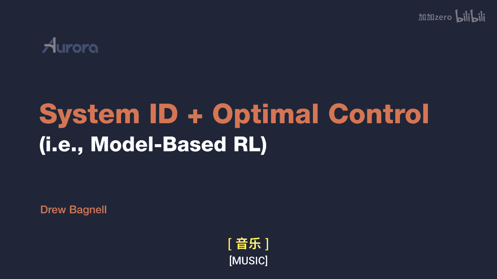

# 137：系统辨识与最优控制 🚁

在本节课中，我们将学习基于模型的强化学习中，如何通过系统辨识来学习模型，并探讨一种更有效的迭代式交互方法。

上一讲我们讨论了使用模型的关键优势，即能够在仿真中学习，从而大幅减少与现实世界交互的成本和时间。当然，实现这一点的关键在于我们学习模型的能力。在本节中，我们将以**自主直升机控制**（具体任务是“漏斗内悬停”）为例，探讨如何从观测数据中学习模型，以便应用最优控制算法。

## 传统方法：系统辨识

传统观点将这个过程称为**系统辨识**，它在工程统计学中本质上是一种监督学习方法。

以下是其基本流程：
1.  **数据收集**：通过某种探索策略（例如，由飞行员控制直升机并引入控制偏差以探索状态空间）来收集数据。
2.  **监督学习**：将观测到的数据应用于监督学习算法（例如线性回归），学习一个模型 `f_θ`。该模型将**状态**和**动作**映射到**下一个状态**。
3.  **策略生成**：将学习到的模型与一个**成本函数**结合，使用规划或最优控制合成算法（也可视为强化学习算法）来输出一个学习到的策略，希望该策略在现实世界中是最优的。

然而在实践中我们发现，优秀的工程师通常不采用这种一次性流程，而是采用一种**迭代式**的方法来构建模型。

## 为何需要迭代方法？

让我们看看原因。在上述直升机任务中，如果我们从专家演示中收集数据，然后应用上一讲提到的最优控制算法来生成策略，结果往往会失败得很彻底。

这为什么会出错？根本原因在于，系统辨识本质上是一个“先有鸡还是先有蛋”的问题。我们真正需要学习的，是强化学习算法或最优控制算法在学习策略时**可能访问到的状态区域**的准确模型。

不幸的是，如果我们先学习一个模型，然后针对它进行规划或优化，几乎必然会在过程中访问到一些模型不准确的状态（这些状态在数据收集过程中采样不足）。然后，强化学习算法可能会找到任何方法来利用这种不准确性，从而学习到一个性能不佳的策略，因为现实世界在这些状态下与模型不匹配。

这个普遍问题有时被称为**协变量偏移**或**分布偏移**。只要我们将统计学习与决策制定相结合，这就是一个根本性问题。结果就是，无论在理论上还是实践中，你都可以构建出误差很低的动态统计模型，并对其应用优秀的优化器或强化学习算法，但在现实世界中仍然得到糟糕的性能。

## 交互式模型学习方法

我发现，将基于模型的强化学习视为**优化器（RL算法）** 与**模型学习器+世界**之间的一个双人博弈，是一种非常有用的思考方式。找到模拟器中不准确性的最佳方法，就是让一个强化学习算法去尝试利用它，寻找模型中的“漏洞”。

因此，我们需要更稳健、本质上更具**交互性**的方法来寻找好的模型和控制器。以下介绍一种本质上是交互式的方法。

其核心思想是，我们将从我们**当前认为的最优策略**以及之前描述的**探索策略**中收集数据。

以下是该迭代算法的步骤：
1.  **数据收集与聚合**：收集描述直升机从某个状态、采取某个动作、到达下一个状态的**转移数据**。将这些数据与之前迭代中收集到的所有转移数据**聚合**在一起。
2.  **模型拟合**：再次拟合模型（例如使用线性回归）。
3.  **策略生成**：将模型交给最优控制合成方法（规划器或强化学习算法），得到一个新的、据称最优的策略。
4.  **循环迭代**：运行这个循环：从新策略（混合一些探索策略的数据）中收集数据，与之前所有数据聚合，拟合新模型，生成新策略，如此反复。

事实证明，运行这个循环（Stefan Ross 等人已证明），这种更接近专家工程师实际使用的交互式方法，在实践中效果非常好，并能提供更强的理论保证。

## 核心概念与保证

这里提到了两个核心概念：
*   **无遗憾学习**：这是一个强大的概念，在任何类似博弈的语境中都很有用。你可以将其简化为这样一类算法：它们不会因为训练数据的微小扰动而大幅改变其输出的模型，并且能在数据量足够大时获得良好性能。
*   **性能保证**：如果你使用一个稳定的函数逼近器，在多次交互迭代中学习到一个低误差模型，并使用一个好的最优控制求解器来生成策略，那么你**必须**获得良好的现实世界性能。反之，如果使用一个无遗憾学习算法（我们用来针对模型进行优化的那类算法）却没有获得良好的现实世界性能，那么原因必然是：在某个时刻，你未能构建出一个能准确描述世界运作方式的低误差模型。

## 方法对比与结果

我们可以将之前提到的“漏斗内悬停”问题，应用上述描述的交互式循环。结果如下：使用这种**数据聚合**方法收集相同数量的样本，结合相同的合成算法，唯一的不同在于我们以交互方式收集数据（即提出最优控制器、尝试、收集更多数据、然后重建模型），最终我们**成功**地执行了漏斗内悬停任务。

## 总结

本节课中，我们一起学习了基于模型的强化学习中的模型学习过程。我们首先介绍了传统的**系统辨识**方法及其面临的**分布偏移**根本挑战。接着，我们探讨了一种更有效的**迭代式交互方法**，该方法通过循环执行数据收集、模型拟合和策略生成，使模型学习集中在策略可能访问的状态区域，从而在实践中获得更好的性能。最后，我们了解了**无遗憾学习**的概念以及该方法所提供的理论保证基础。希望这些内容能为你将模型和强化学习应用于现实世界提供一个良好的开端。