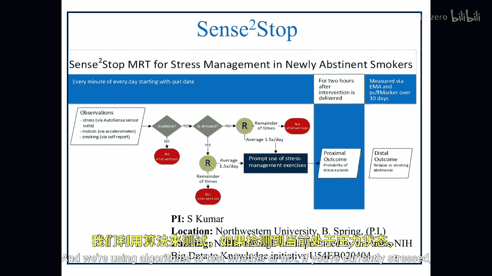

# 138：移动健康中的强化学习应用 🏥

在本节课中，我们将跟随哈佛大学的苏珊·墨菲教授，了解强化学习在移动健康领域的具体应用、面临的挑战以及未来的研究方向。

## 概述

苏珊·墨菲教授来自哈佛大学，任职于统计学与计算机科学领域。她的研究工作聚焦于移动健康，特别是如何将强化学习应用于移动健康场景。她的团队参与了多种类型的研究，其中许多涉及成瘾问题、青少年健康等。

## 移动健康的目标与强化学习的作用

上一节我们介绍了研究背景，本节中我们来看看移动健康的核心目标以及强化学习如何发挥作用。

在移动健康领域，我们的目标是帮助那些与健康问题作斗争的人们，这些问题通常是慢性疾病，例如成瘾或抑郁症。我们希望为他们提供长期的支持。同时，我们也希望测试因果推断，即理解某个治疗行动（在强化学习中即“动作”）是否真的对个人产生了影响。

此外，在移动健康中，我们思考如何能够持续学习与实验，从而不断为每个人改进移动健康应用程序。这正是强化学习可以大展身手的领域。

## 移动健康中的强化学习基本框架

了解了目标后，我们来看看移动健康中强化学习的基本设置。

对于任何给定的用户，他们可以接收到各种各样的干预措施，即“动作”。以下是一些例子：
*   **提醒**：例如提醒服药、提醒进行特定类型的锻炼。
*   **建议**：提供生活建议，或将用户与有相似经历的人联系起来。

这些干预可以随着时间的推移反复进行。每次我们提供一个不同类型的治疗行动后，会观察一个“奖励”。奖励可以是多样的，例如：
*   如果目标是帮助用户更活跃，奖励可以是接下来30分钟内的总步数。
*   如果应用程序旨在帮助管理压力，奖励可以是直到下一次感到压力所经过的时间。

## 案例研究：促进用户参与度

理论框架需要实际案例来印证。接下来，我们通过一个具体的研究案例，看看如何应用强化学习来保持用户的参与度。

一项刚刚完成的研究，目标是帮助年轻人更积极地回答关于他们的压力与孤独感的问题。研究对象是从急诊室招募的、曾因饮酒过量而陷入麻烦的青少年和大学生。

在这个强化学习问题中，所有“动作”都围绕着如何提供“强化物”，以使用户保持参与并回答问题。研究采用了游戏化的界面（一个水族馆），用户回答问题可以丰富自己的水族馆并升级。

研究主要关注两个问题：
1.  提供何种奖励（如表情包、礼物）能帮助用户更投入，从而在明天继续回答问题。
2.  如果今天赠送礼物，用户是否更可能在今晚回答问题。

这项研究的整体目标，就是寻找能保持用户参与回答生活问题的最佳策略。

## 个性化与算法应用

保持参与是第一步，更深层的目标是为每个用户提供个性化服务。本节中我们来看看如何利用研究数据初始化强化学习算法，实现个性化。

我们现在正利用这类研究来初始化移动健康中的强化学习算法。其核心思想是，强化学习算法应该为每个用户个性化定制应用程序。从我们的视角看，这等同于为每个用户学习一个最优策略。

在我们的实验室中，主要使用**贝叶斯强化学习**。贝叶斯强化学习的主要优势之一，在于其随时间更新个体用户信息的方式。同时，它以一种随机的方式选择动作，这有助于我们在研究结束后也能从数据中学习。

## 移动健康中强化学习面临的挑战

实现个性化并非易事。将强化学习应用于移动健康场景时，我们面临诸多挑战。

其中一个问题是通知的侵扰性。如果你曾下载过应用程序，你一定能理解这一点。当应用程序频繁通知时，会令人非常烦恼。通常，应用程序在当下有潜力帮助你（对即时奖励有积极影响），但可能产生负面的延迟效应。这正是强化学习的经典应用场景。

我们必须解决的一些挑战包括：
*   **如何近似价值函数**：以便我们能够快速学习，同时在选择动作时不犯错误。
*   **如何利用群体数据实现个性化**：我们总是拥有许多不同的用户，每个人都是独特的。如何利用一个用户的数据来为每个特定用户个性化或确定一个好的策略，这是我们当前正在努力解决的一大挑战。
*   **如何进行因果推断**：研究结束后，我们总希望进行因果推断，即帮助科学家更多地了解人们为何会采取某些行为（例如为何复吸毒品或重新吸烟）。我们希望利用这些数据来回答此类问题，即使数据是通过强化学习算法收集的，我们也需要找出使用方法。
*   **如何将当前研究数据用于未来用户**：以便他们能从当前研究的学习成果中受益。

## 另一个案例：辅助戒烟

最后，让我们再看一个很酷的、即将结束的研究案例，它展示了强化学习在复杂健康干预中的潜力。

在这项研究中，每个人都在尝试戒烟。研究从他们决定戒烟的那天开始。参与者佩戴各种可穿戴设备，传感器数据持续流入并用于形成多种预测。其中一个关键的预测是：用户当前是否处于生理压力状态。

我们正在使用算法来测试：如果用户当前处于压力状态，是否应该提供提醒，建议其进行压力管理练习。当然，长期目标是**为每个用户找到最优策略**。

## 总结

本节课中，我们一起学习了苏珊·墨菲教授关于强化学习在移动健康中应用的分享。我们了解了移动健康的目标是提供长期个性化支持与进行因果推断，探讨了其基本框架（动作、奖励、策略），并通过促进用户参与度和辅助戒烟两个具体案例，看到了强化学习的实际应用。同时，我们也认识到在该领域应用强化学习所面临的挑战，如平衡即时与延迟效应、实现真正的个性化以及从数据中进行有效的因果推断。这些研究正在推动移动健康技术向更智能、更贴心的方向发展。

祝大家学习顺利，再见。