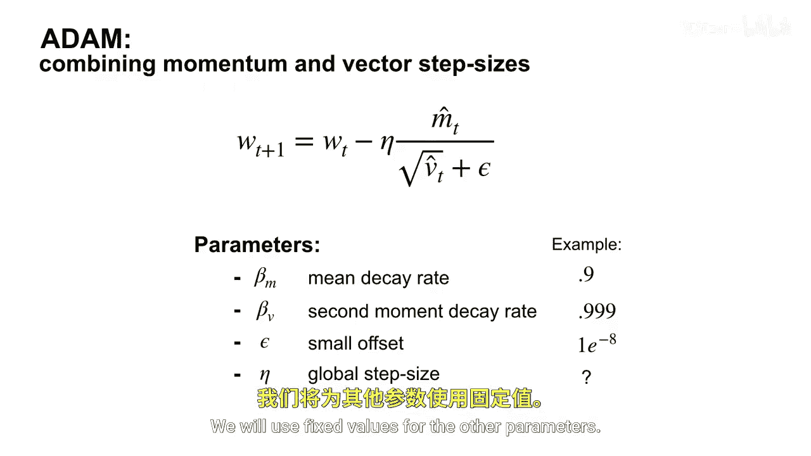

强化学习专项课程：第139讲：与Adam的会议：完善智能体细节 🚀

在本节课中，我们将讨论如何完善智能体的实现细节，特别是关于神经网络的设计与更新方法。我们将回顾如何使用神经网络来近似动作价值函数，并深入探讨Adam优化算法的细节。

---

上一节我们讨论了智能体的高层设计选择，本节中我们来看看具体的实现细节，这些决策在实践中对性能有重大影响。

我们决定使用神经网络来估计动作价值。让我们回顾一下其工作原理。你可能还记得在第三门课程中，神经网络接收状态并生成一种新的表示。例如，在本案例中，状态可能包含着陆器的位置和速度等信息。然后，我们将使用生成的表示来估计每个动作的价值。我们通过构建一个网络来实现这一点，该网络为每个动作都有一个输出节点。

---

接下来，我们讨论如何训练这个神经网络以近似动作价值函数。

我们将使用时序差分误差来训练网络。更准确地说，我们将通过修改权重来减少每个时间步的TD误差。我们只更新与所选动作对应的输出权重。例如，如果动作1被选中，我们就不更新最后一层中对应动作2和动作3的权重。

你可能会问，这通常有问题吗？一般来说没有，但这里有一些细微之处需要考虑。对于线性函数近似，我们也为每个动作价值维护了独立的权重，并且只更新被采取动作的权重。而在神经网络中，每次更新一个动作时，所有动作的共享表示也会随之改变。但在学习过程中，每个动作的结果可能会对表示产生不同的、甚至可能是冲突的更新。然而，这实际上是我们所期望的：我们希望神经网络学习到一个对所有动作都有用的表示。对多个预测都有益的特征通常具有更好的泛化能力。

相比之下，我们也可以为每个动作学习完全独立的神经网络。但那样每个动作的表示将用更少的样本学习，而我们也就无法获得学习共享表示的潜在好处。

---

我们做出的另一个决定是使用Adam算法。该算法结合了向量化步长和一种动量形式。

在第三门课程中，我们讨论了一个步长向量：网络中的每个权重都有自己的步长，该步长根据学习过程的统计数据进行自适应调整。这意味着我们可以对一些权重进行较大的更新，而对其他权重进行较小的更新。这在损失函数在某些维度上较为平坦时可能很有用。或者，我们可以在损失变化更剧烈的其他维度上采取较小的步长。

我们还讨论了如何使用动量来加速学习，尤其是在我们处于损失函数的平坦区域时。请记住，沿相同方向重复步进会积累动量，而沿不同方向步进则会消除动量。

Adam算法结合了这两种思想。它保持梯度的移动平均值以计算动量，其中参数 **β_m** 控制动量的量。Adam还保持梯度平方的移动平均值，这为我们提供了一个步长向量。这种更新方式通常能带来更高的数据效率，因为每次更新都更有效。

你可能已经注意到，我们刚刚引入了几个需要设置的新超参数。我们有两个衰减率、分母中的小偏移量大小以及一个全局步长。因此，我们并未实现免超参数学习。事实上，我们用一个超参数换来了四个。幸运的是，通常使用经验法则不难为这些超参数找到良好的设置，但通过单独调整它们通常可以获得更好的性能。许多人正在研究降低强化学习中对超参数选择敏感性的方法，但这仍然是一个悬而未决的问题。在本顶点项目中，你将研究不同全局步长选择的影响，而其他参数我们将使用固定值。

---

以上就是本周的全部内容。你现在应该具备了实现智能体所需的所有工具。

在本节课中，我们一起学习了如何设计用于动作价值近似的神经网络，以及如何使用TD误差和Adam优化算法来有效地训练它。这些实现细节对于构建一个高性能的强化学习智能体至关重要。

接下来，就是用强化学习让航天器在月球上着陆了。🌕