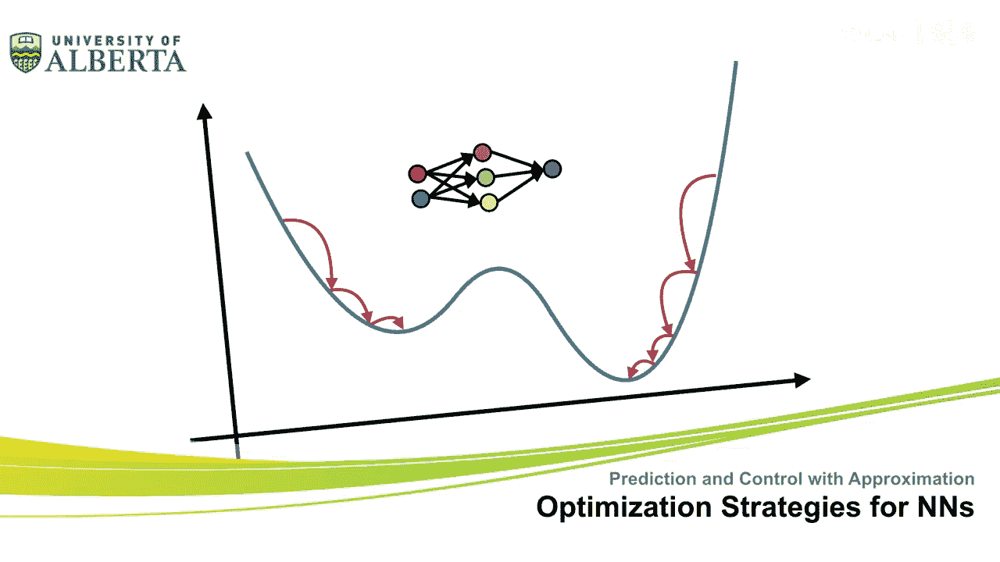
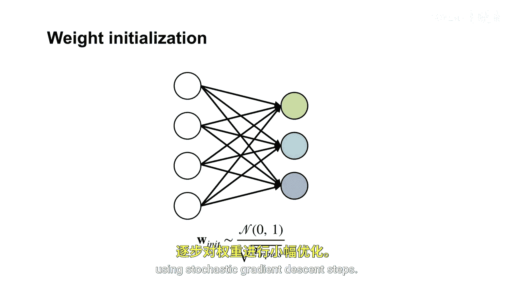
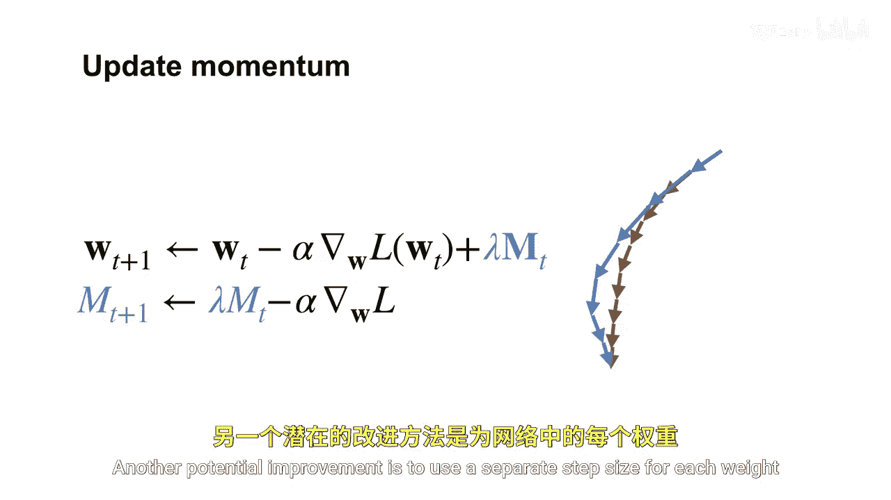
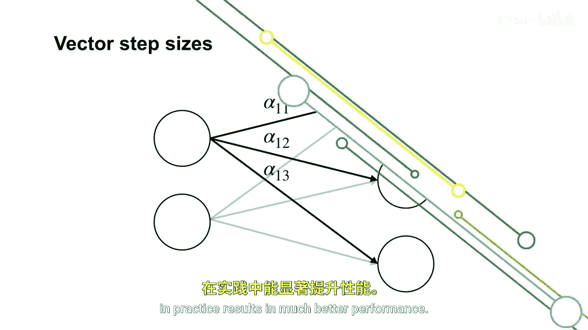

# 140：回顾神经网络的优化策略 🧠

在本节课中，我们将回顾深度神经网络训练中的关键优化策略。这些策略对于高效训练神经网络至关重要，也是后续将神经网络应用于强化学习算法的基础。

---

基于深度神经网络的监督学习系统，现已成为图像分类、语音识别和自然语言处理领域的首选方案。部分原因在于训练数据量的大幅增加以及计算成本的降低。然而，要真正利用这些增长的数据和算力，训练方法的改进是必需的。一些简单的优化策略使得训练网络变得更加容易，并加速了其应用普及。本节课我们将讨论这些策略。

在本视频结束时，你将能够理解神经网络初始化的重要性，并描述用于训练神经网络的优化技术。

## 权重初始化策略

与许多机器学习方法一样，神经网络通过迭代过程进行训练。这个过程必须有一个起点，而这个起点的选择对神经网络的性能有重大影响。

让我们看一个只有一个权重的例子。在y轴上，我们展示损失函数；在x轴上，我们展示权重的值。正如你所知，梯度下降会迭代地将权重移向最近的驻点。

但神经网络的损失函数并非如此简单。如果我们从这个近乎平坦的区域开始，由于梯度接近0，梯度下降可能很难取得进展。相反，如果我们从这个小的“碗状”区域内部开始，那么我们可以快速找到局部最优点。但是，如果我们能从某个更好的位置开始，从而快速找到更优的点，岂不是更好？

以下是一种简单而有效的初始化策略：

*   **随机初始化**：从方差较小的正态分布中随机采样初始权重。
*   **保持多样性**：这样，层内的每个神经元会与其他神经元产生不同的输出，从而提供更多样化的潜在特征。
*   **控制方差**：通过保持方差较小，我们确保每个神经元的输出与其相邻神经元处于同一范围。

这种策略的一个缺点是，随着神经元输入数量的增加，其输出的方差也会增长。我们可以通过将权重的方差按 `1 / sqrt(输入数量)` 进行缩放来解决这个问题。

## 优化更新机制

在确定了网络的起点之后，我们开始使用随机梯度下降步骤对权重进行增量式的小幅改进。

另一种改进训练的方法是考虑更复杂的更新机制。两种常见策略是使用**动量法**和**向量化步长自适应**。我们先来讨论动量法。

想象这是二维权重向量在随机梯度下降下的轨迹。这是标准的随机梯度下降更新规则：
`w_{t+1} = w_t - α * ∇J(w_t)`

而这是加入了动量项的更新规则：
`w_{t+1} = w_t - α * ∇J(w_t) + λ * (w_t - w_{t-1})`
请注意，它类似于常规的随机梯度下降更新，加上了一个称为动量的额外项。动量项使用梯度衰减和（衰减率为λ）来总结梯度的历史。

*   **积累动量**：如果最近的梯度都指向相似的方向，那么我们就会在该方向上获得动量，这意味着我们会朝该方向迈出一大步。
*   **抵消动量**：如果最近的更新方向相互冲突，则会抵消动量，动量项对更新的影响很小，我们将进行常规的梯度下降步骤。

动量法被证明可以加速学习，意味着它能更快地到达驻点。

## 自适应步长

另一个潜在的改进是为网络中的每个权重使用单独的步长。到目前为止，我们只讨论了一个全局标量步长α，众所周知这会产生问题，因为它可能导致某些权重的更新太大，而其他权重的更新太小。

在实践中，根据学习过程的统计数据为每个权重自适应调整步长，能带来更好的性能。

那么更新规则如何改变呢？改变非常简单，不再使用标量α进行更新，而是使用一个步长向量（用下标t表示它可以在每个时间步改变）：
`w_{t+1} = w_t - α_t ⊙ ∇J(w_t)`
梯度的每个维度都由其对应的步长（而不是全局步长）进行缩放。有多种方法可以自适应调整步长向量，你将在作业中实现其中一种。

---

本节课中，我们一起学习了改进神经网络训练的方法。具体来说，我们讨论了一种初始化神经网络权重的策略，以及如何使用动量法和步长自适应来加速学习。现在，你已经准备好用神经网络实现一个时序差分智能体了。祝你学习愉快！