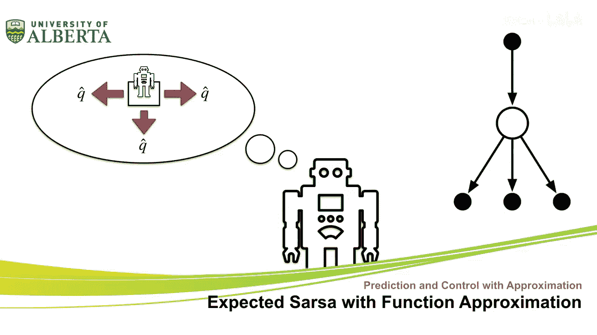
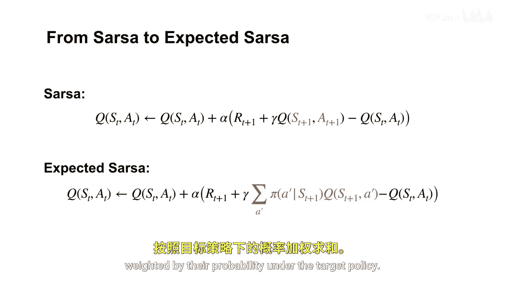
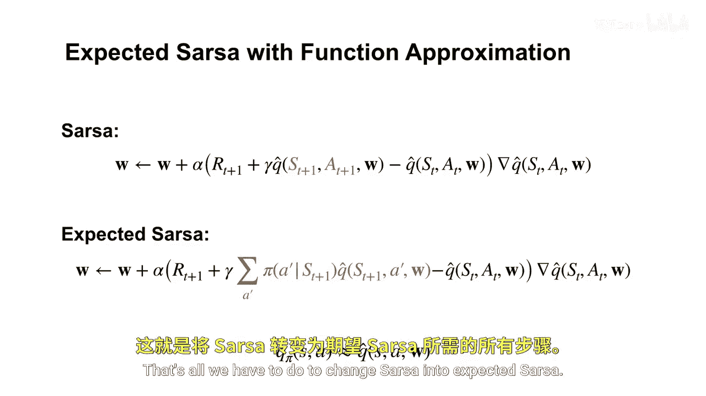
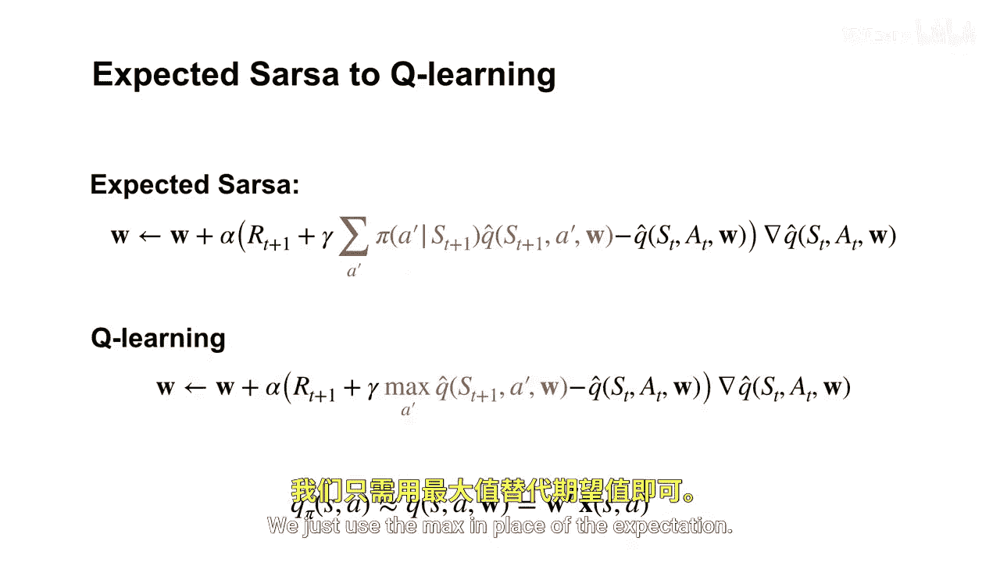

强化学习专项课程：P141：函数逼近下的期望SARSA与Q学习

在本节课中，我们将学习如何将期望SARSA算法扩展到函数逼近的设定下，并理解其与Q学习在函数逼近下的关系。

到目前为止，我们已经讨论了在函数逼近下使用SARSA算法。现在，让我们继续探索近似控制方法，来看看期望SARSA算法。通过本视频的学习，你将能够解释函数逼近下期望SARSA的更新公式，并解释函数逼近下Q学习的更新公式。

让我们看看在使用函数逼近时，如何将SARSA转变为期望SARSA。

首先，回顾一下SARSA的更新公式。SARSA的更新目标包含了下一个状态和动作的动作价值。

现在回想一下，期望SARSA则使用其目标策略下的期望值。为了计算这个期望，我们只需将动作价值按其目标策略下的概率加权求和。

即使在使用函数逼近时，也可以计算相同的期望值。

让我们看看具体如何操作。首先，回顾一下函数逼近下SARSA的更新公式。

它看起来与表格设定下的公式相似，只是动作价值估计由权重向量 **W** 参数化。我们还有一个梯度项，用于将误差适当地分配给权重。

函数逼近下的期望SARSA遵循类似的结构。我们为下一个状态中的每个动作，根据权重向量计算其动作价值。然后，我们计算这些价值在目标策略下的期望。这就是将SARSA转变为期望SARSA所需做的全部改变。

那么，对于函数逼近下的Q学习，我们该如何操作呢？幸运的是，Q学习是期望SARSA的一个特例。在Q学习中，目标策略是关于近似动作价值的贪婪策略。在贪婪策略下计算期望，等同于计算最大动作价值。

因此，函数逼近下的Q学习更新实际上非常直接。我们只需用最大值代替期望值。

本节简短的课程到此结束。今天我们介绍了函数逼近下的期望SARSA算法，并展示了如何将其扩展到函数逼近下的Q学习。下一节，我们将探讨在函数逼近下如何进行探索。在此之前，请保持思路清晰。