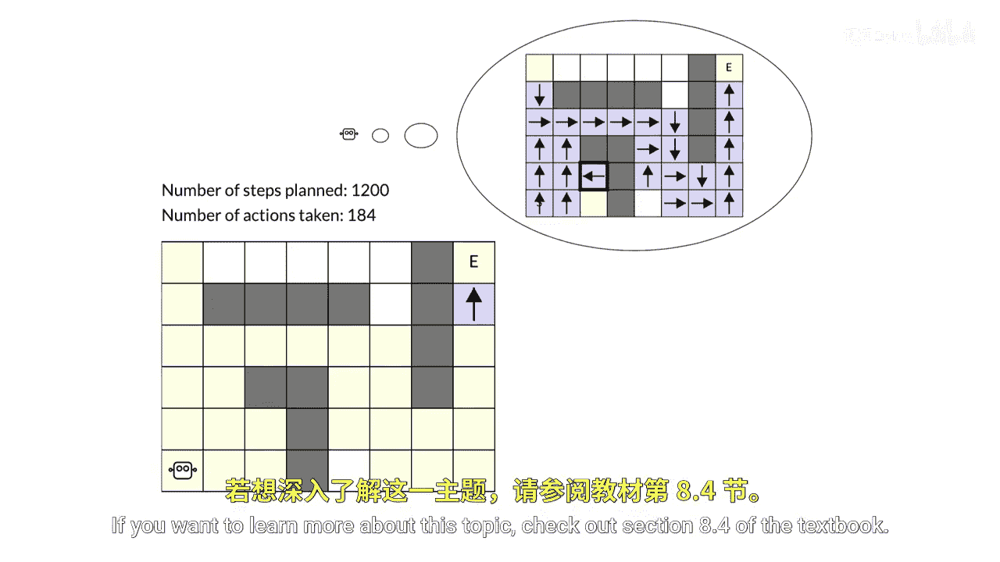

# 142：回顾简单迷宫中的Dyna-Q学习算法 🧠

在本节课中，我们将学习Dyna-Q架构，并了解它如何结合规划、学习和行动。我们还将研究Dyna-Q在网格世界中的运行方式。接下来，我们将通过实验来检验Dyna-Q的实际效果。本视频将使用一个小型网格世界来比较表格型Dyna-Q和无模型的Q学习算法。学习结束后，你将能够描述从真实经验和模型经验中学习如何影响性能，并解释模型如何让智能体以更少的环境交互次数进行学习。

## 实验设置与环境 🧪

今天我们将在这个小型迷宫环境中进行一些实验。与之前一样，智能体有四个可执行的动作。进入目标状态会产生+1的奖励，所有其他状态转移产生的奖励均为零。这是一个分幕式问题，我们将使用折扣因子 **γ = 0.95**。

我们将比较具有不同规划步数的Dyna-Q算法。实验涉及三个智能体，每个智能体都使用学习率 **α = 0.1** 和探索率 **ε = 0.1**。所有智能体的动作价值估计初始值都设为零。实验运行了50幕，重复30次，然后对结果取平均值。

## 性能比较与结果分析 📊

我们可以绘制智能体在完成越来越多幕之后，平均每幕所需的步数。如果智能体表现良好，那么随着幕数增加，所需步数应该减少。也就是说，在Y轴上数值越低越好。

如果我们运行规划步数为零的Dyna-Q，得到的就是纯粹的Q学习算法。如图所示，它进步缓慢，最终稳定在每幕约14步的水平。如果我们运行规划步数为5的Dyna-Q，它能达到与Q学习相同的性能，但速度要快得多。而规划步数为50的Dyna-Q仅需大约三幕就能找到一个优秀策略。Dyna-Q的效率要高得多。观察Y轴，在两幕之后，Q学习找到的策略仍然需要数百步才能走出迷宫。对于相同数量的环境交互，Dyna-Q能学到更多东西。这表明，如果模型正确，规划能更有效地利用环境经验。

## 搜索控制对规划的影响 🔍

上一节我们比较了不同算法的性能，本节中我们来看看搜索控制如何影响规划过程。让我们在一个略有不同的迷宫中可视化正在发生的情况。我们用箭头表示根据每个状态的估计价值所选择的贪婪动作。没有箭头的状态表示在该策略下所有动作被选择的概率均等。

在一幕之后，Q学习只更新了一个动作价值，即目标旁边状态中“向上”动作对应的价值。因为这是唯一经历了非零奖励转移的状态。需要更多幕才能将状态的价值“引导”回附近的其他状态。

让我们更仔细地观察搜索控制如何影响规划。我们的机器人将采取与标准Dyna-Q略有不同的操作，以便更清晰地阐明观点。我们将从10个规划步数开始，并连续调用规划循环10次，总共进行100步规划。如图所示，许多规划更新未能改变价值函数。事实上，在100步规划之后，智能体只更新了两个“状态-动作”对的价值。

我们继续实验。这次，我们尝试每次调用进行100步规划，并让智能体运行更长时间。即使有100个规划步数，前几次调用也只更新了少数几个动作价值。为什么智能体需要这么多规划步数才能学习到合理的价值函数和策略呢？

智能体需要大量规划步数，是因为搜索控制是随机采样“状态-动作”对的。如果采样的“状态-动作”对产生的时序差分误差为零，那么规划更新将不会产生任何效果。在这个环境中，由于所有奖励都是零，且初始价值也是零，这种情况经常发生。如果我们以更有效的方式排序“状态-动作”对，会发生什么？事实证明，智能体可以仅用六分之一的规划更新就学会一个好策略。在大型环境中，随机搜索控制的问题会更加突出。如果你想了解更多关于这个主题的内容，请查阅教材的第8.4节。

## 总结 📝

本节课中，我们一起学习了在简单网格世界中测试表格型Dyna-Q算法。我们看到了规划如何能显著加速学习过程。在我们的实验中，进行的规划越多，智能体的表现就越好。