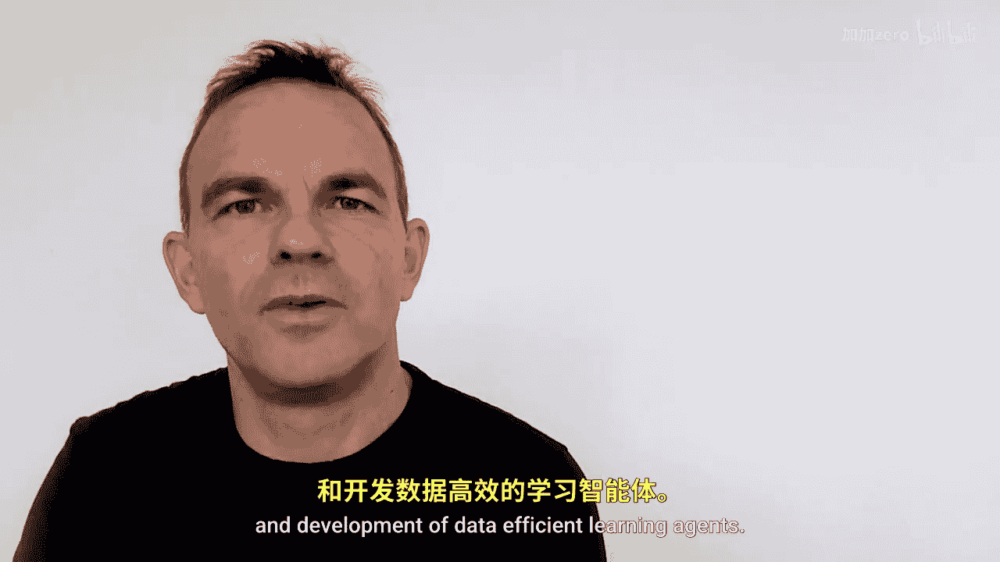
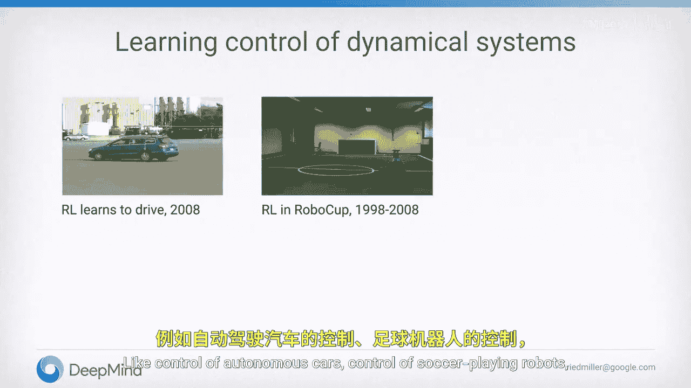
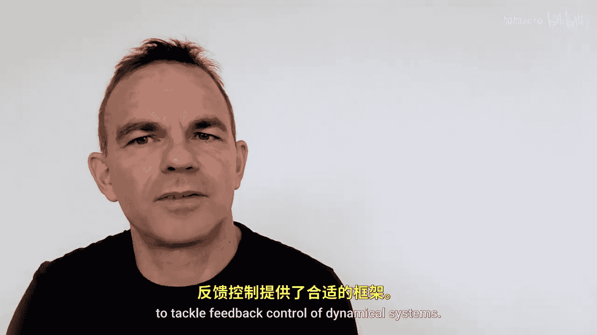
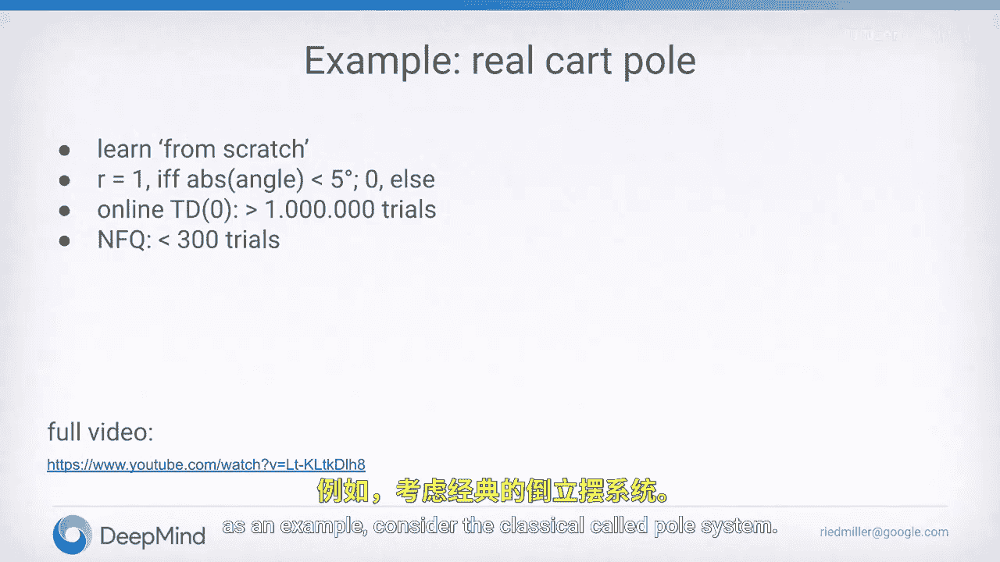
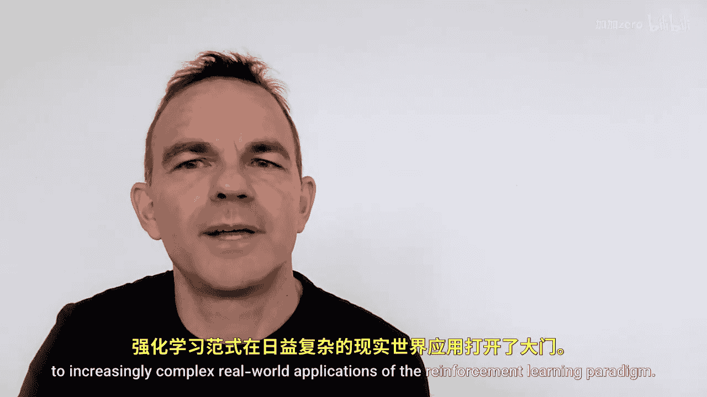

# 144：数据高效强化学习的收集与推断框架 🧠

在本节课中，我们将学习一种特别适用于设计和开发数据高效学习智能体的强化学习视角——收集与推断框架。这个框架尤其适合应用于现实世界的动态系统控制。

---

## 引言

我是 Martin Riedmiller，DeepMind 控制团队的负责人。我在为动态系统控制开发新型强化学习智能体方面已有超过20年的工作经验。

## 强化学习与控制

控制现实世界的动态系统是强化学习控制器一个有吸引力的应用领域。例如自动驾驶汽车的控制、足球机器人的控制，或者从像素输入进行赛车控制。它们都共享相同的基本反馈控制结构：控制器接收观测值，计算动作，并将其应用于环境。

传统的控制理论会首先将过程建模为一组微分方程，然后必须解析地推导出控制律。这是一项繁琐的工作，特别是当系统复杂或高度非线性时。相比之下，强化学习承诺，只要指定了总体控制目标，就能自主学习控制器。这通常通过定义即时奖励来实现。强化学习控制器会优化随时间累积的奖励总和的期望值。

因此，强化学习为解决动态系统的反馈控制问题提供了合适的框架。我们寻找的是一个能优化随时间累积奖励期望的策略。

## 从模型无关到函数逼近

在模型无关的设置中，这可以通过迭代一个动作价值函数 Q 来实现。由于在大多数控制应用中，我们通常处理连续的状态和动作，因此我们使用一个以状态 S 和动作 A 为输入的神经网络来计算 Q 值。

贝尔曼方程被转化为一个二次损失函数，通过梯度下降来最小化网络参数。

## 数据效率的核心挑战

当涉及到在真实系统上学习时，核心问题是如何实现数据高效。在经典的强化学习中，价值函数的更新规则以在线方式应用：智能体观察输入，计算动作，观察结果状态，然后相应地更新其控制器。每个转移经验只使用一次。经验表明，这会导致高度消耗数据的学习行为。如果我们的环境是模拟器并提供无限数据，这可能没问题，但对于数据不丰富的现实世界系统来说，这通常行不通。

## 收集与推断框架

如果数据有限，那么核心观点是：**数据是宝贵的，数据是真实的**。因此，我们不应丢弃任何转移经验 `(S, A, S')`，而应将它们全部存储在转移记忆中。

学习是在整个数据集上进行的。在这一步中，我们从转移记忆中推断知识。推断出的知识只能和转移记忆中的数据一样好。因此，收集正确的数据是我们框架的第二个重要组成部分。

这两个步骤共同构成了所谓的强化学习**收集与推断框架**。这个视角让我们专注于数据高效强化学习的两个主要问题：
*   **推断**：意味着从给定的转移数据集中榨取最多的信息。
*   **收集**：意味着从环境中采样最具信息量的数据。

由于时间关系，本讲座的剩余部分我们将只专注于“推断”部分。

## 神经拟合Q迭代算法

神经拟合Q迭代算法完全体现了从存储的转移经验集中学习的理念。给定一组 N 个转移元组 `D = {(s_i, a_i, s'_i, r_i)}`，算法步骤如下：

以下是 NFQ 算法的核心步骤：
1.  将训练集 `M` 初始化为整个数据集 `D`。
2.  基于动态规划原理推导出的 Q 迭代规则，为 `M` 中的每个样本计算 Q 目标值。
3.  一旦为 `M` 中的所有转移计算了目标值，就通过一个普通的监督学习步骤，将神经网络拟合到这些目标值上。
4.  外循环可以重复任意次数的动态规划步骤，直到在令人满意的精度内逼近最优价值函数 `Q*`。
5.  最终，控制律由在状态 `S` 下对 `Q*` 进行贪婪评估给出：`π(s) = argmax_a Q*(s, a)`。

NFQ 基本上将强化学习转化为一系列监督学习问题。它假设总是在整个可用的转移集上进行更新，这对于非常大的数据集可能不切实际。

## 深度Q网络

DQN 是 NFQ 的一个流行变体，它使用小批量样本进行更新，并进行了一些额外的调整以处理海量数据集。

## 应用实例：倒立摆

作为一个例子，考虑现实中的经典倒立摆系统。在这里，它是完全从零开始学习的。奖励函数的定义相当简单：如果杆子直立则为1，否则为0。或者，也可以考虑小车位置作为奖励函数的额外输入。

经典的在线 Q-learning 在模拟版本中需要大约100万次试验才能学会平衡杆子。而使用 NFQ，训练只需要不到300次试验，速度快了几个数量级。这使得将新型强化学习直接应用于现实世界系统成为可能。

---

## 总结

本节课中，我们一起学习了强化学习的收集与推断框架。我们了解到，通过**珍惜并存储所有转移经验**，以及**从整个数据集中进行推断学习**，可以显著提高强化学习的数据效率。神经拟合Q迭代算法及其变体深度Q网络是这一框架的具体实现。该框架为将强化学习范式应用于日益复杂的现实世界应用打开了大门。