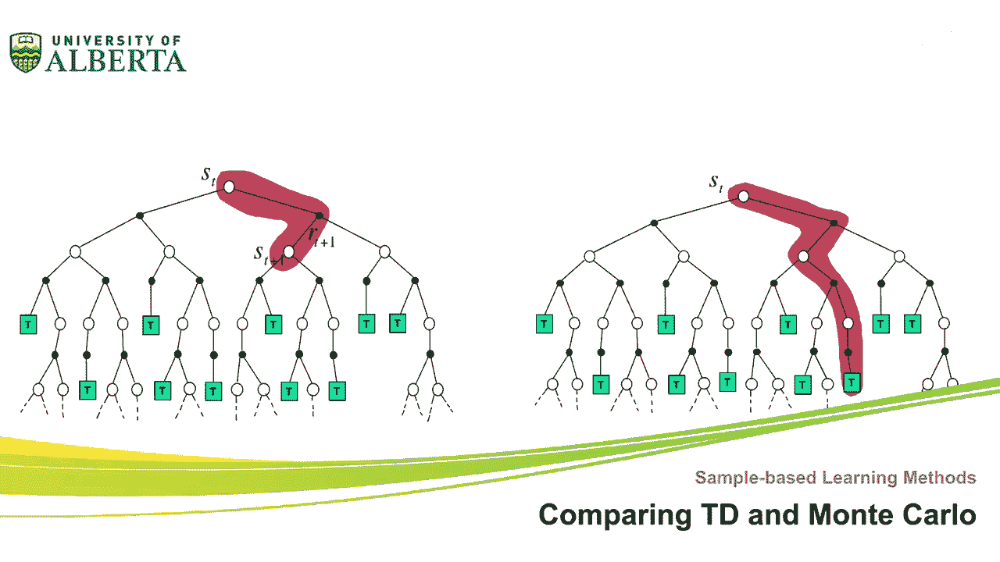
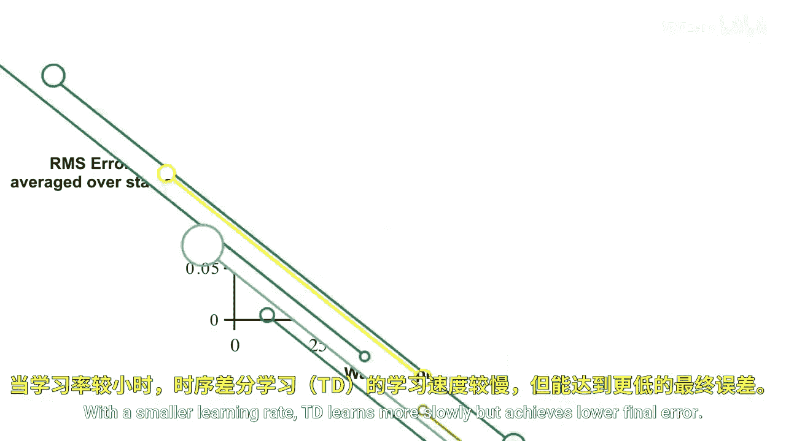

# 146：时序差分与蒙特卡洛方法对比实验 🧪

在本节课中，我们将深入比较时序差分学习与蒙特卡洛方法。我们将通过一个精心设计的实验，直观地展示两种方法在估计价值函数时的表现差异，并分析其背后的原因。

---

在之前的课程中，我们介绍了时序差分学习，并讨论了它相对于动态规划和蒙特卡洛方法的优势。本节中，我们将通过一个科学实验，更深入地比较时序差分与蒙特卡洛方法。

考虑一个简单的马尔可夫决策过程。我们有五个非终止状态。在每个状态下，有两个确定性动作：**向左**和**向右**。我们的目标是评估一个均匀随机策略的价值函数。

所有回合都从状态 **C** 开始。回合在到达最左侧或最右侧时终止。所有状态转移的奖励均为零，除了在右侧终止时会获得 **+1** 的奖励。

我们设折扣因子 **γ = 1**。在这个问题中，状态价值具有直观的含义：每个状态的价值等于从该状态出发，最终在右侧终止的概率。起始状态 **C** 的价值是 **0.5**，这意味着从中心开始随机游走，有50%的概率在右侧终止。

让我们为其余状态标上它们的真实价值。现在，我们开始进行实验。

在幻灯片顶部，我们标注了MDP各状态的**真实价值**。我们的智能体——一个可爱的小机器人——将使用时序差分方法来估计价值函数。在底部，另一个智能体使用蒙特卡洛方法。我们将两个智能体的近似价值函数初始值都设为 **0.5**。

以下是第一个回合中两个智能体的表现分析：

*   **时序差分智能体**：只更新了状态 **E** 的价值。要理解这一点，可以考虑从状态 **C** 到 **D** 的转移。时序差分误差 **δ** 的计算公式为：
    **δ = R + V(D) - V(C)**
    由于这是一个非终止转移，奖励 **R = 0**。状态 **C** 和 **D** 的初始价值都是 **0.5**，因此 **δ = 0**，我们对 **C** 的估计不做任何改变。除了从状态 **E** 进入终止状态的那一步，其他每一步都会发生同样的情况。
*   **蒙特卡洛智能体**：更新了机器人在该回合中访问过的**所有状态**的价值。

让我们观察下一个回合。请注意在回合进行过程中价值是如何更新的。

最终，时序差分智能体在每一步都进行了更新。相比之下，蒙特卡洛智能体则等到回合结束后才进行所有更新。

再看几个回合，时序差分智能体的价值估计似乎在向真实价值移动。这个过程可能较慢，让我们直接跳到后面，评估它们的渐近性能。

我们绘制了在学习过程中几个时间点的估计价值。X轴代表MDP中的每个状态，Y轴代表估计的价值。图中也标出了真实价值曲线和初始估计值（均为0.5）。

*   **第一回合后（红色曲线）**：正如我们讨论的，时序差分只更新了一个状态的价值。
*   **100回合后**：估计值已经接近它们能达到的最佳水平。请注意，我们使用了恒定步长 **α = 0.1**，这意味着价值会根据最近回合的结果产生波动。如果使用更小的学习率，或者更好的衰减学习率，我们可能会得到更精确的估计。

一个自然而然的问题是：时序差分学习是否比蒙特卡洛方法更快？

让我们在示例问题上比较时序差分和蒙特卡洛的性能。下图展示了学习曲线：

*   **X轴**：回合数。
*   **Y轴**：真实价值函数与学习到的估计值之间的**均方根误差**。
*   **红色曲线**：代表蒙特卡洛方法在不同学习率 **α** 下的性能（每条曲线是100次独立运行的平均值）。
*   **黑色曲线**：代表时序差分方法在不同学习率下的性能。

从图中可以看出，时序差分方法的性能**始终优于**蒙特卡洛方法。让我们更仔细地观察：
*   当时序差分的学习率 **α = 0.15** 时，误差下降更快，但最终误差较高。
*   使用较小的学习率时，时序差分学习速度较慢，但能达到更低的最终误差。

---

本节课中，我们一起进行了一个严谨的实验来比较时序差分与蒙特卡洛方法。实验结果表明，在这个特定问题中，时序差分方法能够更快地收敛到更低的最终误差。这验证了其作为在线、增量式学习方法的优势。我们下次再见。