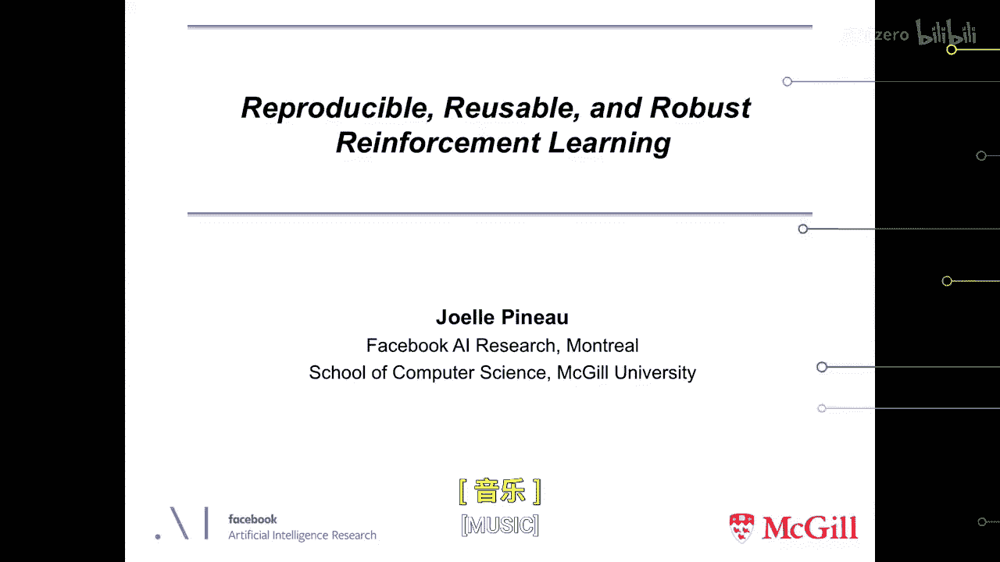
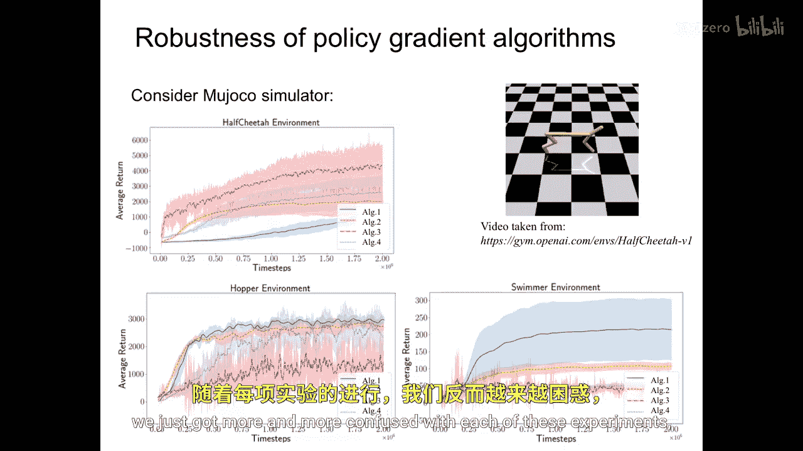
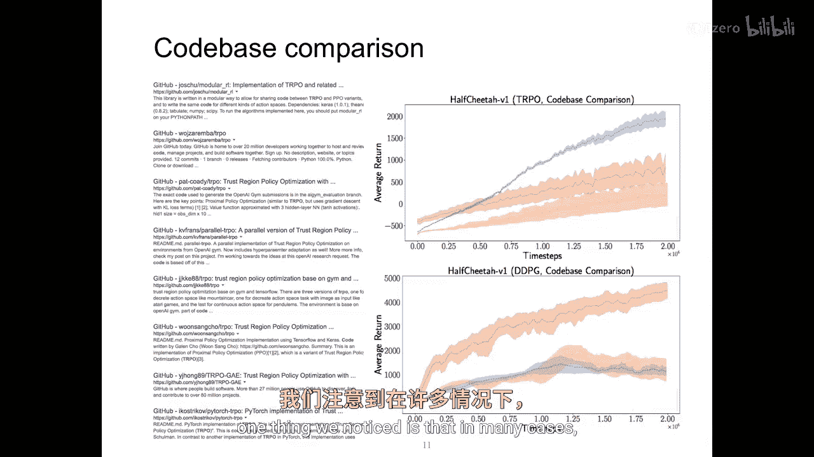
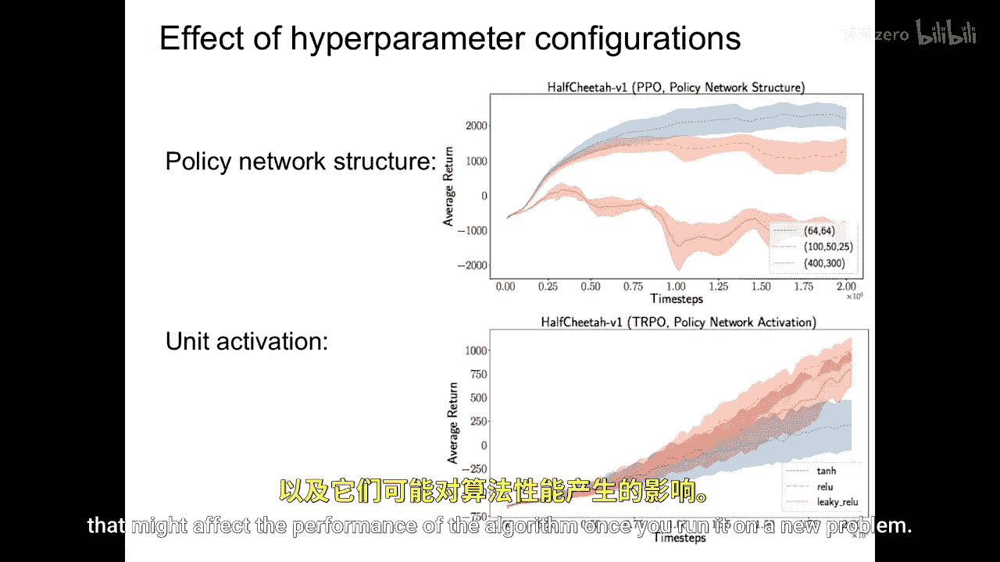

# 147：构建可复现、可重用且鲁棒的系统

在本节课中，我们将探讨在强化学习领域构建可复现、可重用且鲁棒的系统所面临的挑战与重要性。我们将通过具体的研究案例，分析当前研究中存在的问题，并学习如何更严谨地进行实验设计与结果解读。

大家好，我是乔尔·皮诺。我是麦吉尔大学计算机科学学院的教员，同时也是蒙特利尔Facebook人工智能研究实验室的研究经理。今天我很高兴能在这里，与大家分享我们在构建可复现、可重用且鲁棒的强化学习系统方面所做的一些工作。

你可能会好奇，为什么我要将这三个“R”（可复现、可重用、鲁棒）联系在一起，它们有什么共同点。让我引用美国国家科学基金会的一段话：**可复现性指的是研究者使用原始研究者所用的相同材料，复制先前研究结果的能力**。可复现性是研究结果可信且具有信息量的最低必要条件。因此，作为科学家，这些组成部分对我们实践科学的方式非常重要，对于我们分享研究成果的方式也同样重要。

不仅在机器学习领域，整个科学界都曾讨论过“可复现性危机”。《自然》杂志在2016年进行了一项非常有趣的研究，调查了约1500名科学家，询问他们是否认为其所在领域存在可复现性危机，其中很大一部分人给出了肯定的回答，认为存在轻微或严重的危机。

在我们的一些工作中，我们一直试图弄清楚，发出警报和回答调查是一回事，但仔细审视我们自己进行比较时数据告诉了我们什么，则是另一回事。就强化学习而言，过去几年我们看到的进展速度确实令人印象深刻。系统展示了在许多情况下玩游戏的能力，其表现水平超过了最优秀的人类。

我们曾认为其中一些游戏非常困难，可能需要数十年才能解决，但我们已经取得了一些令人瞩目的成果，特别是在围棋游戏上，也在一些具有挑战性的视频游戏上，我们的强化学习系统能够取得非常好的成绩。

在游戏和模拟中表现出色是很好的，这让我们看到了这项技术的潜力。但从长远来看，我们真正关心的是这项技术、我们的算法，能多好地帮助我们解决现实世界的问题。因此，为了了解这门科学已经发展到什么程度，以及我们距离解决这些困难、复杂的现实问题有多近，我们开始深入研究近期的文献。

我们查看了过去大约25年的强化学习论文。你可以看到这条曲线增长非常迅速：21世纪初，每年只有几百篇相关主题的论文发表；最近，每年有超过20，000篇论文发表。因此，每年都有大量的新发现涌现。当我们问及所有这些方法中，哪些真正能在现实世界中发挥作用时，筛选所有这些信息变得非常困难。因此，回到今天的核心主题，论文中报告研究结果的方式是否符合我们在可靠性、鲁棒性和可复现性方面的标准，变得至关重要。

为了验证这一点，我们进行了一项小调查。我们从大量论文中挑选了四篇，特别是四篇被广泛引用、常用且代码可用的论文，并开始研究这些论文中的发现有多鲁棒。我今天要传达的信息实际上超越了这些论文本身，真正关注的是我们如何在这个领域实践实证科学。

我们开始比较这四种不同的方法。这些是策略梯度算法，是策略梯度的不同变体，用于训练一个非常简单的智能体学习行走。我们称之为“半猎豹”领域，有点像一只被分成两半的卡通猎豹，所以只有两条腿，它必须学会奔跑而不摔倒。我们比较了四种不同的算法。在左边的图中，你可以看到这四种算法。基于此，你可能会认为红色算法比其他算法表现好得多。这里具体是哪种算法并不重要，我们的核心信息是关于如何进行公平的比较，以及我们的结论是否由此得出并具有鲁棒性。基于这一个结果，似乎红色算法表现更好。

现在，我们将此扩展到控制器的略微不同变体。还有另一个例子是“跳跃者”，另一个叫做“游泳者”，是我们必须控制的这个角色的略微不同版本。当你查看底部两个图时，你实际上会发现蓝色算法似乎表现得好得多。在左下方，蓝色算法表现相当好，置信区间非常窄；而在右侧，蓝色算法也表现良好，但置信区间非常宽。因此，综合所有这些结果，你会认为，如果在更多领域测试每种算法的性能，就能更好地理解它的效果，并更好地预测它是否可能在现实世界中有用。而我们在这里发现，随着每个实验的进行，我们只是越来越困惑，因为结果彼此之间并不一致。

我们开始更深入地挖掘幕后可能发生了什么。我们想，当然，我们没有自己实现这些算法，我们使用了一些可用的开源代码。所以我们想，也许我们没有找到正确的源代码，也许我们在某个地方得到了一个糟糕的实现。我们开始挖掘不同的实现。我在图中展示的是来自这四种算法之一（称为TRPO）的三种不同的公开可用实现。你在这里看到的是，其中一个版本（蓝色版本）的表现比其他两个版本好得多。

我们想，也许TRPO作为一种策略梯度方法，有点不稳定，代码难以实现。我们查看了其他一些情况，结果非常相似。从一个代码库到另一个代码库，它们声称是相同的算法，应该工作方式相同，对吧？然而，我们在实证性能上看到了非常显著的差异。

随着我们提出越来越多的问题，并深入探究可能解释这些差异的原因，我们注意到，在许多情况下，有许多不同的超参数需要配置。根据你设置这些参数的方式，你会得到非常不同的结果。

大多数代码库都附带一组默认的超参数。人们很容易直接采用那组默认值，不做更改，即开即用。我们发现，一旦你开始调整这些不同的超参数，算法的性能真的会改变。这是一个需要记住的教训：**要非常小心超参数是什么、如何设置，以及这可能会如何影响算法在新问题上运行时的性能**。

你可能会想说，我们是在比较不同的算法，最公平的比较方式是给它们相同的数据量、相同的计算量，一切都相同。但根据我们的分析，正如我提到的，我们真正发现的是，要得出鲁棒的结论，重要的是更深入地思考这个问题，特别是承认一个事实：不同的算法将有不同的超参数，你不能只是从一个算法到另一个算法使用相同的设置。

不同的方法对这些超参数有不同的敏感性。对于其中一些参数，你可能需要比其他的搜索更长时间、更仔细。哪种方法最好通常取决于你拥有多少数据以及你能负担多少计算量。因此，这将根据你的数据来源以及你试图部署AI系统的平台类型，在不同的应用之间发生巨大变化。

综合以上所有内容，回到主要问题，我认为我今天要传达的主要信息是，我们必须非常小心地解释我们在论文中读到的信息。要非常小心我们如何设置实验，如何比较不同的方法。当我们这样做时，我们可以得出更鲁棒的结论。这实际上回到了科学的基础：科学是一项我们参与的集体活动，其目的真正在于理解和解释现象。要做到这一点，我们必须始终非常小心你做事的方式。

非常感谢。