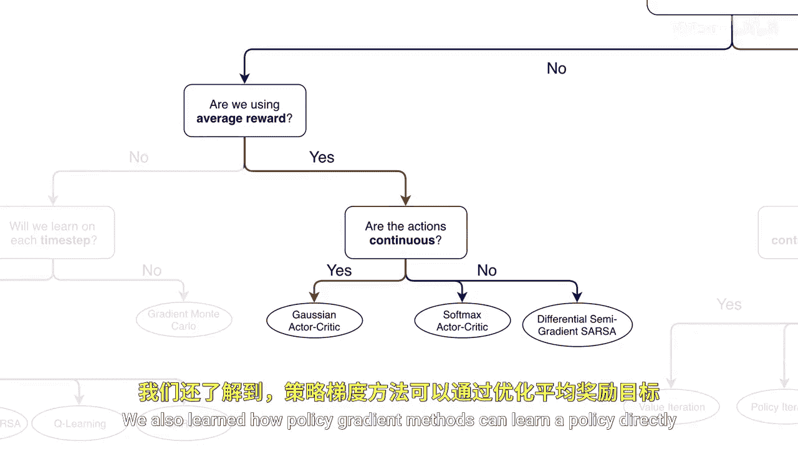

# 150：课程回顾与展望 🎓

在本节课中，我们将一起回顾整个强化学习专项课程的核心内容与学习路径，并对未来的学习与应用进行展望。

---

恭喜你完成了强化学习专项课程。从第一门课程学习价值函数、策略和序贯决策问题的基本概念开始，我们已经走过了很长的路。

回顾所学知识最简单的方法是再次查看我们的课程地图。

## 从表格化方法到函数近似 📊

我们首先从表格化设定开始，这让你能在不涉及函数近似带来的额外复杂性的情况下，熟悉强化学习的许多关键概念。

我们最初假设你拥有一个完美的模型，并专注于预测和控制中的核心思想。我们讨论了动态规划方法以及它们如何解决贝尔曼方程。

## 基于样本的方法与无模型学习 🔄

上一节我们介绍了基于完美模型的方法，本节中我们来看看当智能体不再被给定模型时的情况。我们转向基于样本的方法，智能体主要通过与环境的试错交互进行学习。

以下是智能体不学习模型的相关算法：
*   **蒙特卡洛算法**：通过完整的回合经验进行学习。
*   **时序差分学习算法**：利用自举，可以在每个时间步进行学习和策略更新。

这些算法包括用于控制的 **Q-learning**、**Sarsa**、**Expected Sarsa**，以及用于预测的 **TD** 方法。

## 引入函数近似 🧠

之后，我们使用函数近似来学习近似的价值函数和策略，重新审视了所有这些概念。

我们首先讨论了蒙特卡洛和时序差分算法如何扩展到使用函数近似。这需要定义一个损失函数，并理解基于梯度的优化方法。

接着，我们探讨了两个新概念：平均奖励和策略梯度方法。

我们学习了使用**平均奖励**作为在持续任务中表述智能体目标的新方式。我们也学习了**策略梯度方法**如何通过直接优化平均奖励目标来学习策略。

## 掌握基础的重要性 ⚙️

本专项课程的目标是为你提供基础知识。理解基本原理对于恰当地使用强化学习至关重要。你现在应该能更好地理解强化学习何时适合解决特定问题，以及如何将你的问题表述为一个强化学习问题。

这个看似简单的事情代表了一大步。人们常常会想：“我如何能将最先进的强化学习技术应用到我的问题上？”而实际上，有时一个非常简单的方法就足够了，或者问题本身最初就没有被很好地构建为强化学习问题。我们希望你现在能更明智地判断。

希望你学到了一些关于在使用强化学习时保持条理性和科学性的方法。你现在知道了形式化你的**马尔可夫决策过程**或**多臂老虎机问题**、确定合适的算法、以及仔细评估和理解你的自主学习系统性能是多么重要。

## 展望未来 🚀

掌握基础知识是学习更高级强化学习主题的第一步。你在这里学到的知识也将有助于揭开你在博客文章或科学论文中读到的、初看似乎很复杂的算法的神秘面纱。你现在应该能够看到，最先进的算法系统实际上是建立在相对简单的思想之上的。

永远不要为你所不理解的事物所震慑。我的目标是帮助更多人理解并有效地使用强化学习。我期待着看到你运用新技能所取得的成就。

我们非常享受与你共度的时光。第一次学习一个新主题是如此令人兴奋。我们也坚信，强化学习与人工智能将使世界变得更美好。你现在已经准备好在这个更美好的世界中扮演你的角色了。

---

**本节课中我们一起学习了**：整个强化学习专项课程的知识体系，从表格化方法、动态规划，到无模型的蒙特卡洛与时序差分学习，再到函数近似、平均奖励和策略梯度方法。我们强调了理解基础原理的重要性，并对如何将知识应用于实际问题以及未来的学习方向进行了展望。