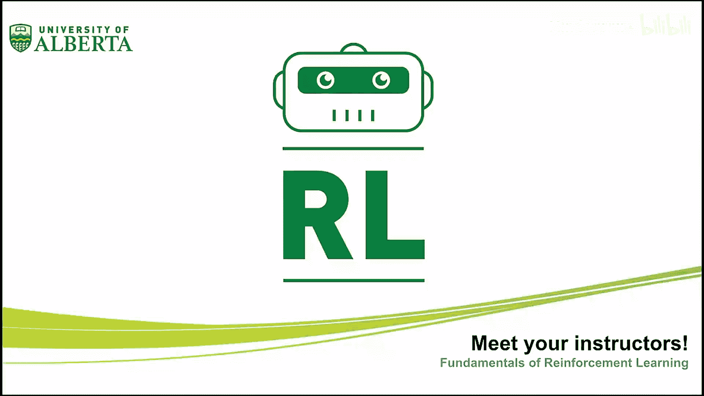

# 002：认识你的导师

在本节课中，我们将认识本课程的两位导师：Martha 和 Adam。他们将介绍自己的背景、如何进入强化学习领域，以及他们对这个领域的看法和展望。

## 导师介绍 👨‍🏫

我是 Martha，阿尔伯塔大学的助理教授。我是 Adam，阿尔伯塔大学的研究教授，同时也是 DeepMind 的高级研究员。

Adam 因其在强化学习的预测知识方面的工作而闻名。全球多个研究小组都在基于他的想法进行研究。我个人认为这是他近年来最重要的工作之一，并且其影响力只会越来越大。他也是一位出色的实证研究者，是设计实验以触及关键问题的大师。他一直在努力提升强化学习社区的科学理解。

Martha 对强化学习的算法贡献不胜枚举。她开发了多种新的离策略学习算法、新的策略梯度方法，并在表示学习方面做出了数十项令人印象深刻的贡献。她确实是强化学习领域冉冉升起的年轻新星之一。她恰好也是我最频繁的合作者以及我的人生伴侣。

## 进入计算机科学的契机 💻

那么，你是如何进入计算机科学领域的呢？我在东海岸长大，高中时对科学非常感兴趣，比如物理、化学、生物，但我没有找到真正适合的方向。因此，我有些随机地选修了一门关于计算机科学和编程的课程，用的甚至是 GW-BASIC。这对我来说确实是一个决定职业生涯的时刻，因为我记得第一次实现 `if` 语句或 `for` 循环时，能够让计算机为我执行一系列指令，这让我感到非常神奇。从那时起，我就注定要在大学学习计算机科学了。

## 与强化学习的结缘 🤖

那么，你为何开始研究强化学习呢？为了研究生学习，我搬到了阿尔伯塔大学，最初是来研究并行分布式计算的，那是我本科时关注的方向。我选了很多系统课程，还剩一门选修课要选。于是我采用了一个非常合理的策略：我浏览了教授们的照片，然后挑选了看起来最友善的一位教授。没错，那就是 Rich Sutton，课程是“强化学习导论”。那门课非常棒，真的鼓舞人心。那是我第一次接触人工智能或任何形式的机器学习。我记得那门课的一个早期作业是实现 Sarsa 算法来解决一个网格世界问题。这又是一个决定性的时刻，看着智能体学会解决这个迷宫，它接收到的唯一反馈是每步 -1 的奖励信号，但它却神奇地找到了迷宫中那条极其高效的路径。这再次让我着迷，我沉迷其中，并决定余生都要继续从事这个领域。

## Martha 的研究之路 📈

Martha，你又是如何开始从事机器学习和人工智能研究的呢？我本科其实是从数学开始的。我一直认为函数和动力系统非常优美。然后我只是为了好玩选了一门计算机科学课程，结果真的非常有趣，所以我就继续同时学习数学和计算机科学。实际上，这两个学科与人工智能和机器学习结合得非常好。之后我在暑期做了一些人工智能研究，并从此继续下去。我之所以留在这个领域，是因为随着时间的推移，它不仅仅是关于数学中的函数，更是一个你可以进行大量协作的社区，你可以建立一个帮助他人的职业生涯。在我的日常工作中，我指导很多人，并与一个团队一起研究难题。能够在一个团队中研究如此有趣的问题，真的非常棒。

## 研究生阶段的重要一课 🎓

可能有些人学习这门强化课程是因为他们想在强化学习领域进行研究生学习。那么，你在研究生阶段学到的最重要的事情是什么？也许令人惊讶的是，我学到的一个经验可能适用于所有科学领域，甚至任何形式的研究，那就是真正热爱深入了解事物的细节，专注于小问题并真正、真正地理解它们。我认为这在很多方面都适用，这也是我传授给我的学生和课堂上的东西，我非常注重教给我的研究生这一点，我也希望能与学习这个专项课程的人们分享。

## 工作的意义与乐趣 ❤️

那么，你喜欢你工作的哪些方面呢？我热爱做研究，但有时这可能会让你有点疲惫，比如工作时间很长，同行评审过程可能有点令人沮丧。因此，在那些时候，当你退一步审视自己的研究时，它可能显得有点渺小和不重要，很难看出它将如何影响世界并让世界变得更美好。所以在那些时候，你总是可以依靠教学和指导。教学是你可以帮助人们第一次学习事物、理解你的领域如何运作的地方，这非常令人兴奋。你也是他们职业生涯开始的见证者，无论他们最终进入学术界、工业界还是创办自己的公司。成为这个过程的一部分是一种非常奇妙的体验。你知道，在我一周中，对我来说最好的一天总是那些日程排满了与学生会议的日子，我可以帮助他们解决问题，更好地理解强化学习。

## 强化学习的重要性 🌟

为什么你认为研究强化学习如此重要？我们认为强化学习的潜力非常大，但仍然存在许多开放的挑战。机器学习已经开始被更广泛地使用，但强化学习只在少数几个领域得到应用。但同时，我认为强化学习可以产生非常大的影响，我认为在未来十年左右，我们将看到更多的控制工程师在他们的系统中实际使用强化学习。我们真的会看到它是一种可以在更大的工程系统中帮助自动化决策的工具。但我认为，要真正实现这一点，我们需要在强化学习方面取得一些进展。我们需要更多地思考如何拥有稳健的算法，以及如何让人们乐于使用这些算法。因此，我认为除了在工业界的应用，我们还需要思考如何改进强化学习算法，以便这两件事能够同时发生。

那么你呢，为什么你认为强化学习值得研究？自然，我认为强化学习是研究人工智能并朝着解决人工智能问题取得进展的完美框架。但强化学习对我来说也非常重要，因为我对发展性学习系统非常感兴趣。你可以想想人类，比如在地板上玩耍的婴儿，或者学习认识世界的幼小动物。我想了解这些系统及其工作原理。如果你思考这些系统，它们能在极短的时间内学到海量的知识。它们学习如何爬行，学习自己的身体如何工作，学习如何与环境互动、操纵物体、与世界中的其他智能体交流。总的来说，它们是非常强大的学习系统，而这一切只发生在几周到几个月的时间里，这真的非常惊人。感觉我们还有大量的工作要做，才能接近这类系统。因此，我真的很想了解这些系统可能使用的算法和表示方法，而我认为强化学习是观察和理解这些事物的正确视角。

## 未来的应用前景 🚀

应用总是能推动领域的兴趣和兴奋点，我们在游戏和一些工业控制问题上已经有了一些应用。但你认为强化学习的下一个重大突破会是什么？我认为，从本质上讲，强化学习是一种通用的自动化决策方法。它是一种将在我们许多工程系统中帮助我们的工具。因此，我认为它真正会起飞的地方是工业控制领域。在工业控制领域，专家们正在真正寻找方法来优化他们的系统性能。因此，我们将看到它被用于降低能源成本或节省工业控制系统中的其他类型成本。在专家手中，我们真的可以在不久的将来让这些算法很好地工作。所以我真的把它看作是一种将促进专家工作的工具，而不是说取代人们或使他们自动化消失。

在本节课中，我们一起认识了本课程的两位导师 Martha 和 Adam。他们分享了自己进入计算机科学和强化学习领域的个人经历，强调了深入理解细节和教学指导的重要性，并阐述了强化学习作为自动化决策框架的巨大潜力及其在工业控制等领域的未来应用前景。他们的见解为我们学习这门课程提供了宝贵的背景和动力。