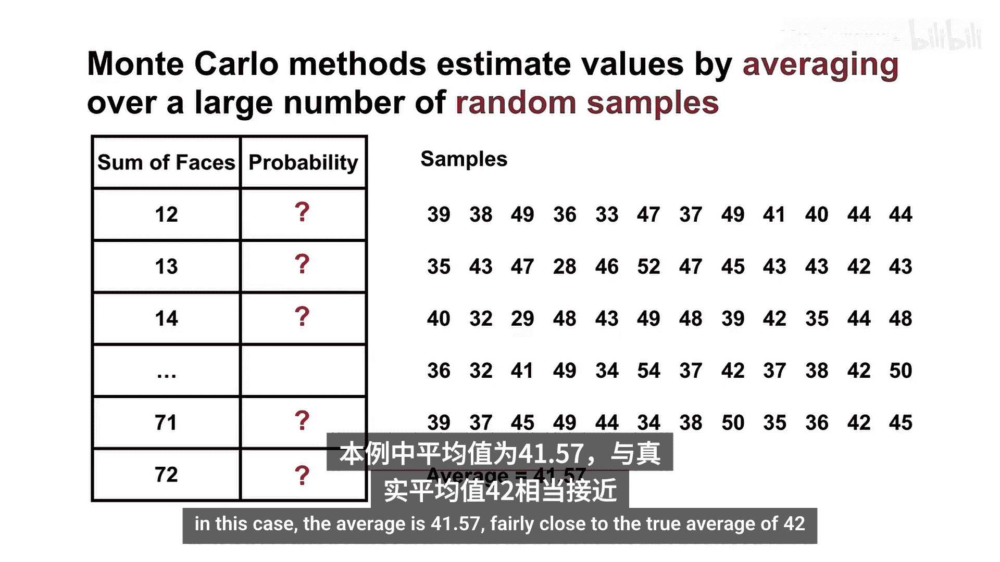
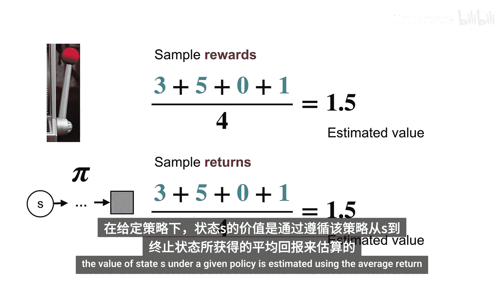
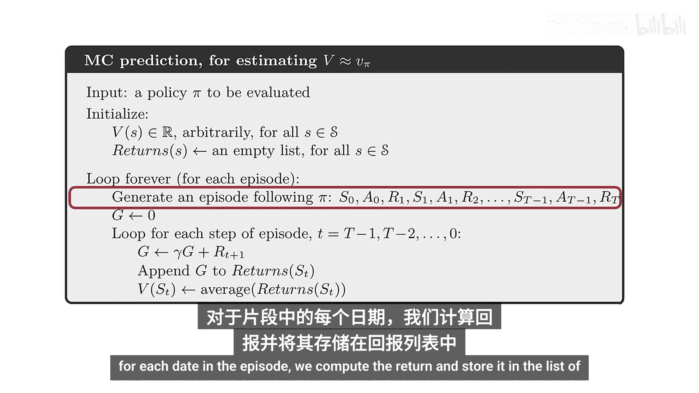
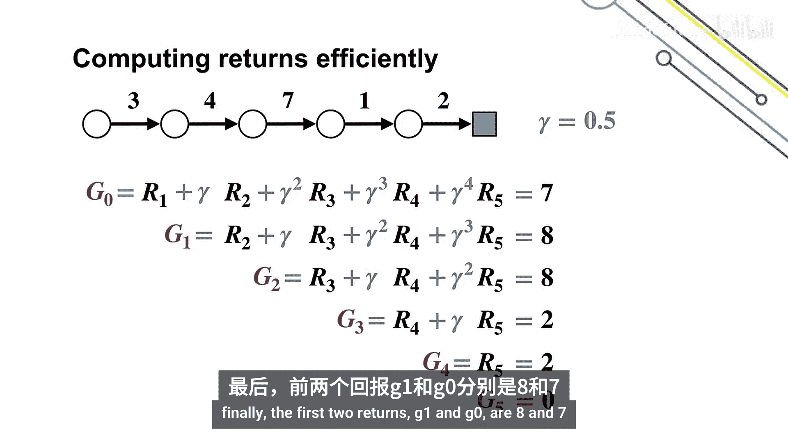
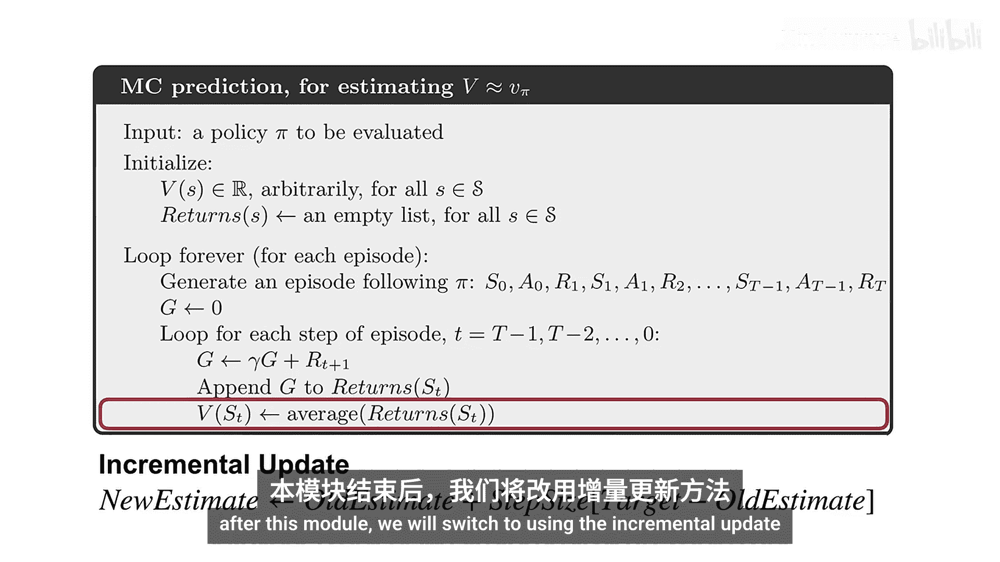

# 003：什么是蒙特卡洛方法

在本节课中，我们将要学习蒙特卡洛方法在强化学习中的应用。我们将了解它如何直接从经验中学习，而无需环境的动态模型，并学习一个用于估计状态价值函数的基本算法。

## 蒙特卡洛方法的定义与应用

术语“蒙特卡洛”通常被更广泛地用于指代任何依赖重复随机抽样的估计方法。

在强化学习中，蒙特卡洛方法允许我们直接从经验中估计价值。它从一系列状态、动作和奖励中学习，这种从经验中学习的方式之所以引人注目，是因为智能体可以在不了解环境动态先验知识的情况下，准确地估计价值函数。

通过本视频的学习，你将能够理解如何使用蒙特卡洛方法从采样的交互中估计价值函数，并识别哪些问题可以使用蒙特卡洛方法解决。

## 从动态规划到蒙特卡洛

之前，我们讨论了强化学习与动态规划的联系。要使用纯粹的动态规划方法，智能体需要知道环境的转移概率。但在某些问题中，我们根本不知道这些概率。

想象一个气象学家试图预测天气。天气如何变化取决于多种环境因素，我们根本无法确切知道未来天气模式的概率。即使对于合理的任务，计算动态规划中使用的转移概率也很困难。

试想预测掷12次骰子的结果。动态规划计算的数量之大和复杂性之高，使得它们既繁琐又容易出错，无论是在编码还是数值精度方面。

## 蒙特卡洛方法的优势

这就是蒙特卡洛方法可以发挥作用的地方。让我们尝试找出掷12次骰子的平均点数总和。

蒙特卡洛方法不会像这里展示的那样，穷举所有可能的结果。事实上，你不需要知道任何结果的概率就能使用蒙特卡洛方法。

相反，蒙特卡洛方法通过对大量随机样本进行平均来估计价值。让我们掷几次12个骰子并查看结果。在这个例子中，平均值是41.57，相当接近真实平均值42。

## 在强化学习中的应用

在强化学习中，我们希望学习一个价值函数。价值函数代表期望回报，因此学习价值函数的蒙特卡洛方法会首先观察从同一状态出发的多个回报。

然后，它可以平均这些观察到的回报，以估计从该状态出发的期望回报。随着样本数量的增加，平均值往往会越来越接近期望回报。智能体从一个状态观察到的回报越多，样本平均值接近该状态价值的可能性就越大。

这些回报只能在情节结束时被观察到，因此我们将专注于用于情节任务的蒙特卡洛方法。

## 与多臂老虎机方法的类比

蒙特卡洛方法和强化学习看起来有点像多臂老虎机中的方法。在多臂老虎机中，一个摇臂的价值是通过拉动该摇臂所采样的平均收益来估计的。蒙特卡洛方法则考虑策略而非摇臂。

在给定策略下，状态S的价值是通过遵循该策略从S到终止所采样的平均回报来估计的。

## 状态价值函数估计算法

现在，让我们看一个用于估计策略状态价值函数的算法。蒙特卡洛算法必须跟踪多个观察到的回报。

我们引入一个回报列表，每个状态一个。每个列表保存从状态S观察到的回报。然后，我们通过遵循策略生成一个情节。

对于情节中的每个时间步，我们计算回报并将其添加到该状态的回报列表中。但我们如何高效地做到这一点呢？

假设折扣因子γ为0.5，想象一个在时间步5结束的情节，其奖励序列是3， 4， 7， 1， 2。让我们找出每个回报G0到G5，首先写下每个回报的方程。

请注意，每个回报都包含在前一个时间步回报的方程中。这意味着我们可以通过从G5开始反向计算来避免重复计算。

让我们现在开始做。情节在t=5时结束，因此根据定义，G5等于0。G4等于时间5的奖励加上γ乘以时间5的回报，即2。G3等于时间4的奖励加上γ乘以时间4的回报。时间4的奖励是1，我们刚刚计算出时间4的回报是2。解方程，我们可以看到时间3的回报也是2。继续下去，我们可以找到时间2的回报是7加上γ乘以2，即8。最后，前两个回报G1和G0分别是8和7。

## 高效计算与增量更新

通过从终止时间步反向工作，我们可以高效地计算情节中遇到的每个状态的回报。第一个回报（指反向计算时的第一步）只是最后一个奖励，因此我们将最后一个奖励添加到状态S_{T-1}的回报列表中。然后，我们将S_{T-1}的价值设置为S_{T-1}的回报平均值。

在前一个时间步t-2，我们像之前一样计算回报，然后将其添加到状态S_{t-2}的回报列表中。最后，我们更新S_{t-2}的价值。如果我们继续这个循环直到结束，我们将更新当前情节中访问的所有状态的价值。然后，我们可以在许多情节中重复整个过程，最终学习到价值函数的一个良好估计。

你可能想知道我们是否可以避免将所有样本回报保存在列表中。事实上，我们可以。我们可以使用这里的公式增量地更新样本平均估计。

回想一下，我们在估计多臂老虎机的动作价值时讨论过使用这种增量更新。在本模块中，我们使用概念上更简单的样本平均来专注于蒙特卡洛的核心思想。在本模块之后，我们将切换到使用增量更新。

## 总结

本节课中我们一起学习了蒙特卡洛方法如何直接从交互中学习，特别是它们不需要环境的动态模型。我们还展示了一个用于在情节问题中学习状态价值的蒙特卡洛算法。