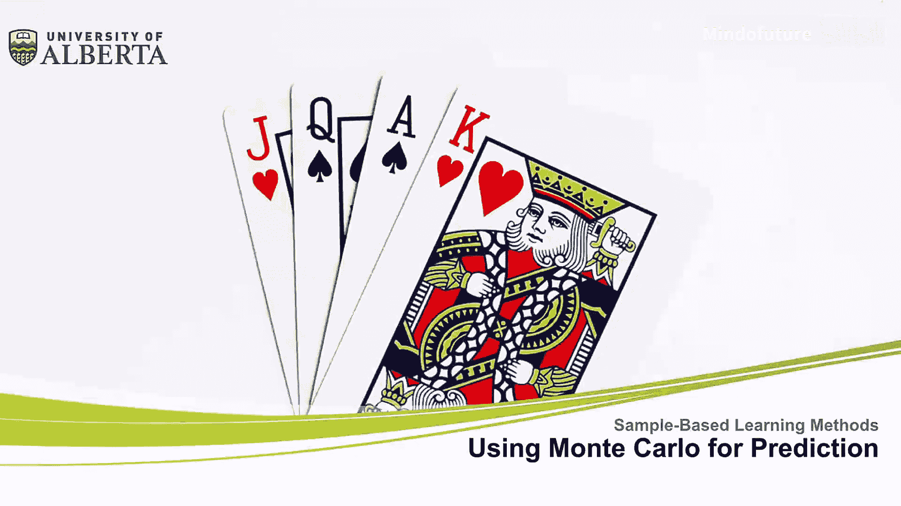
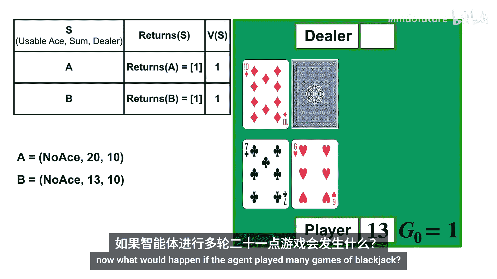

# 004：使用蒙特卡洛进行预测

在本节课中，我们将学习如何使用蒙特卡洛方法进行预测，以估计给定策略下的状态价值函数。想象一下，询问1000个人对某件事的体验，如果大多数人的体验良好，就决定去做这件事。这就是蒙特卡洛方法的核心思想。

## 蒙特卡洛预测算法详解 🃏

上一节我们介绍了蒙特卡洛的基本概念，本节中我们来看看一个具体的应用实例：二十一点纸牌游戏。

二十一点使用一副标准的52张牌。游戏目标是收集牌，使点数总和尽可能大，但不能超过21。人头牌计为10点，A可以计为11点或1点，由玩家决定。游戏开始时，玩家和庄家各发两张牌。玩家可以看到庄家的一张牌，另一张牌是盖着的。如果玩家初始牌即为21点，则获胜，除非庄家也是21点，则为平局。如果玩家初始牌不是21点，可以继续要牌。如果玩家牌的总和超过21点，则“爆牌”并输掉游戏。否则，当玩家决定停止要牌时，轮到庄家行动。庄家只在点数总和小于17时才要牌。如果庄家爆牌，玩家获胜。否则，点数总和更接近21点的一方获胜。

我们可以将此问题表述为一个无折扣的马尔可夫决策过程，每一局二十一点对应一个回合。奖励在游戏结束时给出：输为-1，平为0，赢为+1。玩家有两个动作：要牌或停牌。玩家根据三个变量决定要牌还是停牌：是否拥有可用的A、手牌点数总和、庄家显示的牌。总共有200个状态。我们假设牌是从牌堆中**有放回**地抽取，这意味着无需记录已发出的牌，且状态满足马尔可夫性质。

## 蒙特卡洛预测实战演练 📈

现在，让我们使用蒙特卡洛方法来学习一个特定策略的价值函数，该策略是：当玩家手牌点数为20或21时停牌。

假设在第一个回合中，玩家手牌点数为13，没有可用A，庄家显示的牌是10。由于玩家的策略是固定的，他选择要牌，得到一张7，点数变为20。因为点数是20，玩家选择停牌。现在轮到庄家，庄家抽到一张9，爆牌输掉游戏，玩家获得+1的奖励。

第一个回合结束后，玩家可以执行蒙特卡洛更新并开始学习。由于折扣因子为1，且唯一的非零奖励是回合结束时的+1，因此该回合中每个状态的回报都是+1。

以下是更新过程，我们从回合末尾向前回溯处理每个状态：

*   在最后一个非终止状态（状态A），玩家点数为20，没有可用A，庄家显示10。我们将+1添加到状态A的回报列表中，并将状态A的价值设置为该列表的平均值。
*   回溯到倒数第二个状态（状态B），玩家点数为13，没有可用A，庄家显示10。同样，我们将+1添加到状态B的回报列表中，并将状态B的价值设置为该列表的平均值。

至此，我们处理了第一个回合中的所有状态，完成了该回合的蒙特卡洛更新。

## 长期学习结果分析 📊

如果智能体玩很多局二十一点，价值函数会如何变化？

让我们看看智能体在10，000个回合后学到的价值函数。我们将分别绘制拥有可用A和没有可用A的状态价值函数图。图的三个轴分别是：庄家显示的牌、玩家手牌点数总和、该状态的价值。

拥有可用A的图比没有可用A的图粗糙得多，这是因为大多数二十一点游戏中没有可用A，因此可用A状态的价值是用少得多的样本估计的。两张图的形状相似。观察图表，庄家显示的牌对价值函数的影响似乎不大。然而，观察玩家手牌点数总和，当玩家点数为20或21时，状态价值要高得多。

为什么这些价值比玩家点数为19时高这么多？答案与智能体遵循的策略有关。该策略总是在点数19或更低时要牌，因此当点数为19时，智能体很可能爆牌。另一方面，当点数为20或21时，智能体会停牌，并很可能获胜。

现在，让我们看看500，000个回合后的价值估计，此时估计值已几乎收敛到真实状态价值。注意，现在的图表平滑得多。我们看到了与之前相同的模式：除非点数是20或21，否则价值较低。

## 蒙特卡洛学习的特点总结 💡

最后，我们来总结一下蒙特卡洛学习的一些含义。

首先，蒙特卡洛直接从经验中学习，因此不需要维护庞大的环境模型。其次，蒙特卡洛方法可以独立于任何其他状态的价值来估计单个状态的价值。在动态规划中，每个状态的价值依赖于其他状态的价值，这是一个很大的区别。最后，更新每个状态价值所需的计算量**完全不依赖于**MDP的大小，而是取决于回合的长度。

在本节课中，我们一起学习了如何使用蒙特卡洛预测来学习策略的价值函数，并讨论了蒙特卡洛学习无需遍历整个MDP的特点。