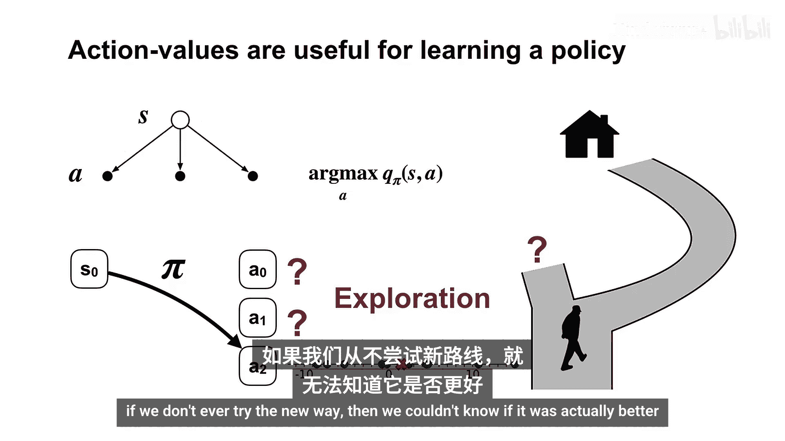
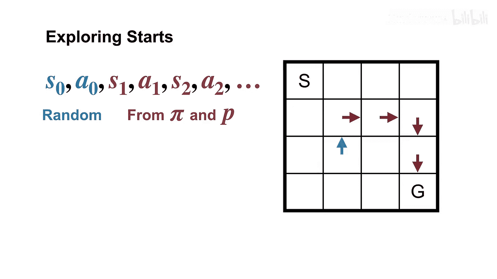

**基于样本的学习方法：P05：使用蒙特卡洛进行动作价值评估**

在本节课中，我们将学习如何使用蒙特卡洛方法估计动作价值函数，并理解在算法中保持探索的重要性。

---

上一节我们介绍了如何使用蒙特卡洛方法学习固定策略下的状态价值函数。本节中，我们来看看如何学习动作价值函数。

学习动作价值的过程与学习状态价值几乎完全相同。回想一下，我们通过平均从某个状态出发的样本回报来学习该状态的价值。同样地，我们可以通过平均从某个“状态-动作”对出发的样本回报来学习该动作的价值。

以下是基本步骤：
1.  遵循策略，从特定的“状态-动作”对开始，收集一个完整的回合。
2.  计算该回合的回报。
3.  对访问该“状态-动作”对所获得的所有回报取平均值。

那么，为什么我们需要学习动作价值呢？动作价值对于学习策略非常有用。它们允许我们在同一状态下比较不同的动作。如果我们拥有对其他动作价值的估计，就可以在发现更好的动作时切换过去。

但这可能带来一个挑战。让我们考虑为一个确定性策略学习动作价值函数。想象一个从未被策略选中的动作。智能体将永远无法观察到与该动作对应的回报，因此无法形成准确的蒙特卡洛估计。智能体必须在每个状态中尝试所有动作才能学习它们的价值。这就是强化学习中“保持探索”的问题。

让我们思考一个现实世界的例子。想象你总是沿着通常的道路走回家。最近，附近新建了一条路。如果我们从不尝试新路，就无法知道它是否真的更好。

一种保持探索的方法称为“探索性起点”。在探索性起点中，我们必须保证回合能在每一个“状态-动作”对中开始。之后，智能体只需遵循其策略即可。考虑屏幕上的网格世界。

让我们看看探索性起点如何与图中红色箭头所示的策略配合工作。探索性起点会在一个回合开始时随机采样一个“状态-动作”对（图中以蓝色箭头表示）。在本例中，蓝色动作与红色策略的动作不同。在初始动作之后，智能体将遵循红色策略直到回合结束。

为了评估像这个网格世界中的确定性策略，我们必须能够以这种方式设置起始状态。但这并非总是可行的。

其他探索策略，例如 **ε-贪心**，可用于评估随机策略。我们将在后续课程中详细讨论。

---

本节课中，我们一起学习了蒙特卡洛算法如何用于估计动作价值函数，并讨论了在评估过程中保持探索的重要性。理解这一点对于后续将蒙特卡洛方法用于策略改进和控制至关重要。