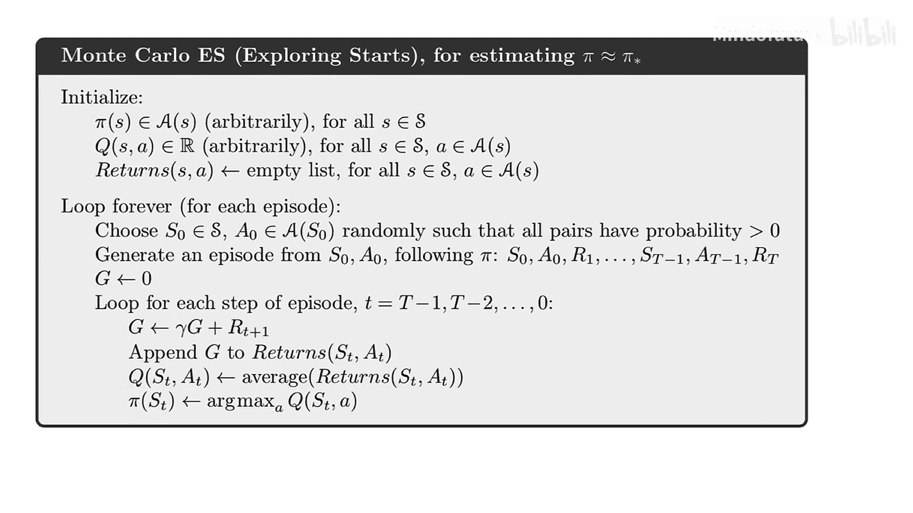

# 006：使用蒙特卡洛方法进行广义策略迭代

在本节课中，我们将学习如何将蒙特卡洛方法应用于广义策略迭代框架。我们将介绍一个具体的算法——带探索性起点的蒙特卡洛控制，并理解其如何通过交替进行策略评估与策略改进来优化策略。

上一节我们介绍了如何使用蒙特卡洛方法估计动作价值。本节中，我们来看看如何利用这些估计值来构建一个完整的广义策略迭代算法。

## 广义策略迭代框架

广义策略迭代包含两个核心步骤：**策略评估**与**策略改进**。GPI算法会产生一系列策略，其中每个新策略都至少与之前的策略一样好。

*   在**策略改进**步骤中，我们可以使策略相对于智能体当前的动作价值估计变得**贪婪**。
*   在**策略评估**步骤中，我们将使用**蒙特卡洛方法**来估计动作价值。

需要记住的是，在GPI框架中，价值估计只需要得到**一定程度的改进**，而无需完全收敛到真实值。只要估计值能持续改进，算法最终就能收敛。

蒙特卡洛控制方法将策略改进和策略评估结合在**逐个片段**的基础上进行。

## 算法：带探索性起点的蒙特卡洛控制

现在，让我们将这两个步骤整合到一个算法中。

以下是带探索性起点的蒙特卡洛控制算法的主要步骤：

1.  **初始化**：为所有状态-动作对初始化动作价值函数 `Q(s, a)` 和一个随机策略 `π(s)`。
2.  **循环（对每个片段）**：
    *   **探索性起点**：随机选择一个起始状态 `S0` 和起始动作 `A0`。
    *   **生成片段**：遵循当前策略 `π`，从 `(S0, A0)` 开始与环境交互，直至片段结束，记录过程中的状态、动作和奖励序列。
    *   **策略评估（更新Q值）**：
        *   从片段末尾开始，为每个访问过的状态-动作对 `(St, At)` 计算其回报 `Gt`。
        *   将 `Gt` 添加到 `(St, At)` 对应的回报列表中。
        *   计算该列表的平均值，并以此更新动作价值估计 `Q(St, At)`。
    *   **策略改进**：
        *   对于片段中访问过的每一个状态 `S`，将策略更新为贪婪策略：`π(S) = argmax_a Q(S, a)`。

这个算法完成了策略评估步骤后，立即进行策略改进。我们只需根据更新后的动作价值，在每个观察到的状态中选择贪婪动作。这比我们在动态规划中执行此步骤要简单得多。

本节课中，我们一起学习了如何在GPI框架内使用蒙特卡洛方法，并讨论了一个名为“带探索性起点的蒙特卡洛”的GPI算法示例。该算法通过交替进行基于经验片段的策略评估和贪婪策略改进，逐步优化策略直至收敛。