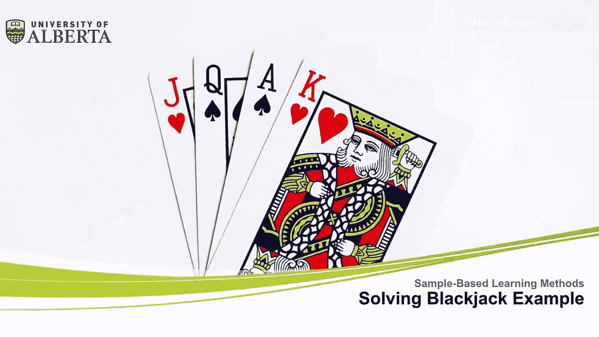
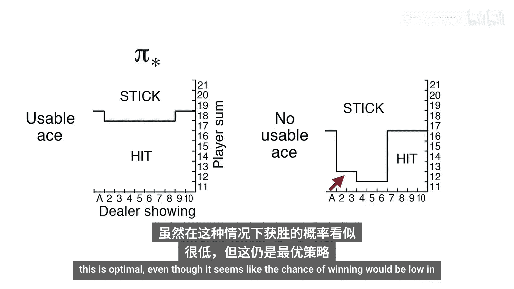

# 007：解决二十一点示例

在本节课中，我们将学习如何将带有探索性起点的蒙特卡洛控制方法应用于一个具体示例。我们将训练一个智能体玩二十一点游戏，并观察算法如何工作。课程结束时，你将能够应用此方法解决一个马尔可夫决策过程示例。

上一节我们介绍了广义策略迭代的蒙特卡洛控制方法。本节中，我们来看看如何在一个实际例子中应用它。

## 🎲 学习策略：带有探索性起点的蒙特卡洛方法

我们将使用带有探索性起点的蒙特卡洛方法来训练智能体玩二十一点。探索性起点要求每个回合从一个随机的状态和动作开始。在我们的二十一点版本中，游戏自然从随机状态开始，因此我们只需在每个回合的第一个动作中随机选择“要牌”或“停牌”。这意味着智能体忽略其在初始状态下认为的最佳动作，而是随机选择。

初始策略设定为：当智能体手牌点数总和小于20时选择“要牌”，当总和为20或21时选择“停牌”。

让我们逐步模拟一局游戏，看看算法会如何运作。

## 📝 游戏步骤示例

假设智能体手牌总点数为13（没有可用的A），庄家明牌是8。根据随机采样的第一个动作，智能体选择“要牌”。

智能体得到一张7，点数总和变为20。在下一步，智能体根据其策略选择动作，因此它选择“停牌”。现在轮到庄家。

庄家抽到一张9，点数超过21，输掉游戏，智能体获得+1的奖励。

很好。现在让我们看看在游戏过程中遇到的状态-动作对，从回合的末尾开始向前回溯。

## 🔍 回溯更新过程

以下是分析游戏过程中状态-动作对的步骤：

1.  **分析最后一个非终止状态**：智能体手牌点数为20，没有可用A，庄家明牌为8。从这个状态，智能体选择了“停牌”。智能体将+1添加到与该状态-动作对对应的回报列表中。该状态下“停牌”动作的估计值就是1。

2.  **比较动作价值**：我们来看这个状态下两个动作的价值。智能体从未尝试过“要牌”动作，所以其价值为0。“停牌”动作的价值是1（我们刚刚计算得出）。因此，相对于Q函数，这个状态下的贪婪动作是“停牌”，因为它具有最高的估计价值。

3.  **向前回溯一步到起始状态**：智能体手牌点数为13（没有可用A），庄家明牌是8。随机选择的动作是“要牌”。同样，智能体将+1添加到该状态-动作对的回报列表中。列表的平均值形成了动作价值的估计。

4.  **更新策略**：最后，策略在此状态下被更新为相对于动作价值估计的贪婪策略。在这个状态下，我们从未尝试过“停牌”动作，其价值为0。但“要牌”动作带来了回报1。因此，贪婪动作是“要牌”，策略也相应更新。

我们将这个过程在许多回合中重复进行。动作价值和策略将逐渐接近其最优值。

## 📊 最终习得策略分析

让我们看一下智能体在运行很长时间后找到的近似最优策略。

注意智能体在持有可用A时的玩法。对于庄家的大多数牌，智能体会持续“要牌”直到点数接近19。因为有可用A，智能体在计算手牌点数总和时有更大的灵活性，因此策略更具攻击性。

相反，在没有可用A时，策略在很大程度上取决于庄家展示的牌。当智能体点数总和大于等于13，且庄家牌面点数较低（如2或3）时，智能体会选择“停牌”。这是最优策略，尽管在这种情况下获胜的机会看起来可能较低。

本节课中，我们一起学习了如何将带有探索性起点的蒙特卡洛方法应用于一个马尔可夫决策过程示例。我们通过二十一点游戏演示了算法的具体步骤，包括随机起始动作、游戏过程模拟、回报回溯以及策略的贪婪更新。最终，我们观察了智能体习得的近似最优策略在不同情况下的表现。