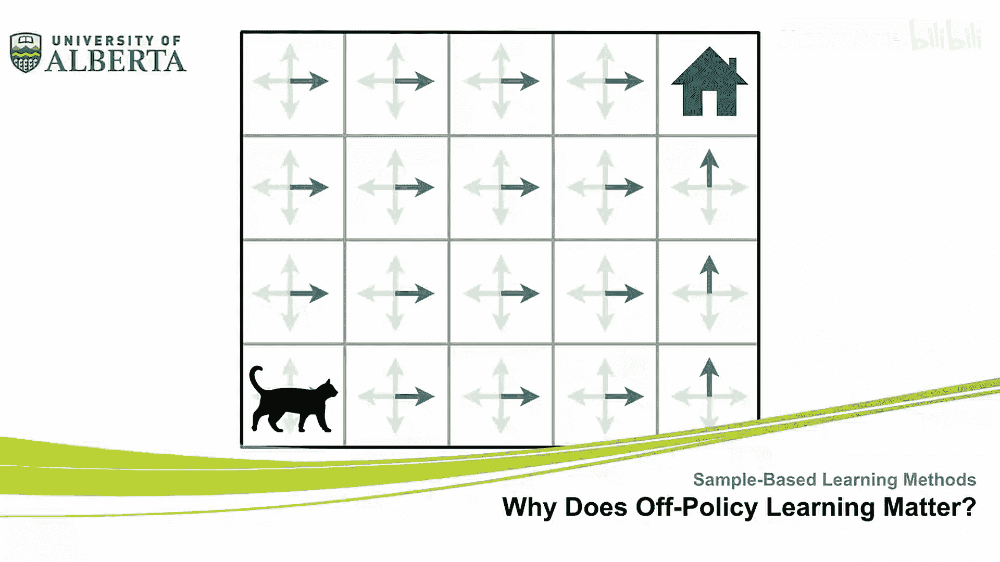

# 009：离线策略学习的重要性

在本节课中，我们将探讨离线策略学习的概念，理解它如何帮助我们解决强化学习中的探索问题，并区分目标策略与行为策略。

## 探索与利用的权衡

上一节我们讨论了探索与利用的权衡。其核心要点是，智能体必须偶尔采取次优的探索性行动，这可能导致获得较少的即时奖励。

## 离线策略学习简介

本节中我们来看看一种学习价值函数的新方法：离线策略学习。通过本节学习，你将能够理解离线策略学习如何帮助处理探索问题，并能举例说明目标策略和行为策略。

ε-贪心策略通过在每个时间步以一个小概率进行探索，有助于解决持续探索的问题。然而，ε-贪心策略的缺点是，无论是对于执行动作还是对于学习过程，它都是次优的。它们既不是获取奖励的最优策略，也不是寻找最佳动作的最优探索策略。

到目前为止，在本课程中，我们一直在隐式地讨论**在线策略学习**。在在线策略学习中，智能体学习的是用于生成数据的策略本身。在策略评估中，这意味着学习价值函数；在控制中，这意味着学习最优策略。

## 离线策略学习的定义

与在线策略不同，在**离线策略学习**中，智能体从遵循**另一个不同策略**所生成的数据中，学习一个目标策略。也就是说，我们正在学习的策略（目标策略）与我们用于选择动作的策略（行为策略）是分离的。例如，你可以让智能体遵循一个完全随机的策略，同时学习最优策略。

以下是相关策略的定义：

*   **目标策略**：智能体正在学习的策略，是学习的目标，通常用 **π** 表示。智能体学习的价值函数就是基于这个策略的。一个典型的目标策略例子就是**最优策略**。
*   **行为策略**：智能体用于选择动作的策略，它定义了智能体的行为，通常用 **b** 表示。图中展示的行为策略是**均匀随机策略**。

## 为何分离行为与目标策略？

我们为什么要将行为策略与目标策略分离开来？因为它提供了另一种实现持续探索的策略。如果智能体的行为严格遵循目标策略，它可能只会访问到有限的状态。而如果智能体能够遵循一个倾向于探索的行为策略，它就能体验到更多样化的状态。

离线策略学习还有其他一些有用的应用，例如从演示中学习和并行学习，但促进探索是其主要的动机之一。

## 离线策略学习的关键规则

离线策略学习有一个关键规则：**行为策略必须覆盖目标策略**。用公式表示，即对于任意状态 **s** 和动作 **a**，如果目标策略选择该动作的概率大于零：
`π(a|s) > 0`
那么行为策略选择该动作的概率也必须大于零：
`b(a|s) > 0`

这背后有重要的数学原因，我们将在后续视频中讨论。但这里有一个直观的解释：考虑一个状态，如果行为策略总是选择“向上”的动作，而目标策略建议“向右”。智能体将永远无法学习到在该状态下选择“向右”的动作价值，因为它从未观察到选择“向右”会带来什么结果（也许能获得+100万的奖励，但它永远不会知道）。

值得注意的是，离线策略学习是在线策略学习的严格泛化。**在线策略是离线策略的一个特例，即当目标策略等于行为策略时**。😊

## 总结

本节课中我们一起学习了离线策略学习。关键要点是：离线策略学习是实现持续探索的另一种有效方式。我们学习的策略称为**目标策略**，而我们从中选择动作的策略称为**行为策略**。理解这两者的区别是掌握高级强化学习算法的基础。