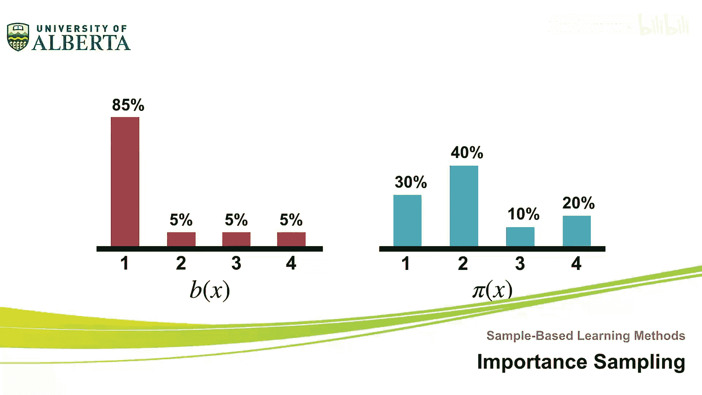
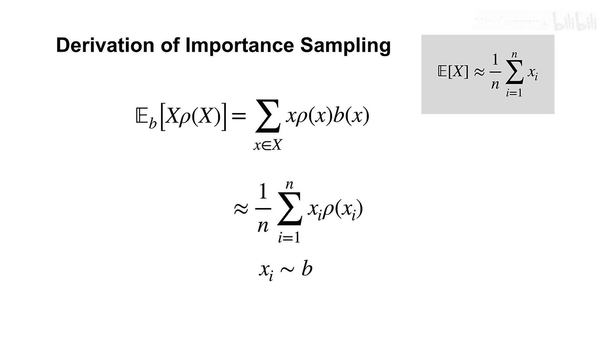
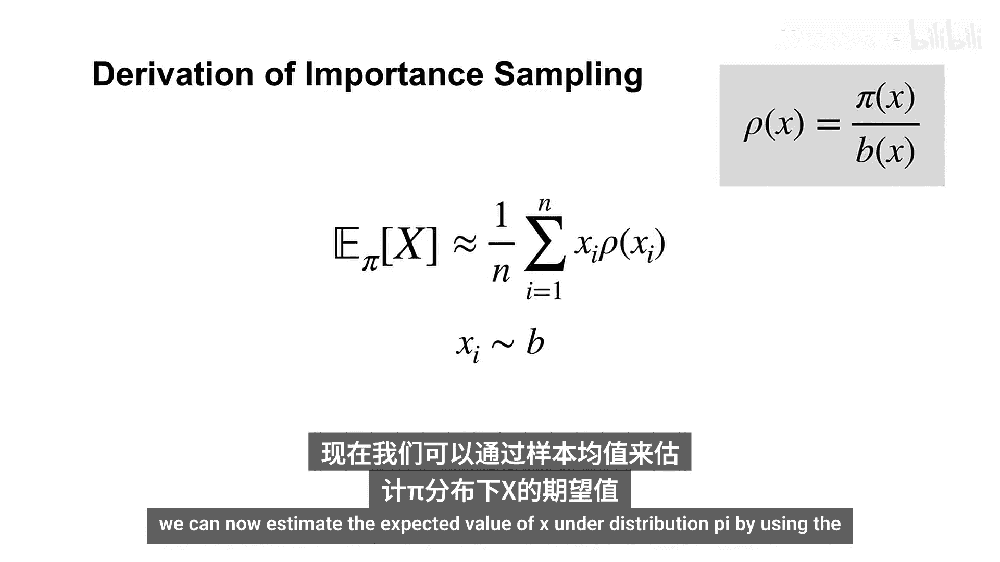
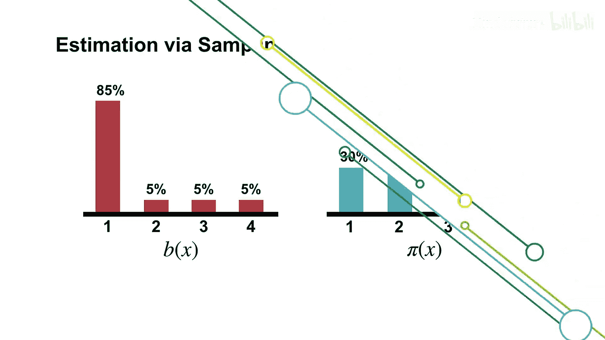
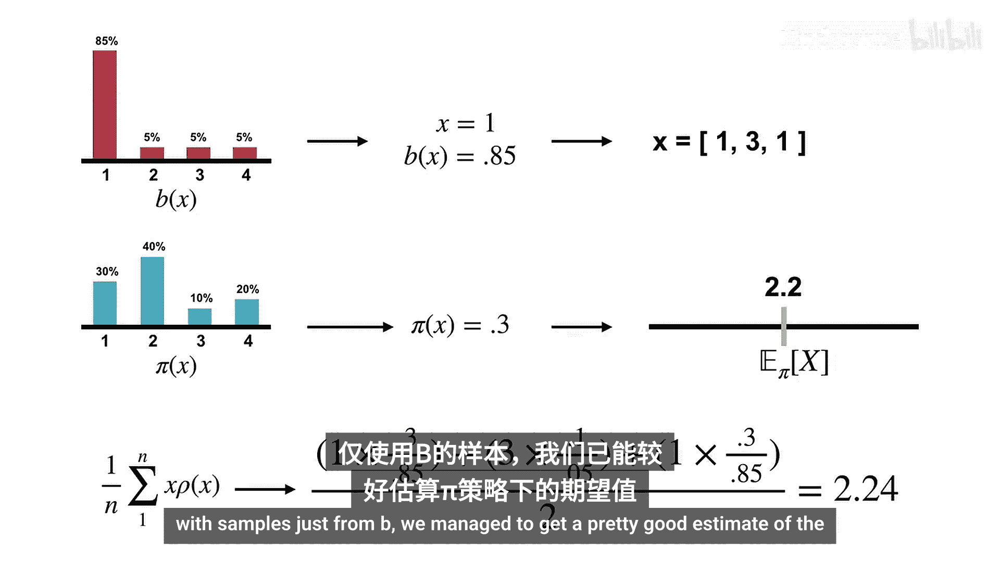

基于样本的学习方法：P10：重要性采样

在本节课中，我们将学习重要性采样。正如我们将在后续视频中看到的，重要性采样使我们能够进行离策略学习，即在遵循一个策略的同时学习另一个策略。本节中，我们将首先描述重要性采样的工作原理。通过本节学习，你将能够使用重要性采样，利用来自不同分布的样本来估计目标分布的期望值。

让我们首先明确重要性采样所要解决的问题。

我们有一个随机变量 **x**，它从一个概率分布 **B** 中被采样。我们想要估计 **x** 的期望值，但这是相对于目标分布 **π** 的期望。由于 **x** 是从 **B** 中抽取的，我们不能简单地使用样本平均值来计算在 **π** 下的期望。样本平均值给出的是在 **B** 下的期望值。

让我们从期望值的定义开始。对所有可能的结果 **X** 求和，乘以它在 **π** 下的概率。

`E_π[x] = Σ_x x * π(x)`

接下来，我们可以乘以 `b(x) / b(x)`，因为这一项等于 1。`b(x)` 是在 **B** 下观察到结果 **X** 的概率。

`E_π[x] = Σ_x x * π(x) * (b(x) / b(x))`

调整分子，我们最终得到 **π** 和 **B** 之间的一个比率。

`E_π[x] = Σ_x x * (π(x) / b(x)) * b(x)`

这个比率对我们非常重要，被称为重要性采样比率。我们通常将重要性采样比率写作 **ρ(x)**。

`ρ(x) = π(x) / b(x)`

现在，让我们更进一步。如果我们把 **x** 乘以重要性采样比率看作一个新的随机变量，再乘以观察到 **x** 的概率 `b(x)`，我们可以将这个和重写为在 **B** 下的期望。

`E_π[x] = Σ_x [x * ρ(x)] * b(x) = E_B[x * ρ(x)]`

注意，我们的期望现在是在 **B** 下，而不是在 **π** 下。

我们知道如何使用重要性采样来修正期望，但如何利用数据来估计这个期望呢？这实际上非常简单。我们只需要计算一个加权样本平均值，以重要性采样比率作为权重，如下面的公式所示。

`估计值 = (1/N) * Σ_{i=1}^{N} x_i * ρ(x_i)`

请注意，这些样本 **x_i** 是从 **B** 中抽取的，而不是从 **π** 中抽取的。

这样，我们现在就可以使用从分布 **B** 抽取的样本，通过样本平均值来估计分布 **π** 下 **x** 的期望值。

让我们看一个使用重要性采样来估计期望的小例子。我们有两个相当不同的分布 **B** 和 **π**。

我们将根据 **B** 抽取样本，并尝试估计在 **π** 下的期望值。在右侧，我们将跟踪当前对 **π** 下期望值的估计。作为参考，我们在线的中间显示了真实的期望值。

以下是计算步骤：

1.  从 **B** 抽取一个样本。我们得到 **x = 1**，这在 **B** 下发生的概率是 0.85。如果从 **π** 抽样，得到 **x = 1** 的概率是 0.3。为了计算 **π** 的样本平均值，我们需要使用重要性采样公式。代入观测值，我们得到估计值：`1 * (0.3 / 0.85) ≈ 0.35`。
2.  再次抽取样本。这次从 **B** 得到 **x = 3**，概率为 0.05。如果从 **π** 抽样，看到 3 的概率是 0.1。我们将 **x** 加入缓冲区，然后将观测值代入公式。我们取之前的估计值，加上新的估计值 `3 * (0.1 / 0.05) = 6`，然后除以 2，得到 `(0.35 + 6) / 2 = 3.175`。
3.  抽取最后一个样本。再次从 **B** 抽取并加入缓冲区。将观测值代入重要性采样比率公式，得到 `2 * (0.6 / 0.1) = 12`。现在有三个样本：0.35， 6， 12。平均值是 `(0.35 + 6 + 12) / 3 ≈ 6.12`。

仅使用来自 **B** 的样本，我们成功获得了在 **π** 下期望的一个相当不错的估计。

本节课中，我们一起学习了如何使用重要性采样，在数据从另一个分布采样时，估计一个分布下的期望值。下次见。