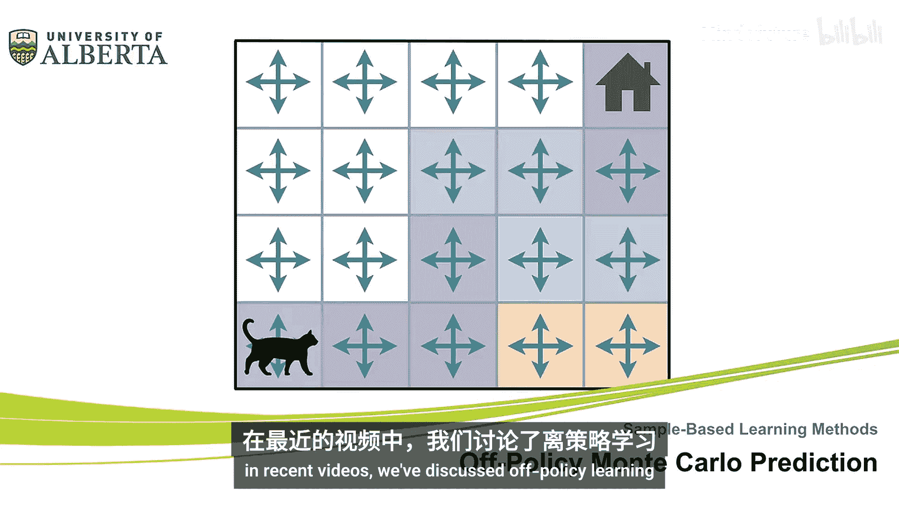
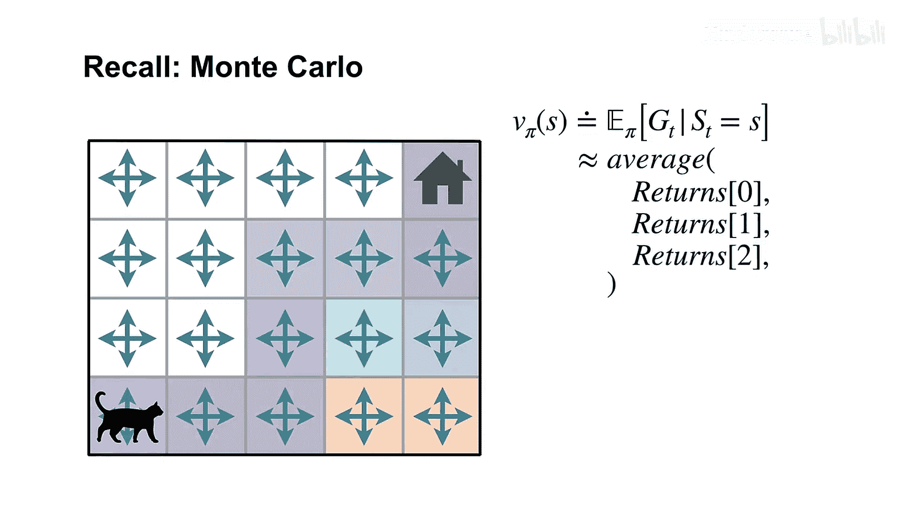
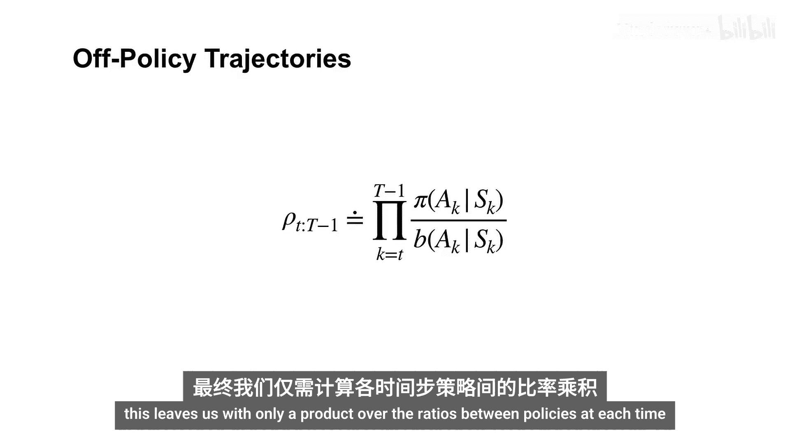
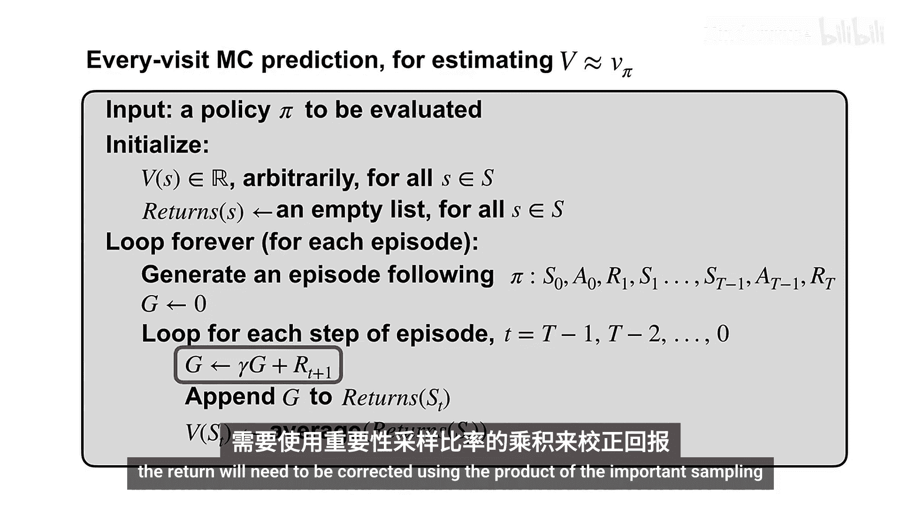
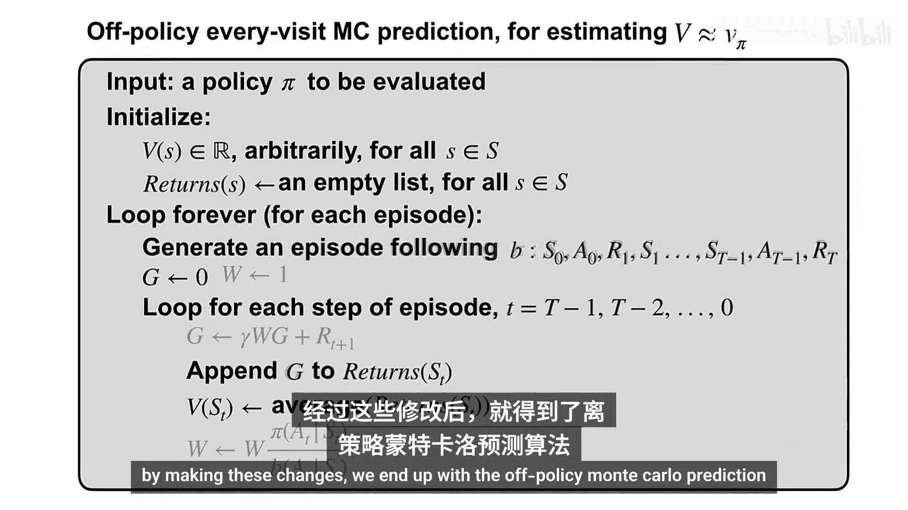
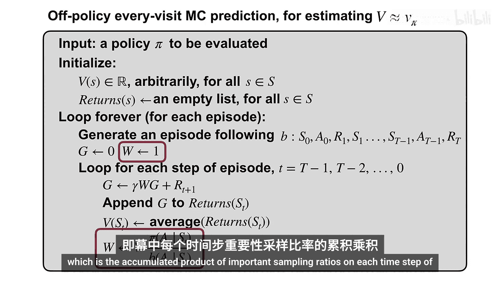
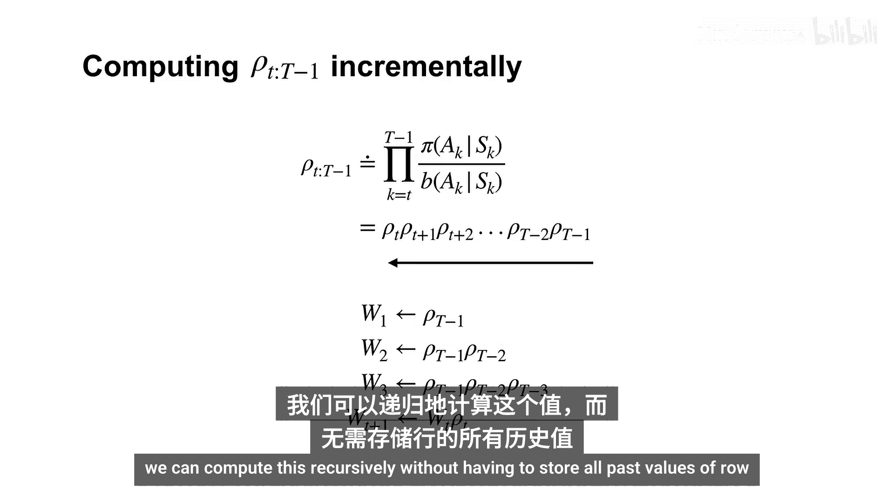

# 011：离线策略蒙特卡洛预测

在本节课中，我们将学习如何利用蒙特卡洛方法进行离线策略预测。我们将理解如何使用重要性采样来修正回报，并了解如何修改蒙特卡洛预测算法以适应离线策略学习。

## 蒙特卡洛估计的目标 🎯

上一节我们讨论了离线策略学习的基本概念。本节中，我们来看看蒙特卡洛估计的具体目标。

蒙特卡洛估计的目标是，通过计算从某个状态开始的所有回报的样本平均值，来估计每个状态的价值。

## 离线策略学习的挑战 ⚠️

然而，当我们尝试使用遵循行为策略 `B` 的回报来估计目标策略 `π` 下的价值时，会遇到一个问题。

如果我们简单地平均在行为策略 `B` 下从状态 `S` 观察到的回报，将无法得到正确的答案。我们必须对平均值中的每一个回报进行修正，这正是重要性采样的作用。

我们需要为每个采样到的回报计算出 `ρ` 的值。这里的 `ρ` 是轨迹在策略 `π` 下的概率除以轨迹在策略 `B` 下的概率。

这个 `ρ` 修正了整个轨迹的分布，从而修正了回报的分布。使用这个修正，我们就能得到我们想要的——策略 `π` 下回报的期望值。

## 计算轨迹概率 📊

为了计算 `ρ`，我们需要知道如何计算一个轨迹在某个策略下的概率。

让我们考虑轨迹的概率分布。这个概率可以理解为：给定智能体处于某个状态 `S_t`，它采取行动 `A_t`，然后转移到状态 `S_{t+1}`，接着采取行动 `A_{t+1}` 并转移到 `S_{t+2}`，如此继续，直到在时间 `T` 终止的概率。所有的行动都是根据行为策略 `B` 采样的。

由于马尔可夫性质，我们可以将这个概率分布分解成更小的部分。

以下是分解步骤：
*   第一部分是智能体在状态 `S_t` 选择行动 `A_t` 的概率，乘以环境转移到状态 `S_{t+1}` 的概率。
*   第二部分给出了下一个时间步经验发生的概率，依此类推。

我们可以使用连乘符号重写这个概率乘积列表。

现在我们已经定义了轨迹在策略 `B` 下的概率。记住我们的目标：我们希望用轨迹在策略 `π` 下的概率和在策略 `B` 下的概率来定义 `ρ`。

## 重要性采样比率的推导 ➗

让我们将这些概率代入 `ρ` 的定义中。

正如我们在之前的视频中所见，我们可以取这些概率并将它们乘以重要性采样比率。环境的转移动态在每个时间步上相互抵消，这给我们留下了一个仅关于每个时间步策略比率的乘积。

## 离线策略价值估计 🧮

现在让我们回到离线策略估计 `V_π`。智能体观察到许多遵循行为策略 `B` 的回报。

我们可以通过用 `ρ` 修正每个回报，来使用这些回报估计 `V_π`。

## 算法实现：从在线到离线 🔄

现在让我们看看如何实现这一点。首先回顾一下在线策略蒙特卡洛预测算法。

我们需要在这里做两个改变：
1.  片段将不再遵循 `π` 生成，而是遵循 `B` 生成。
2.  回报需要使用重要性采样比率的乘积进行修正。

通过进行这些更改，我们得到了离线策略蒙特卡洛预测算法。

请注意，片段现在是遵循行为策略生成的。回报被一个新项 `W` 修正，`W` 是片段每个时间步上重要性采样比率的累积乘积。

## 增量计算重要性权重 🔢

我们可以从 `t` 到 `T-1` 增量地计算 `ρ`。

为了理解原因，让我们写出每个时间步的乘积。回想一下，蒙特卡洛算法是反向遍历时间步的。

以下是计算过程：
*   在算法的第一步，`W` 被设置为最后一个时间步的 `ρ`。
*   在下一个时间步，`W` 是倒数第二个 `ρ` 乘以最后一个 `ρ`，依此类推。

每个时间步在乘积中增加一个额外的项，并重用所有之前的项。我们可以递归地计算这个值，而无需存储所有过去的 `ρ` 值。

## 总结 📝

本节课中，我们一起学习了离线策略蒙特卡洛预测。我们使用了重要性采样比率来修正由行为策略生成的回报，并修改了在线策略蒙特卡洛预测算法以用于离线策略学习。