# 012：批量强化学习 🧠

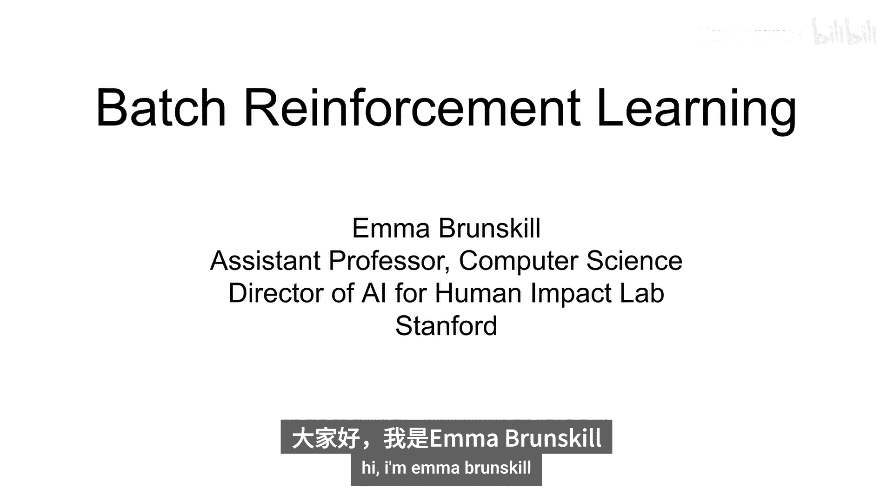

在本节课中，我们将学习**批量强化学习**的核心概念。这是一种利用历史数据来学习并改进未来决策策略的方法，尤其适用于无法进行大量在线交互的场景，例如教育、医疗等领域。

---

## 引言：从汉堡到教育 📚

我是艾玛·布伦斯基尔，斯坦福大学计算机科学系的助理教授。我的研究重点是高风险场景下的强化学习，特别是那些有望造福社会的应用。

我想从一个故事开始。在20世纪80年代，美国一家名为A&W的快餐连锁店试图与麦当劳的“四分之一磅汉堡”竞争，推出了“三分之一磅汉堡”。尽管口味测试很好，价格也相近，但产品却失败了。原因是许多顾客认为“三小于四”，所以觉得自己得到的牛肉更少。

这个故事说明了数学教育的重要性。当我开始思考强化学习如何造福社会时，教育成为了一个极具吸引力的例子。我和同事Zin Pavvic以及研究生们一起，思考如何更好地教授分数知识，希望方法能兼具吸引力、有效性和高效性。

你现在看到的游戏叫做“折射”，已有数十万学生玩过。我们面临的一大挑战是：如何设计学生活动的顺序，以保持他们的参与度和积极性，并确保他们真正在学习。

我们可以将此视为一个决策策略问题：基于学生迄今为止与游戏的互动序列，我们应该提供什么下一个活动，以最大化我们关心的某个结果（奖励函数）？这个奖励可以是学生的坚持程度或学习量。在我们的案例中，这些是可选的学习环境，因此我们非常关注如何最大化学生的坚持度。

大约五年前我们开始思考这个问题，这让我对今天要简要介绍的问题产生了浓厚兴趣。但我想强调，我绝不是第一个思考将强化学习应用于造福社会的人。实际上，自强化学习诞生之初（可以追溯到20世纪40年代的**多臂老虎机**问题），就有一条并行的脉络在思考如何用强化学习帮助人类，从“教学机器”到“自适应临床试验”都是如此。

---

## 批量强化学习的挑战与机遇 ⚖️

我认为这在社会影响方面非常令人兴奋，但也为强化学习带来了许多基础性问题。特别是，如果我们看看当前强化学习取得的一些非凡成功，它们往往集中在机器人或游戏等领域。在这些场景中，我们通常可以访问**模拟器**进行大量尝试，即使智能体长时间学习失败，只要最终学会，我们也能接受。

相比之下，在涉及与人交互的领域（如教育、医疗），我们目前还没有很好的人类学习或行为模拟器。这意味着我们必须依赖**真实数据**，但这也带来了挑战，因为收集真实数据涉及与真人交互，我们必须谨慎行事。

因此，我和我的实验室学生思考的一个关键问题是：**我们如何开发强化学习技术，以尽量减少智能体学习所需的数据量？以及任何智能体要做出良好决策所需信息量的基本极限是什么？** 我认为，如果我们能回答这些问题，不仅能在强化学习的基础理论上取得进步，还能帮助更多的人。

---

## 回顾：马尔可夫决策过程 🔄

首先，我们快速回顾一下MDP的背景知识。大家应该熟悉**状态**、**动作**、**下一个状态**、**动态模型**和**奖励**这些概念。

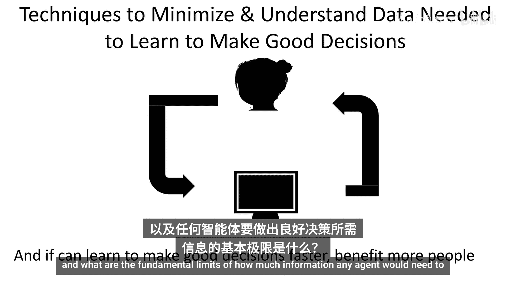

今天我们要思考的是**反事实**情况：我们将从过去获取数据（这些数据可能来自某个特定的**行为策略**），并希望利用这些数据来改进未来的决策。

---

## 反事实推理的难点 🤔

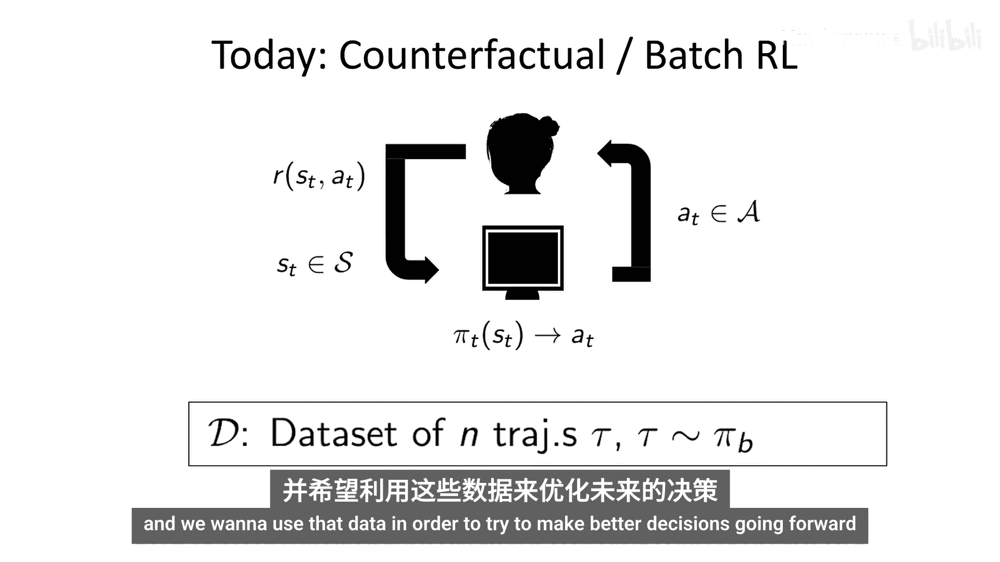

这是一个充满挑战的问题，主要原因在于它涉及“如果……会怎样”的推理。你可以想象，一个智能体在过去做出了一系列决策并得到了一些结果，而且可能不止一次地这样做过。

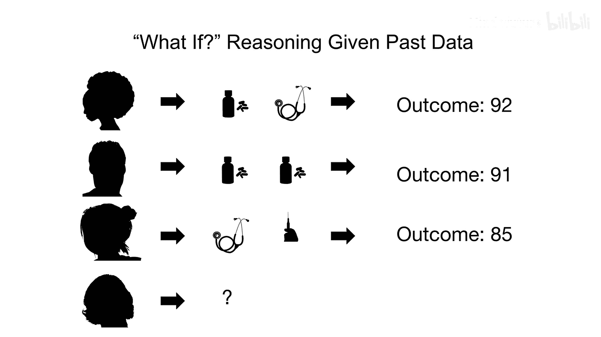

挑战在于，你永远无法知道如果你现在不看这个视频，你的生活会是什么样子——这就是一个反事实，你永远无法亲身体验。因此，当我们试图利用旧数据来做出未来更好、不同的决策时，这是一个关键挑战。

具体来说，就像在多臂老虎机中看到的那样，我们面临**数据截断**问题：我们无法看到替代动作会导致什么结果，无法获得我们本可以得到的奖励。这个挑战在多臂老虎机中就存在。

但是，当我们考虑使用旧数据进行强化学习时，我们实际上还面临一个额外的挑战：**泛化问题**。如果你考虑一个智能体不是做一个决策，而是做一系列决策，那么策略的组合可能性会随着决策**时间步长**的增加而急剧增加。

因此，如果我们希望从过去的数据中泛化，去思考我们从未经历过的动作序列可能会发生什么，我们就需要某种泛化的方法。

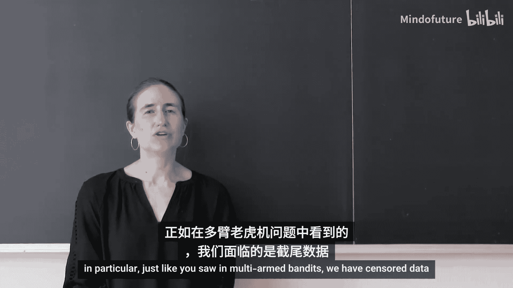

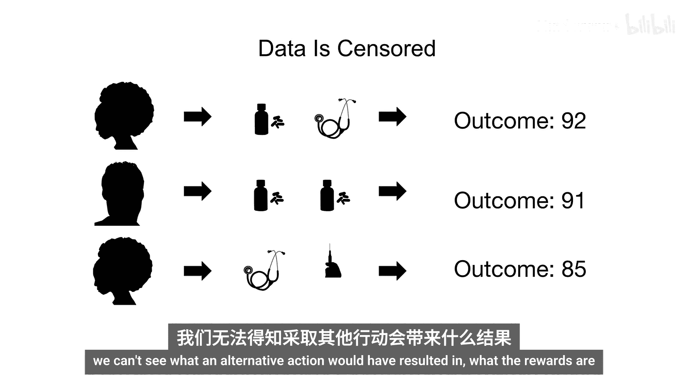

---

## 批量强化学习的目标 🎯

近年来，许多人对于“如何利用旧数据做出更好的未来决策”这个问题感到兴奋。这与**因果推理**和**反事实推理**等领域密切相关，这些领域在统计学、流行病学和其他计算机科学领域有着悠久的历史。但真正令人兴奋的是，过去几年人们努力将这些思想与机器学习方法、强化学习相结合，以期产生更大影响。

我们许多人真正希望实现的是所谓的**反事实强化学习**或**批量强化学习**：我们获取旧数据，从中学习一个新的策略，并且能够确信该策略在未来部署时的价值。这涉及两个方面：
1.  **策略评估**：评估替代策略会有多好的能力。
2.  **策略优化**：在所有可能的策略集合中，寻找价值最大化的策略。

---

## 策略评估：从治疗效应估计到重要性采样 📊

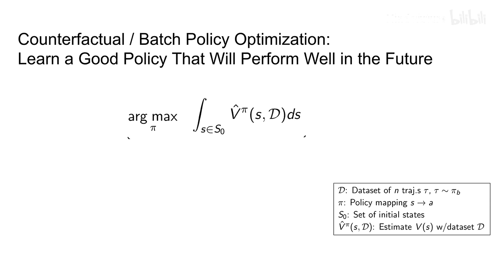

我想先简要谈谈策略评估问题。需要指出的是，其他领域（如计量经济学）对此有大量研究，通常称为**治疗效应估计**。例如，如何评估一种治疗方案是否优于对照决策？

然而，当我们考虑一系列决策时，又会遇到挑战。我同事David Soag、I'malli Dahi Bazzlan等人的一篇近期论文很好地说明了这一点。它阐述了当我们开始使用旧数据尝试做出新决策时出现的一些挑战。

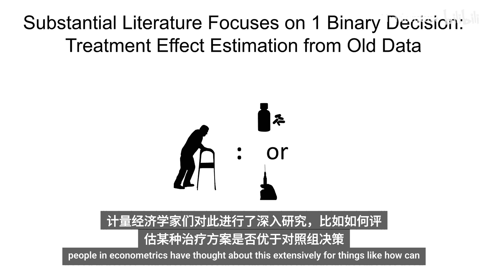

具体来说，假设你有一组以特定方式治疗过的患者，现在你想考虑一种特定的治疗序列。随着我们做出决策（例如选择是否给患者使用呼吸机或镇静剂），接受过特定干预序列或特定动作序列的既往患者数量会变得非常少。因此，即使我们一开始有大量数据（例如10万名患者，这是一个合理的数字），最终可能只有几百名患者实际接受的治疗与我们想要评估的策略相匹配。

本质上，我们可以将此视为**协变量偏移**的挑战。当我们使用不同的策略时，它们通常会采取不同的动作，这些不同的动作会导致不同的状态分布。我们真正需要思考的是，在我们预期会遇到的那些不同的状态和动作分布下，会产生什么样的奖励结果。

---

### 重要性采样：解决分布不匹配的关键工具

为了应对这种分布不匹配的问题，一个重要的工具是**重要性采样**。正如你最近了解到的，重要性采样允许我们使用从不同策略生成的数据，并对其进行重新加权，从而得到正确的期望值。

其优美之处在于，我们实际上不需要知道世界的动态模型，因为世界的动态模型在分子和分母中是相同的，所以会相互抵消。

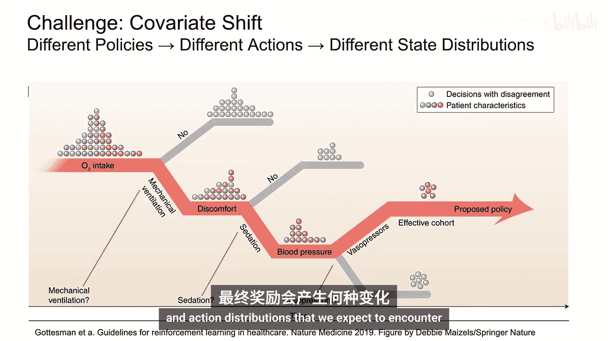

以下是重要性采样的核心公式。在有限时间步长的情况下，一个策略的价值可以表示为观察到特定轨迹的概率乘以该轨迹的奖励，然后对所有可能轨迹求平均。重要性采样权重 `w` 是目标策略 `π` 与行为策略 `μ` 在给定轨迹下概率的比值：

`V(π) = E_τ~μ [ (Π_t π(a_t|s_t) / μ(a_t|s_t)) * R(τ) ]`

其中 `τ` 代表轨迹 `(s_0, a_0, s_1, a_1, ..., s_T)`，`R(τ)` 是该轨迹的总奖励。

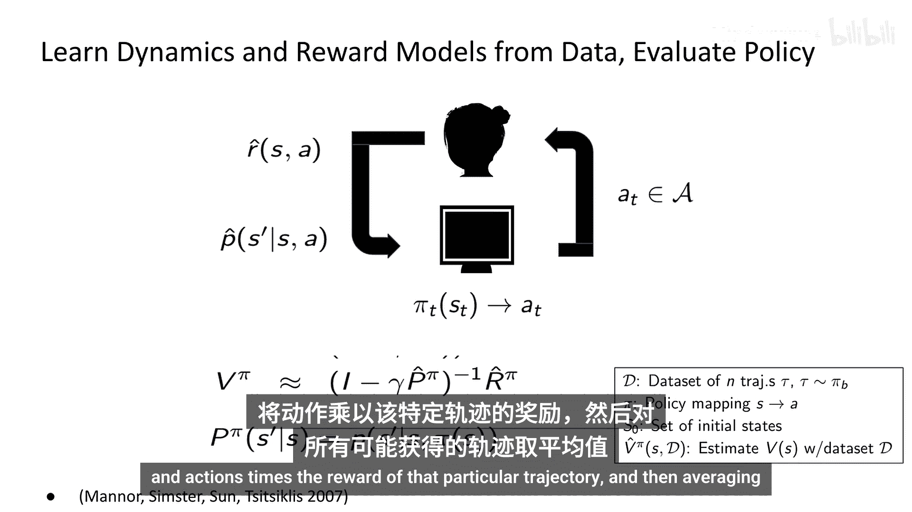

自这种方法被引入强化学习以来，该领域出现了许多令人兴奋的工作。它是策略评估的关键工具，因为我们可以利用它在某些假设下，使用现有的旧数据来评估替代策略的价值。

---

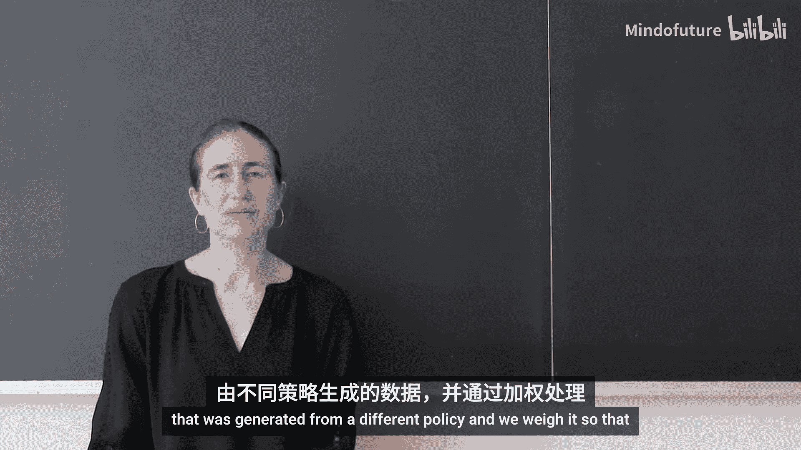

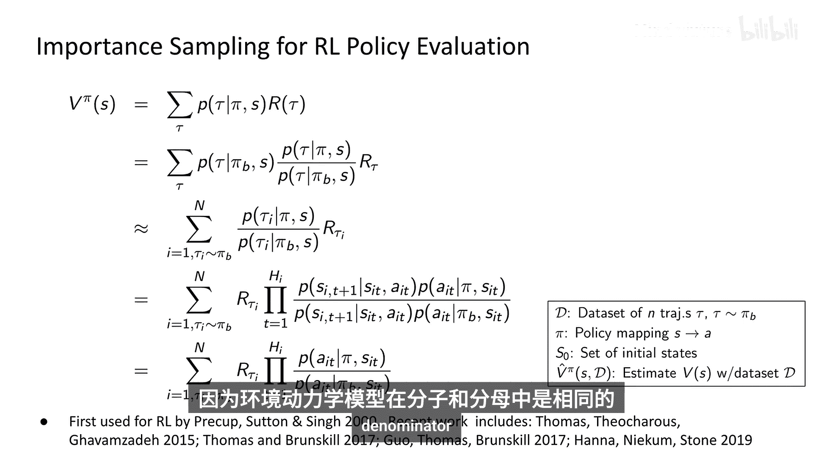

### 重要性采样的挑战与替代方案

然而，使用重要性采样进行策略评估也存在一些挑战。重要性采样为我们提供了一个**无偏估计量**，但其**方差通常可能非常高**。事实上，我们之前的一些工作表明，方差有时会随着时间步长呈指数级增长。这意味着，如果我们没有大量数据或者时间步长很长，这些估计量对未来新策略表现的预测可能会非常不准确。

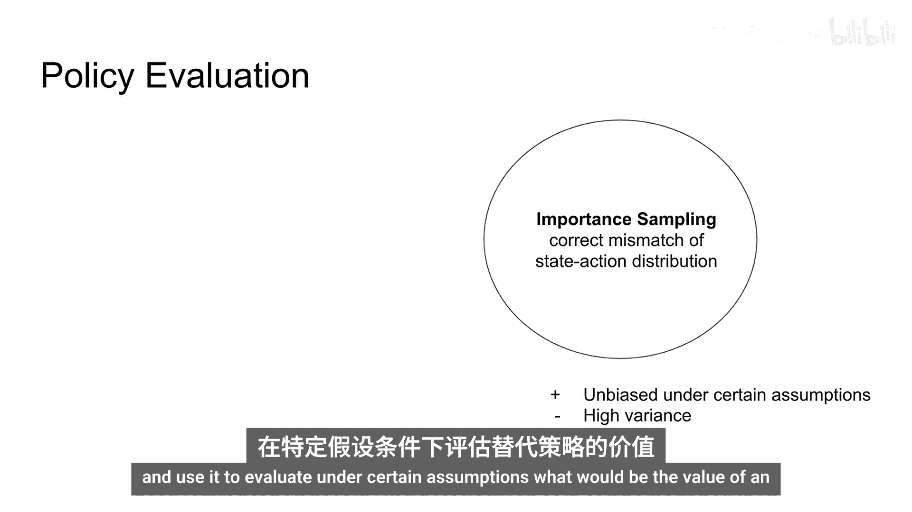

一种替代方案是使用**参数化模型**，就像在MDP规划部分听到的那样。这些模型可能存在**偏差**，因为我们使用的函数逼近器或选择的模型表示可能不正确，无法真实反映世界生成数据的方式。但作为回报，它们可以有很低的方差。

因此，过去几年一个令人兴奋的创新是**双重稳健估计量**的思想。这个源于统计学的概念在过去十年中被引入到强化学习和老虎机问题中。其思想是结合基于模型的估计量和重要性采样两者的优点，以获得更低的方差和更低的偏差。

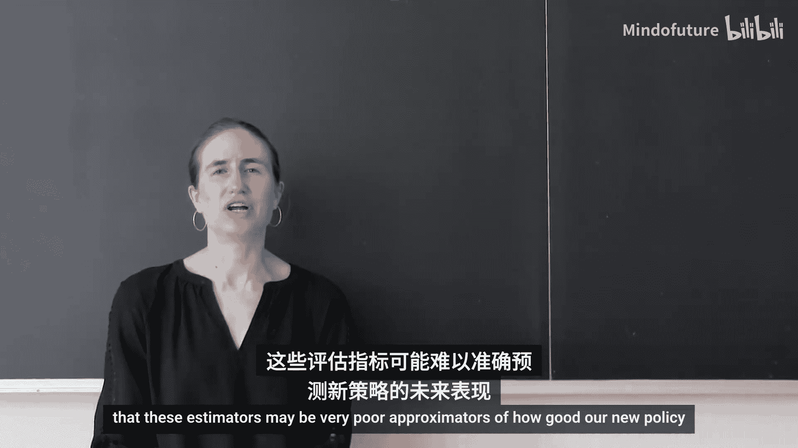

---

## 从评估到优化：学习更好的策略 🚀

这些是我们可以进行策略评估的方法示例。我们真正想做的是在此基础上进行**策略优化**。我们近期的研究表明，我们可以利用重要性采样这类思想来实际做出更好的未来决策。

这里我以CartPole环境为例进行说明。下图展示了我们如何通过基于重要性采样的先进技术进行策略优化，从而学习到比用于收集数据的行为策略好得多的策略。我认为，通过使用这类技术可能带来的性能提升是非常令人兴奋的。

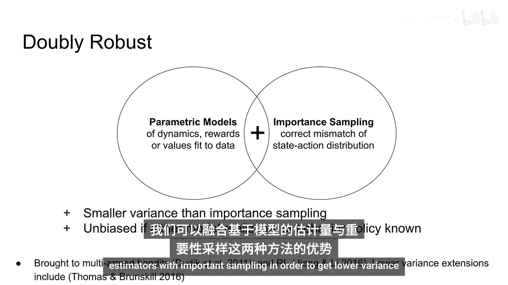

---

## 未来展望与成功案例 🌟

我认为，要真正解决这个问题，特别是在我们希望对性能有正式保证的情况下，还有大量的成长空间和开放性问题。在我的实验室，我们一直在政策评估、政策优化方面做很多工作，并尝试开始推导正式的性能边界，以便在部署这些策略时能有信心。我的同事们在这些领域也做了许多非常令人兴奋的工作。

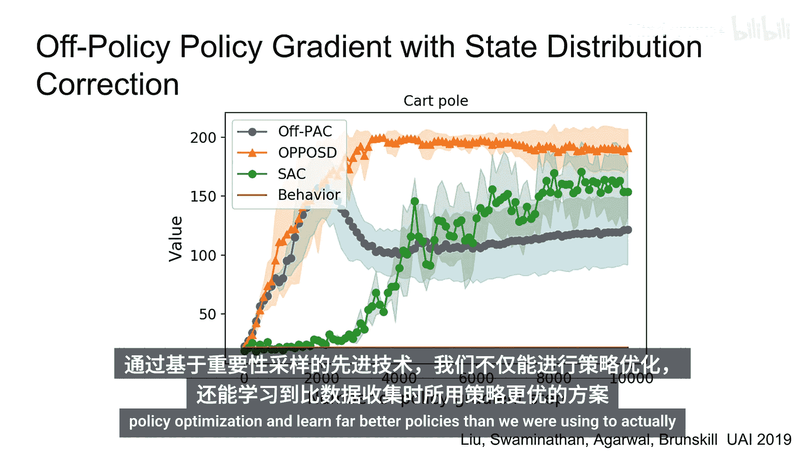

我们还有很长的路要走，但在结束之前，我想给出一个乐观的理由。让我们回到开头提到的“折射”游戏的例子。我们的目标是利用大约11,000名学生的旧数据，找出是否存在一种更好的教学方法，能让学生更投入。

我们使用了一种基于重要性采样的方法，得到了一个我们认为能将学生坚持度提高约30%的策略。我们随后对另外2,000名学生进行了研究，发现坚持度确实提高了约30%到32%。

因此，我认为这充分说明，有时我们可以用这类方法准确预测未来，并且真的可以带来改变。

---

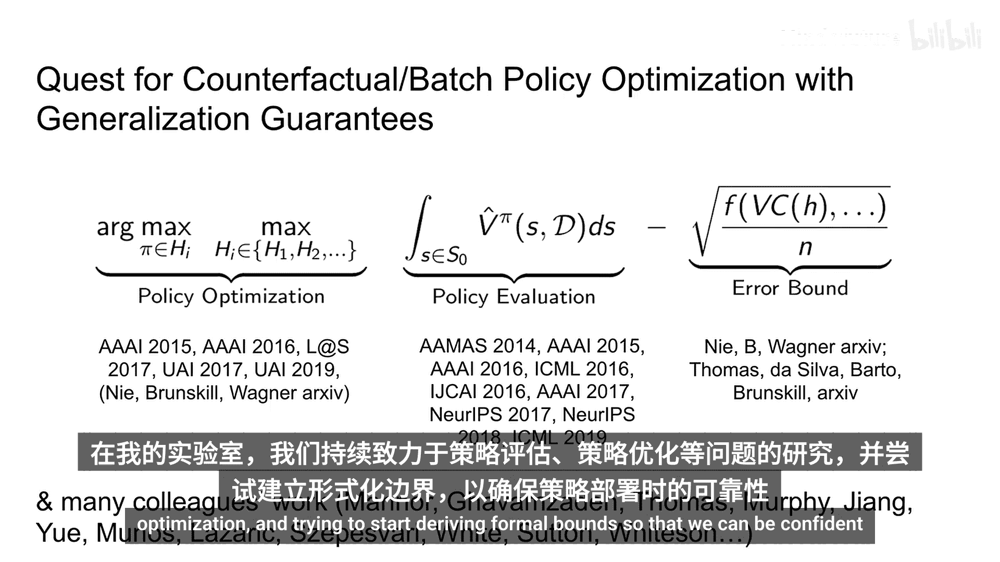

## 总结 📝

本节课中，我们一起学习了**批量强化学习**的核心内容。我们了解到：
1.  批量强化学习旨在利用历史数据（**离线数据**）来学习和优化策略，适用于模拟器不可用或与真人交互成本高的领域。
2.  其核心挑战包括**反事实推理**、**数据截断**和**分布不匹配**导致的**泛化问题**。
3.  **重要性采样**是解决分布不匹配、进行策略评估的关键技术，但它可能带来高方差。
4.  **双重稳健估计量**等方法结合了模型估计和重要性采样的优点，以平衡偏差和方差。
5.  从策略评估可以进一步发展到**策略优化**，从而从旧数据中学习到优于原行为策略的新策略。
6.  在教育等实际领域的成功应用表明，批量强化学习具有造福社会的巨大潜力。

通过理解这些概念，我们为在无法进行无限探索的现实世界场景中应用强化学习奠定了重要基础。