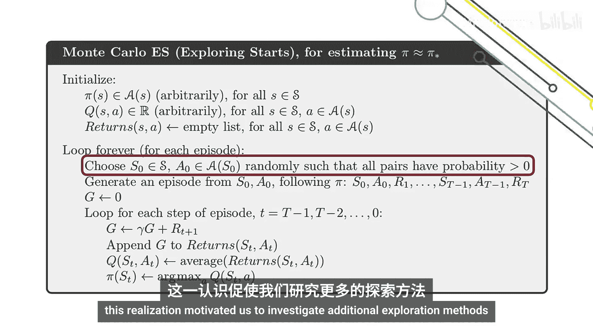
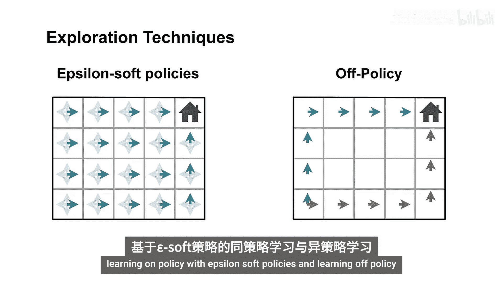
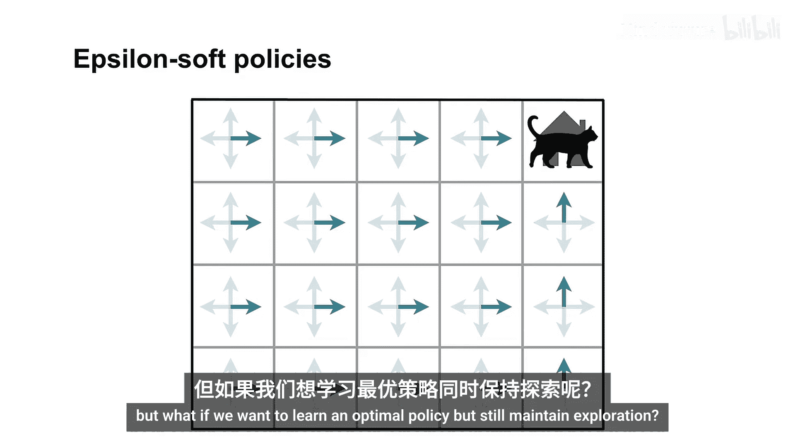
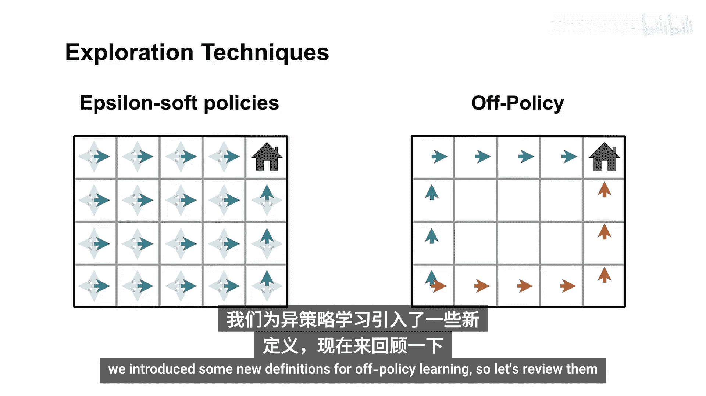

# 013：课程总结

## 📚 概述

在本节课中，我们将回顾第一周学习的核心内容。第一周主要聚焦于如何仅利用从环境中获得的经验来估计价值函数并寻找最优策略。我们探讨了同策略与异策略蒙特卡洛方法，并重新审视了多臂老虎机中的探索问题。

## 🔍 蒙特卡洛算法回顾

上一节我们介绍了课程的整体目标，本节中我们来看看第一周的核心算法——蒙特卡洛方法。

蒙特卡洛算法是基于样本的学习方法。当环境模型未知或难以建模时，可以使用这些方法。蒙特卡洛算法通过**对多个观察到的回报进行平均**来估计价值函数。其公式表示为：
`V(s) ≈ average( G_t | S_t = s )`
它们需要等待一个完整的回报序列结束后才更新价值估计。因此，蒙特卡洛方法仅适用于**分幕式马尔可夫决策过程**。

我们讨论了蒙特卡洛方法如何融入广义策略迭代框架，这引出了我们的第一个基于样本的控制算法：**带探索性开端的蒙特卡洛控制**。

## 🤔 探索问题与解决方案

蒙特卡洛算法不像动态规划那样遍历所有状态-动作对，因此它们需要一个探索机制来确保学习到每个状态-动作对的信息。我们首先考虑了“探索性开端”。

以下是探索性开端的要求：
*   要求每个幕的初始状态和初始动作是随机选择的。
*   在实际应用中（例如自动驾驶汽车），探索性开端并非总是可行或安全的。

这一认识促使我们研究其他的探索方法。

## 🧭 两种主要的探索策略

我们介绍了解决探索问题的另外两种策略。

第一种策略是**采用ε-软策略进行同策略学习**。在这种策略下，智能体遵循并学习一个随机策略。它大部分时间采取贪婪动作，但会以一个小概率ε采取随机动作。这样，所有状态-动作对的价值估计都能随时间持续改进。这种同策略方法迫使我们学习一个**接近最优的策略**，而非绝对最优策略。

那么，如果我们既想学习最优策略，又想保持探索，该怎么办呢？

答案在于**异策略学习**。我们为异策略学习引入了一些新的定义。

## 📖 异策略学习核心概念

以下是异策略学习中的关键定义：
*   **行为策略**：智能体用来选择动作的策略。
*   **目标策略**：智能体在其价值函数中学习的策略。

通过设定一个合适的、具有探索性的行为策略，智能体可以学习任何确定性的目标策略。一种在遵循一个策略的同时学习另一个策略的方法是使用**重要性采样**。

重要性采样允许智能体根据在行为策略下采样的经验，来估计目标策略下的期望回报。其核心是重要性采样比：
`ρ = Π (π_target(a|s) / π_behavior(a|s))`
这个比率对样本进行重新加权。它增加了在目标策略π下更可能出现的回报的重要性，并降低了那些不太可能出现的回报的重要性。样本平均值有效地包含了每个回报的正确比例，因此在期望上，就好像回报是从目标策略π下采样得到的一样。

## ✅ 总结

本节课中我们一起学习了第一周的核心内容。我们回顾了蒙特卡洛作为样本学习方法的特性，深入探讨了探索问题及其三种解决方案：探索性开端、ε-软策略同策略学习以及异策略学习。我们明确了行为策略与目标策略的区别，并了解了重要性采样在连接两者中的作用。下一模块，我们将讨论强化学习中最基本的概念之一：时序差分学习。