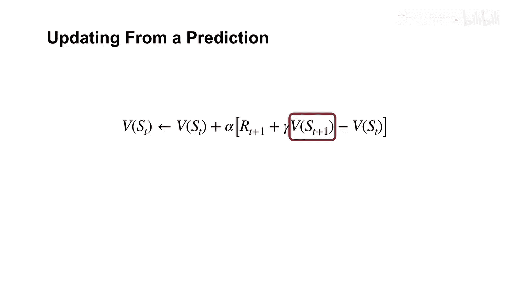
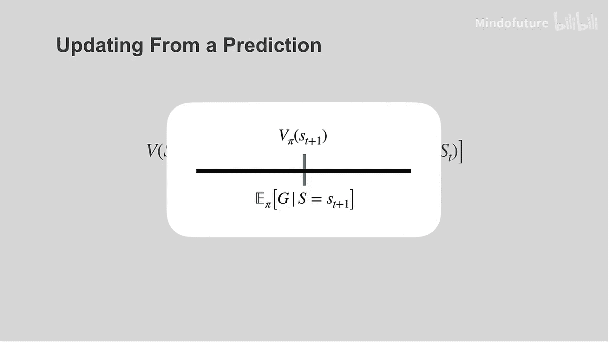
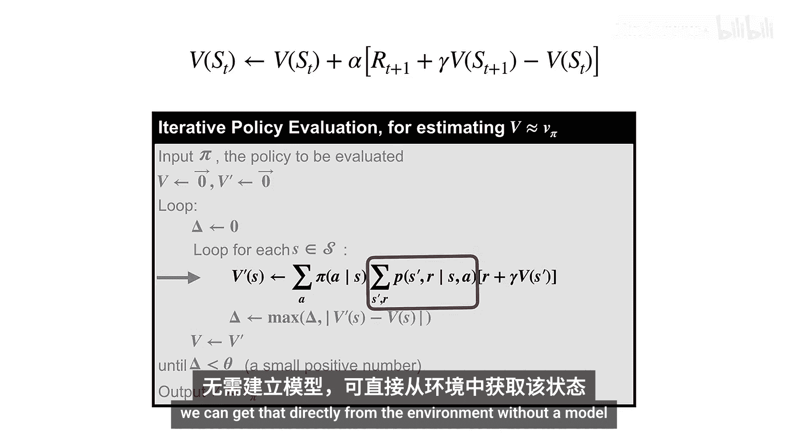
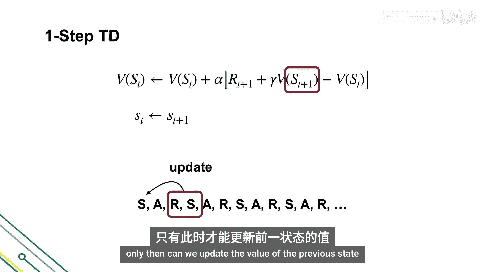
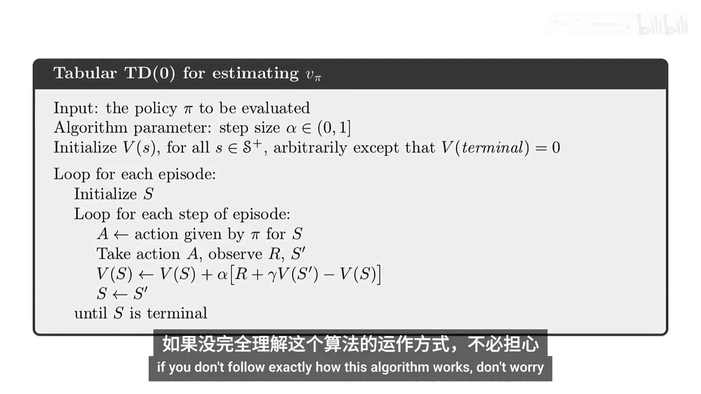

**基于样本的学习方法：P14：什么是时序差分(TD)学习**

在本节课中，我们将讨论强化学习中最核心的思想之一。引用教科书的话：如果必须找出强化学习中一个核心且新颖的思想，那便是时序差分学习。通过本视频，你将能够定义时序差分学习、定义时序差分误差，并理解TD(0)算法。

在预测问题中，我们的目标是学习一个价值函数，用于估计从给定状态开始的回报，这一点你已经了解。

在开始之前，我们先讨论对蒙特卡洛策略评估方法的一个小修改。

我们可以使用以下公式来增量式地更新我们的估计价值：
`V(St) ← V(St) + α [Gt - V(St)]`
请注意，这使用了类似于我们多臂老虎机学习算法中的恒定步长α。这意味着该算法无需保存回报列表即可形成蒙特卡洛估计。

然而，要计算回报`Gt`，我们必须对完整的轨迹进行采样。这意味着我们在一个回合（episode）期间无法学习。但我们希望能够在一个回合结束前就进行增量式学习。为了实现这个目标，我们必须提出一个新的更新目标。

回顾折扣回报的定义：
`Gt = Rt+1 + γRt+2 + γ²Rt+3 + ...`
我们之前看到，这可以递归地写成：
`Gt = Rt+1 + γGt+1`
时间T的状态价值是时间T的期望回报。我们可以用递归定义替换这个期望内的回报：
`V(St) = E[Gt] = E[Rt+1 + γGt+1]`
由于期望的线性性质，我们可以进一步拆分这个方程：
`V(St) = E[Rt+1] + γE[Gt+1]`
然后我们得到下一步的期望回报，这恰好是下一个状态的价值：
`V(St) = E[Rt+1 + γV(St+1)]`
现在，我们也递归地写出了价值函数。

让我们回到增量式蒙特卡洛更新规则。我们希望朝着回报`Gt`更新，但又不想等待它。我们可以用即时奖励加上对下一个状态回报的估计来替换时间T的回报：
`V(St) ← V(St) + α [ (Rt+1 + γV(St+1)) - V(St) ]`
我们可以将下一个状态的价值视为直到回合结束的回报的替代品。这样，我们就不必等到回合结束，但仍然需要等到下一步。

我们称`Rt+1 + γV(St+1)`为**TD目标**。括号内的项类似于一个误差，我们称之为**TD误差**。我们经常将TD误差记作δt：
`δt = Rt+1 + γV(St+1) - V(St)`

这个更新目标起初可能看起来有点奇怪。TD将一个状态的价值更新为朝着它自己对下一个状态价值的估计。随着对下一个状态价值估计的改进，我们的目标也会改进。

实际上，我们在动态规划中做过类似的事情。在动态规划中，我们朝着所有可能下一个状态的价值进行更新。主要区别在于，在动态规划中，我们使用了所有可能下一个状态的期望。我们需要一个环境模型来计算这个期望。而在TD中，我们只需要下一个状态。我们可以直接从环境中获得它，而无需模型。

接下来，我们谈谈如何直接从环境中获得下一个状态。

将时间T+1视为当前时间步，时间T视为前一个时间步。因此，为了进行TD更新，我们只需存储前一个时间步的状态。我们看到的是一个经验流：状态、动作、奖励、下一个状态，依此类推。从时间T的状态，我们可以采取一个动作并观察到时间T+1的下一个状态。只有在那时，我们才能更新前一个状态的价值。

现在我们可以完整描述表格型TD(0)算法。TD将待评估的策略作为输入，还需要一个步长参数α和价值函数的初始估计。每个回合从某个初始状态S开始，智能体根据其策略采取行动，直到到达终止状态。在回合的每一步，我们都使用TD学习规则更新价值。我们只需要跟踪前一个状态来进行更新。这就是TD(0)。

强化学习中的许多算法都基于TD。如果你不完全理解这个算法的工作原理，请不要担心，在接下来的几集中，我们将通过几个实例来逐步讲解TD。

本节课中，我们一起学习了时序差分学习，它使用了回报的自举估计。我们了解了TD误差，并讨论了TD(0)算法。