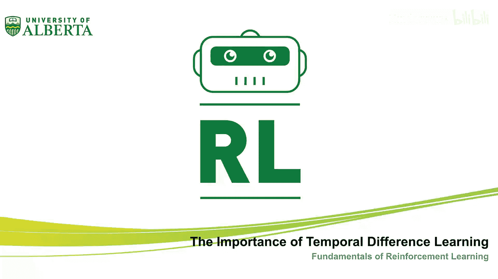

# 015：TD学习的重要性

在本节课中，我们将要学习时间差分学习的重要性。时间差分学习是一种专门用于预测学习的方法，它在人工智能领域扮演着至关重要的角色。

我的名字是理查德·萨顿。我是一名科学家，一生都在研究强化学习。我在阿尔伯塔大学和DeepMind Alberta工作。我的名字拼写是SUTTON，理查德·萨顿。今天，我将讲述时间差分学习的重要性。

时间差分学习是一种专门用于预测学习的方法。这使得它成为本世纪人工智能领域最重要的事物之一。我们知道，我们专注于那些能够随计算能力扩展的方法。近年来，计算能力大幅提升，因此这些方法的影响力也变得更大。在各种学习类型中，**预测学习**是随计算能力扩展得最彻底、最广泛的一种。

## 预测学习的可扩展性

上一节我们提到了预测学习的重要性，本节中我们来看看它为何如此可扩展。预测学习意味着你试图预测接下来会发生什么。你做出一个预测，然后等待并观察实际发生的情况。当你得知结果后，你就进行学习。正因为你只需要等待，你不需要训练数据集，也不需要人们做大量准备工作，甚至不需要明确的学习目标。学习预测是**最具可扩展性**的一种学习方式。

时间差分学习是一种专门为学习预测而设计的学习方法。那么，学习预测有什么特别之处呢？一个特点是时间的流逝。你做出一个预测，实际上是在每个时刻做出一系列预测。然后，当你发现实际发生了什么时，你就知道了所有这些预测的正确答案。为了处理这种时间结构带来的后果，你需要专门的学习规则，这就是我们拥有时间差分学习的原因。

## 与监督学习的对比

现在，我相信你已经学习或听说过监督学习方法。监督学习意味着存在某种监督者告诉你答案是什么。这可能发生在学校里，但在正常生活中，我们并没有监督者或指导者告诉我们该做什么。然而，在预测学习中，我们有。在预测学习中，你做出预测，然后只需等待，就会发现发生了什么。

这非常特别。你可能会说，预测学习是**有监督的**，因为你等待并发现结果，这指导了你。但你也可以说它是**无监督的**，因为你不需要监督者，你只是等待并通过事件的自然进程发现你应该说什么。因此，我有时喜欢认为预测学习是**无监督的监督学习**。

请记住，时间差分学习是一种专门用于**多步预测学习**的方法。关于监督学习，我还想说一点：你可能经常听到监督学习被描述为预测学习，在某种意义上确实如此。但在最重要的意义上，它不是。监督学习是你做出预测，然后被告知答案是什么，而不是你必须等待并观察实际发生的情况。监督学习完全基于训练集。或者，在一种特殊情况下，即你只尝试预测一步时，预测学习可以被视为传统的监督学习问题：你做出预测，等待一步，看到结果。然而，我们的大多数预测都不是一步预测，比如预测今天晚些时候或一秒钟后会发生什么。一步可能被认为是十分之一秒。当然，我们会在十分之一秒的时间尺度上做预测，但在我们的生活中，**更长期**的预测要重要得多。

## 在自然系统中的体现

既然预测学习和时间差分学习如此重要，你可能会预期它会在自然系统、动物和人类中出现。这几乎是我们人工智能领域发展的一个附带发现，但事实是，时间差分学习在动物学习理论，特别是奖励系统理论中，扮演了主要角色。

以下是时间差分学习在神经科学中的体现：

*   **标准模型**：时间差分模型现在是大脑奖励系统的标准模型。
*   **神经信号**：我们可以在大脑中观察到与时间差分误差相对应的信号，这些信号似乎驱动着学习，正如时间差分学习模型所预测的那样。
*   **多巴胺的作用**：在动物和哺乳动物中，传递时间差分误差信号的物质是**多巴胺**神经递质。
*   **其他生物**：在其他动物中，例如蜜蜂，传递时间差分误差信号的物质被称为**章鱼胺**。但本质上它们是相同的，即使在这些非常不同的动物系统（昆虫、哺乳动物、灵长类动物，甚至海蛞蝓）中也是如此。

我想再多说一点关于工程学或人工智能学习模型与自然学习系统的心理学模型之间的关系。这种联系有时可能被夸大，但我仍然为时间差分学习在人工智能和心理学/神经科学中都是一个严肃而重要的话题感到自豪。因为它在这些各自独立的领域中都因其**不同**的成功标准而受到重视。在人工智能领域，我们庆祝时间差分学习，因为它是一种强大且广泛适用的学习方法。在神经科学领域，他们庆祝时间差分学习，因为它能准确建模和预测动物行为。

## 总结

本节课中我们一起学习了时间差分学习的核心地位。所有这些都归结为预测学习。预测学习是人工智能的关键。预测学习是最重要的一种学习类型。而时间差分学习是一种专门的方法，它利用了学习预测的**时间结构**。

非常感谢。以上就是相关的内容。