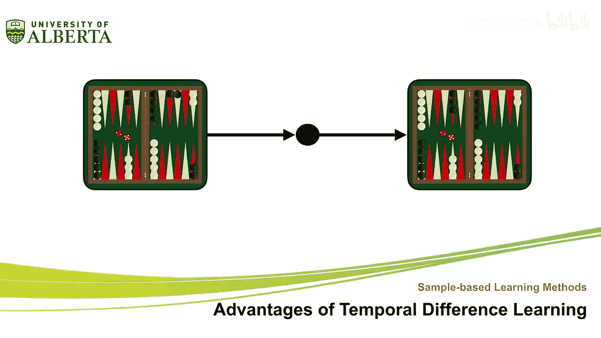

# 016：时序差分学习的优势

在本节课中，我们将要学习时序差分（TD）学习方法的优势。我们将通过一个日常生活中的例子，对比TD方法与动态规划和蒙特卡洛方法的不同，并理解TD如何实现更高效、更灵活的在线学习。

## 回顾与引入

上一节我们介绍了时序差分学习的基本概念。TD方法巧妙地结合了动态规划和蒙特卡洛方法的核心思想。与动态规划类似，TD方法使用**自举法**；与蒙特卡洛方法类似，TD方法能够**直接从经验中学习**。这种结合产生的效果比两者简单相加更为强大。

本节中，我们将通过一个具体案例，来深入理解TD学习的优势。

## 案例分析：下班回家

让我们考虑一个预测下班回家所需时间的例子。每天你都会根据星期几、天气和其他因素来预测回家所需时间。假设你已经多次开车回家，对各种路况下的剩余时间有了不错的估计。

下图展示了一次回家旅程的预测变化。圆圈中的数字代表你对剩余驾驶时间的预测。

*   离开办公室时，你预测需要 **30分钟**。
*   5分钟后，你驶出停车场，发现下雨了。由于雨天交通较慢，你将剩余时间预测更新为 **35分钟**。
*   又过了15分钟，你比预期更早地驶出高速公路，于是将剩余时间预测更新为 **15分钟**。
*   旅程进行到30分钟时，你被一辆慢车挡住，预测还需要 **10分钟**。
*   10分钟后，你转入家所在的街道，通常从这里到家需要 **3分钟**。
*   3分钟后，你到家了。实际总耗时 **43分钟**。

为了改进我们的预测，我们需要定义奖励。在这个例子中，我们使用**所花费的时间**作为奖励。例如，驶出停车场花了5分钟，这个转移的奖励就是5。

你最初预测需要30分钟，但实际花了43分钟。我们可以从这次经验中学习。

## 蒙特卡洛方法更新

首先，我们看看蒙特卡洛方法如何处理，这里我们使用常数α的蒙特卡洛方法，并设α=1。

在蒙特卡洛方法中，我们朝着**回报**的方向更新估计值，而回报只有在整个回合（到家）结束后才能知道。

以下是使用蒙特卡洛方法的更新过程：

*   **从办公室出发**：实际总耗时43分钟，因此时间0的回报是43。由于α=1，我们将估计值完全更新为实际回报：`V(办公室) = 43`。
*   **从停车场出口出发**：实际剩余耗时38分钟，更新：`V(停车场出口) = 38`。
*   **从高速公路出口出发**：实际剩余耗时23分钟，更新：`V(高速公路出口) = 23`。
*   **被慢车挡住时**：实际剩余耗时13分钟，更新：`V(被慢车挡住) = 13`。
*   **转入家所在街道时**：实际剩余耗时3分钟，更新：`V(家所在街道) = 3`。

蒙特卡洛方法必须等到最终结果（到家）已知后才能开始学习。

## 时序差分方法更新

现在，让我们将时钟倒回，看看TD方法如何进行**在线更新**。TD方法的核心公式是：
`V(S_t) ← V(S_t) + α [ R_{t+1} + γV(S_{t+1}) - V(S_t) ]`
在本例中，折扣因子γ=1，α=1。

以下是TD方法的逐步更新过程：

*   **更新“办公室”的估计值**：
    *   当前估计：`V(办公室) = 30`
    *   获得的奖励：`R = 5` (驶出停车场耗时)
    *   下一状态（停车场出口）的估计值：`V(停车场出口) = 35`
    *   TD目标：`5 + 35 = 40`
    *   TD误差：`40 - 30 = 10`
    *   更新：`V(办公室) ← 30 + 1 * (40 - 30) = 40`

*   **更新“停车场出口”的估计值**：
    *   当前估计：`V(停车场出口) = 35`
    *   获得的奖励：`R = 15` (到达高速公路出口耗时)
    *   下一状态（高速公路出口）的估计值：`V(高速公路出口) = 15`
    *   TD目标：`15 + 15 = 30`
    *   更新：`V(停车场出口) ← 35 + 1 * (30 - 35) = 30`

*   **更新“高速公路出口”的估计值**：
    *   当前估计：`V(高速公路出口) = 15`
    *   获得的奖励：`R = 15` (被慢车挡住耗时)
    *   下一状态（被慢车挡住）的估计值：`V(被慢车挡住) = 10`
    *   TD目标：`15 + 10 = 25`
    *   更新：`V(高速公路出口) ← 15 + 1 * (25 - 15) = 25`

*   **更新“被慢车挡住”的估计值**：
    *   当前估计：`V(被慢车挡住) = 10`
    *   获得的奖励：`R = 10` (转入家所在街道耗时)
    *   下一状态（家所在街道）的估计值：`V(家所在街道) = 3`
    *   TD目标：`10 + 3 = 13`
    *   更新：`V(被慢车挡住) ← 10 + 1 * (13 - 10) = 13`

可以看到，在回家的路上，TD方法就能**实时**地更新每个状态的估计值，而无需像蒙特卡洛方法那样等待最终结果。

## TD方法的优势总结

本节课中我们一起学习了时序差分学习的核心优势。以下是TD方法的主要优点：

*   **无需环境模型**：与动态规划不同，TD方法不需要知道环境的完整模型（如状态转移概率），可以直接从经验中学习。
*   **在线学习**：与蒙特卡洛方法不同，TD方法可以在每个时间步进行更新，无需等待一个回合结束。这使得学习更加及时和高效。
*   **自举法**：通过基于其他估计值（`V(S_{t+1})`）来更新当前估计值，TD方法能够更有效地利用已有知识。
*   **收敛性**：在适当的条件下，TD方法能够渐近地收敛到正确的预测值。
*   **更快的收敛速度**：通常，TD方法比蒙特卡洛方法收敛得更快。我们将在下一个视频中看到一个具体的例子。

总之，时序差分学习通过结合动态规划的自举思想和蒙特卡洛的从经验学习能力，提供了一种强大且高效的强化学习方法，特别适用于需要在线、增量式学习的场景。