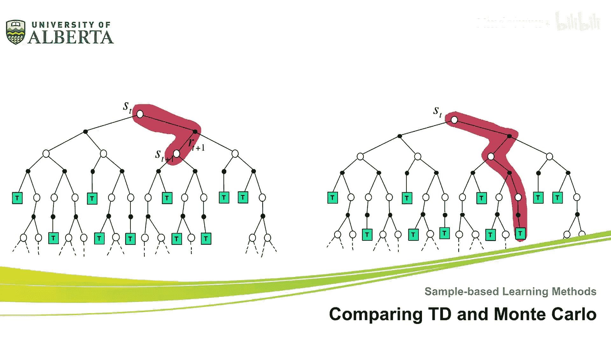
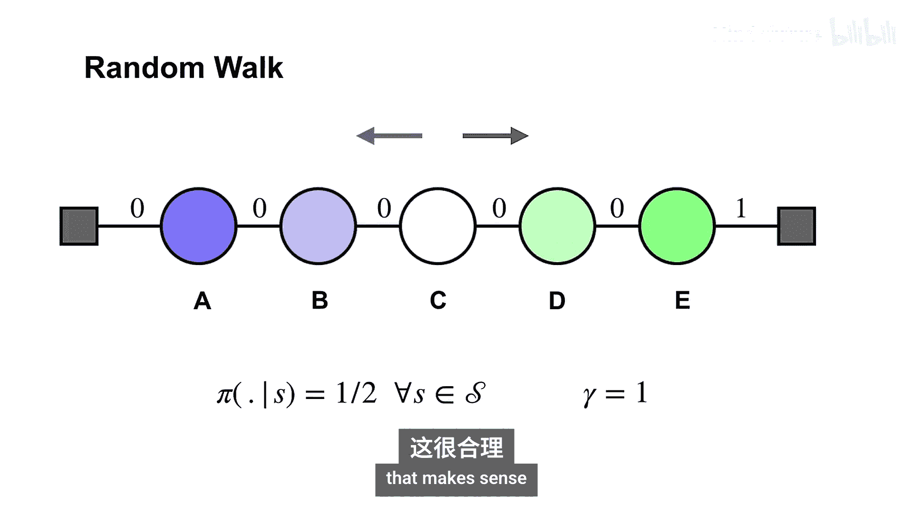
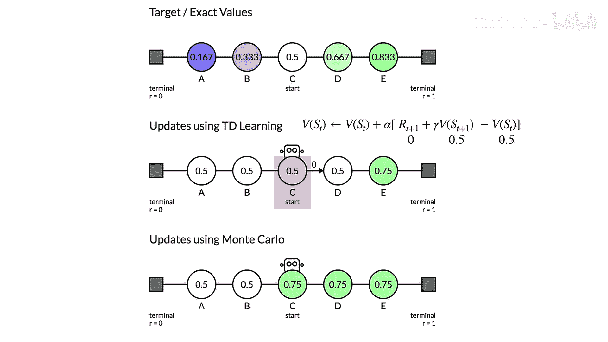
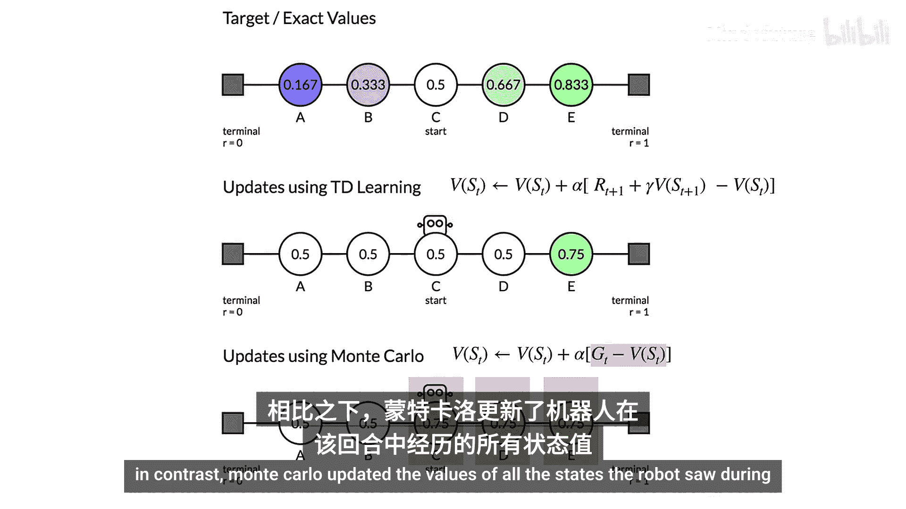
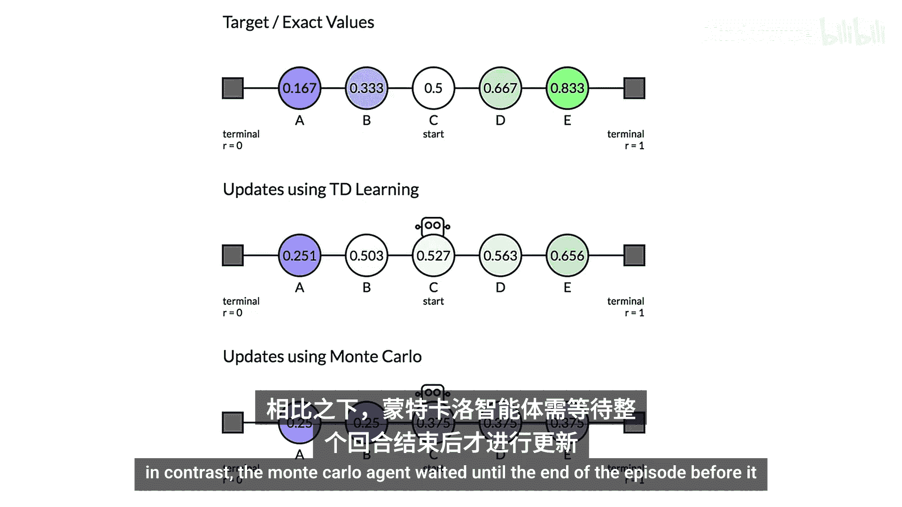
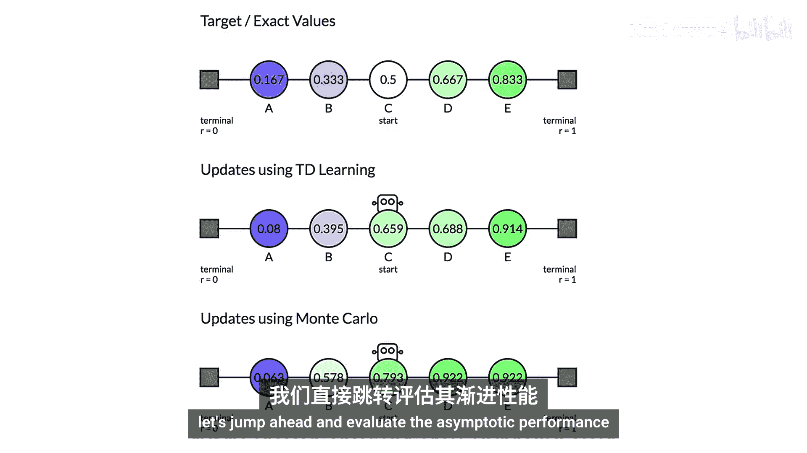
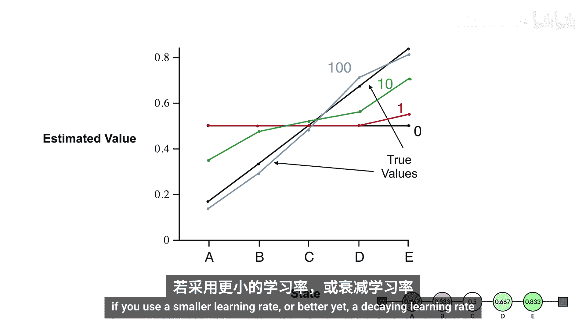
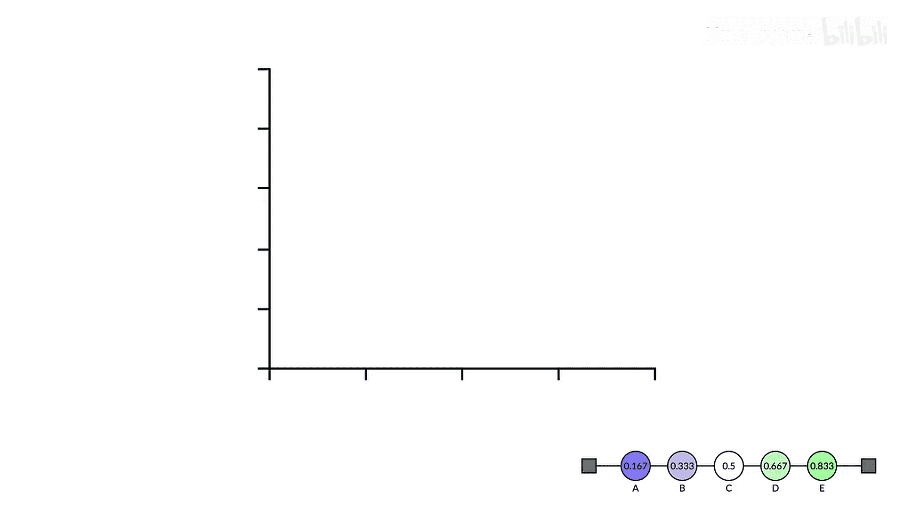
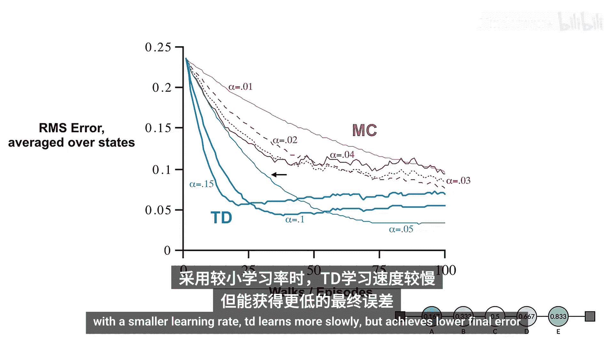
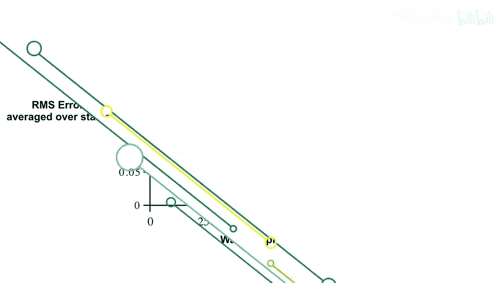

# 017：比较TD和蒙特卡洛

在本节课中，我们将深入比较时序差分学习与蒙特卡洛方法。我们将通过一个精心设计的实验，直观地展示两者在估计值函数时的差异与性能表现。课程结束时，你将能够识别TD学习在实践中的优势。

在之前的视频中，我们介绍了时序差分学习，并讨论了它相对于动态规划和蒙特卡洛方法的优点。本节中，我们将通过一个科学实验来更深入地比较TD和蒙特卡洛。

## 🧪 实验环境设置

考虑一个简单的马尔可夫决策过程，它有五个非终止状态。在每个状态中，有两个确定性的动作：向左和向右。我们的目标是评估一个均匀随机策略的值函数。

所有回合都从状态C开始，并在最左侧或最右侧终止。除了在右侧终止时获得+1奖励外，所有状态转移的奖励均为0。我们将折扣因子γ设置为1。

在这个问题中，状态值具有直观的含义：每个状态的值是从该状态出发，最终在右侧终止的概率。起始状态C的值是0.5，这意味着从中心开始随机游走，有50%的概率在右侧终止。

## 🤖 实验过程：第一回合

现在开始实验。我们在幻灯片顶部标注了MDP各状态的**真实值**。一个使用TD学习的智能体（我们可爱的小机器人）和一个使用蒙特卡洛方法的智能体，将分别估计值函数。我们将两个智能体的**初始近似值函数**都设为0.5。

以下是第一回合中两个智能体的表现观察：

*   **TD智能体**：仅更新了状态E的值。这是因为在非终止转移（如从C到D）中，TD误差为0（奖励0 + 下一状态值0.5 - 当前状态值0.5），所以不更新。只有在转移到终止状态时（从E到右侧终止），TD误差非零，才会更新状态E的估计值。
*   **蒙特卡洛智能体**：更新了机器人在该回合中访问过的所有状态的值。它需要等待回合结束，获得完整的回报后，才能进行更新。

## 🔄 实验过程：后续回合

让我们观察下一个回合。注意值在回合中是如何更新的。

最终，TD智能体在每一步都进行了更新。相比之下，蒙特卡洛智能体仍然需要等到回合结束后才进行更新。

再看几个回合，TD智能体的值估计似乎正在向真实值移动。这个过程可能较长，让我们直接评估它们的**渐近性能**。

## 📊 学习过程可视化

我们在学习过程中的几个时间点绘制了估计值。X轴代表MDP中的每个状态，Y轴代表估计值。图中也标出了真实值和初始估计值（均为0.5）。

*   红色曲线显示了第一回合结束后的学习值。正如我们讨论的，TD只更新了一个状态的值。
*   100回合后的估计值已经接近它们能达到的最佳水平。需要注意的是，我们使用了**恒定步长α=0.1**，这意味着估计值会因最近回合的结果而波动。如果使用更小的学习率，或者更好的**衰减学习率**，可能会得到更精确的估计。

## ⚖️ TD vs. 蒙特卡洛：学习速度比较

一个自然的问题是：TD学习是否比蒙特卡洛更快？

让我们在我们的示例问题上比较TD和蒙特卡洛的性能。

下图展示了比较结果。X轴代表回合数，Y轴代表值函数与学习估计值之间的**均方根误差**。

*   红色学习曲线代表了蒙特卡洛方法在不同α值下的性能，每条曲线是100次独立运行的平均结果。
*   现在看TD的性能。我们看到TD的表现始终优于蒙特卡洛。

让我们更仔细地观察。注意，学习率为0.15时，误差下降更快，但最终误差更高。使用更小的学习率时，TD学习速度更慢，但能达到更低的最终误差。

## 📝 总结

本节课中，我们一起学习了如何通过一个精心设计的实验来比较TD学习和蒙特卡洛方法。实验结果表明，在这个特定问题中，**TD学习收敛更快，并且能达到更低的最终误差**。

我们看到了TD利用**时序差分误差**进行在线、增量更新的优势，而蒙特卡洛方法则需要等待整个回合结束。这种差异使得TD在样本效率上往往表现更佳。