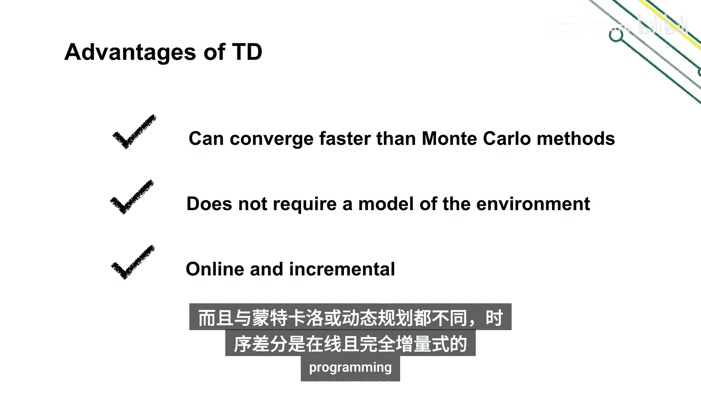

# 019：时序差分学习总结 🎯

在本节课中，我们将总结第二周关于时序差分学习的关键内容。我们将回顾TD学习的核心思想，并将其与动态规划和蒙特卡洛方法进行比较，最后展望后续的学习方向。

## 引导：结合动态规划与蒙特卡洛的优点 🧠

上一节我们介绍了蒙特卡洛方法，本节中我们来看看时序差分学习。TD学习结合了动态规划和蒙特卡洛方法各自的优点。

我们从动态规划中借鉴了一个重要概念，称为**引导**。TD更新朝着一个引导回报进行。我们可以将时间步T之后的回报替换为**奖励加上对下一个状态价值的估计**。

公式表示为：
`V(St) ← V(St) + α [Rt+1 + γV(St+1) - V(St)]`

我们说TD从一个猜测更新到另一个猜测，它将其价值估计引导至下一个状态的价值。

## 表格型TD(0)算法 📊

以下是TD(0)算法的核心特点：

TD可以在情节的每一步更新其价值估计。它不必等待情节结束，只需要记住前一个状态。

与蒙特卡洛和动态规划相比，TD通常比蒙特卡洛收敛得更快。与动态规划不同，TD不需要环境模型。此外，TD是在线的且完全增量的，这与蒙特卡洛或动态规划都不同。

## TD预测更新过程 🚗

我们学习了TD如何在其接收新信息时更新预测。我们通过预测下班回家所需时间来演示这一点。

我们使用TD在开车回家的每个阶段不断优化预测的到达时间。TD根据每一步的实际体验即时调整预期。

## 实验比较：TD vs 蒙特卡洛 📈

最后，我们在随机游走任务上进行了比较TD和蒙特卡洛的实验。

在每次状态转移时，TD更新其价值函数以反映最新信息。相比之下，蒙特卡洛仅在每个情节结束时更新其价值函数。

从长期来看，TD比蒙特卡洛学习得更快，并达到了更好的最终误差水平。

## 总结与展望 🌟

本节课中我们一起学习了时序差分学习的核心原理。我们了解了TD如何通过引导结合动态规划和蒙特卡洛的优点，掌握了TD(0)算法的在线更新机制，并通过实际例子和实验看到了TD相对于蒙特卡洛的效能优势。

在接下来的课程中，我们将使用TD构建控制算法。期待在后续课程中继续深入学习。