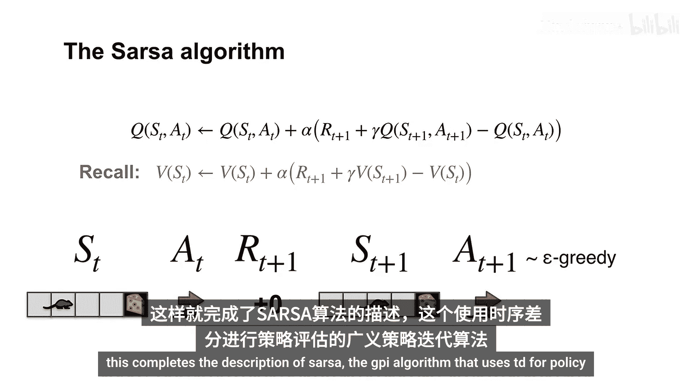

# 020：Sarsa - 使用TD的GPI

在本节课中，我们将学习如何将时序差分（TD）学习与广义策略迭代（GPI）框架相结合，以寻找改进的策略。我们将重点介绍Sarsa控制算法，这是一种利用TD学习进行策略评估的GPI方法。

## 广义策略迭代回顾

上一节我们介绍了广义策略迭代（GPI）的基本概念，它结合了策略评估和策略改进两个部分。

我们首先看到的具有这种形式的算法是策略迭代。策略迭代在策略改进之前，会运行策略评估直至收敛。

随后，我们看到了使用蒙特卡洛方法的GPI，它在每个幕（episode）结束后执行一次策略评估和改进的循环。

为了更好地理解蒙特卡洛GPI，可以想象一只老鼠在一个四状态的走廊里，尽头有奶酪。老鼠最初一无所知，遵循随机策略。最终，老鼠会通过随机移动偶然碰到奶酪。在那一刻，老鼠会更新其动作价值函数。然后，它根据其动作价值函数进行贪心化来改进策略。随着这个过程重复，它最终将学会最优策略。

需要注意的是，蒙特卡洛GPI在改进之前并不执行完整的策略评估步骤。相反，它在每个幕之后进行评估和改进。更进一步，我们甚至可以在仅仅一次策略评估步骤后就改进策略。我们将使用TD学习来实现这一点。

## 在GPI中使用TD学习

为了在GPI中使用TD学习，我们需要学习一个动作价值函数。因此，我们需要看一个与你过去所见略有不同的TD版本。

我们不再关注从状态到状态的转移并学习每个状态的价值，而是关注从“状态-动作”对到“状态-动作”对的转移，并学习每个“状态-动作”对的价值。这个算法被称为**Sarsa预测**。

让我们更详细地了解一下它。

## Sarsa预测算法详解

Sarsa这个缩写描述了更新中所使用的数据：**S**tate（状态）、**A**ction（动作）、**R**eward（奖励）、next **S**tate（下一个状态）、next **A**ction（下一个动作）。

Sarsa对“状态-动作”对的价值进行预测。以下是其工作流程：

1.  智能体在初始状态选择一个动作，从而创建第一个“状态-动作”对。
2.  接着，它在当前状态下执行该动作，并观察到奖励 `R_{t+1}` 和下一个状态 `S_{t+1}`。
3.  在Sarsa中，智能体在更新其价值估计之前，需要知道其下一个“状态-动作”对。这意味着它必须在更新前确定下一个动作。
4.  由于我们的智能体正在为特定策略学习动作价值，它使用该策略来采样下一个动作。

以下是完整的更新公式：
`Q(S_t, A_t) ← Q(S_t, A_t) + α [R_{t+1} + γ Q(S_{t+1}, A_{t+1}) - Q(S_t, A_t)]`

这个公式看起来与状态价值的TD更新非常相似，只是状态价值 `V(S)` 被替换为了动作价值 `Q(S, A)`。

我们刚刚描述的算法是用于**策略评估**的，它为某个特定的固定策略学习动作价值。然而，得益于GPI框架，我们可以将其转变为一个**控制**算法。这次，我们将在每个时间步改进策略，而不是在一个幕之后或收敛之后。

## 从评估到控制：Sarsa控制

将Sarsa预测嵌入GPI框架，就得到了Sarsa控制算法。其核心思想是：在每一步，我们使用当前的策略（通常是ε-贪心策略）来选择动作 `A_t` 和 `A_{t+1}`，然后使用上述Sarsa更新公式来改进动作价值函数 `Q` 的估计。同时，我们根据更新后的 `Q` 函数来持续改进策略（例如，使ε-贪心策略基于最新的 `Q` 值）。

这完成了对**Sarsa**的描述，这是一种使用TD进行策略评估的GPI算法。

## 总结

本节课中，我们一起学习了如何将广义策略迭代与时序差分学习相结合，以寻找改进的策略。

**Sarsa控制算法**是GPI与TD学习结合的一个典型例子。它通过在线地、逐步地评估和更新“状态-动作”对的价值，并同步改进策略，最终能够学习到接近最优的策略。与蒙特卡洛方法相比，Sarsa能够更及时地利用新经验，通常具有更快的收敛速度。