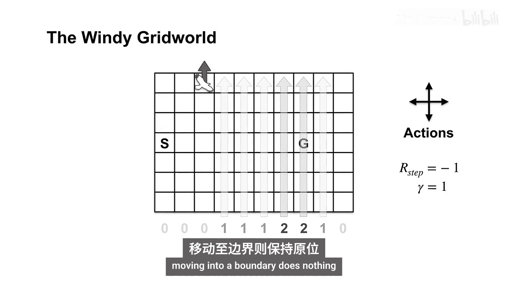
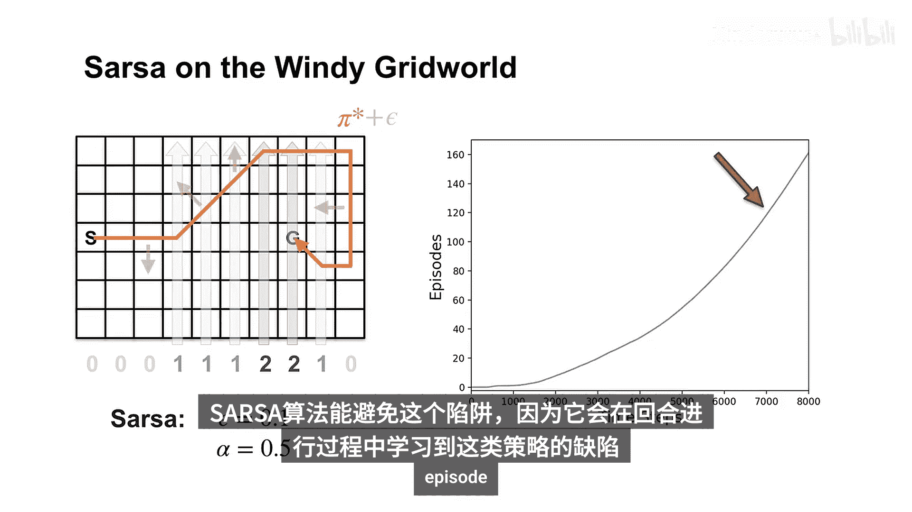

# 021：有风网格世界中的Sarsa

## 概述
在本节课中，我们将学习Sarsa控制算法在一个具体示例——有风网格世界中的实际运行过程。我们将分析算法的性能，并理解其学习机制。

## 有风网格世界介绍
上一节我们介绍了Sarsa算法的基本概念，本节中我们来看看它在一个具体环境中的应用。这个环境是一个有风网格世界，它在标准网格世界的基础上增加了一个特殊机制。

有风网格世界的状态构成一个网格，其中包含一个起始状态和一个终止状态。智能体可以在四个常规方向（上、下、左、右）移动。智能体每走一步会获得-1的奖励，这激励它尽快到达终点。由于这是一个分幕式任务，折扣因子γ设为1。

这个环境的特殊之处在于风。当智能体从某些特定状态移动时，风会将其向上吹。每个状态的风力强度取决于其所在的列。例如，如果智能体在一个风力强度为1的列中执行向左的动作，它会先向左移动一格，然后再被风向上吹一格。如果移动会撞到边界，则该移动无效。

## 应用Sarsa算法
现在，我们将Sarsa算法应用于这个任务。我们将使用ε-贪心策略进行动作选择。

以下是本示例中使用的参数：
*   **ε (epsilon)**: 0.1
*   **α (alpha)**: 0.5
*   **初始Q值**: 0

ε值为0.1意味着智能体平均每10步会随机选择一个动作（探索）。初始Q值设为0是乐观的，这有助于鼓励系统性的探索。

## 算法性能分析
这张图展示了在每个时间步之后，已完成的总幕数。结果是经过100次运行平均后的数据。

请注意，最初的几幕需要数千步才能完成。曲线逐渐变陡，表明完成每幕所需的时间越来越短。在大约7000步之后，贪心策略停止改进，幕完成率停止增长。这意味着智能体的策略在最优策略附近徘徊，但由于探索的存在，不会完全精确地达到最优。

## 与蒙特卡洛方法的对比
值得注意的是，蒙特卡洛方法在这里可能不太适用。这是因为许多策略无法到达终止状态。蒙特卡洛方法只有在一幕终止时才能进行学习，因此一个糟糕的策略可能会让智能体陷入困境，永远无法在这个网格世界中学习到一个好的策略。

例如，如果策略在起始状态总是选择向左的动作，智能体将永远无法到达终点。Sarsa算法避免了这种陷阱，因为它可以在幕中进行学习，及时认识到糟糕策略的后果，从而切换到其他策略，不会被困住。

## 总结
本节课中，我们一起学习了Sarsa控制算法在一个具体MDP示例——有风网格世界中的运行。我们分析了Sarsa的性能曲线，理解了其学习过程，并通过与蒙特卡洛方法的对比，认识了Sarsa在线学习、能及时更新策略的优势。