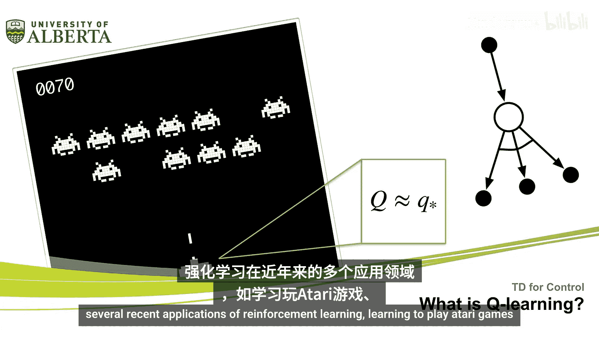
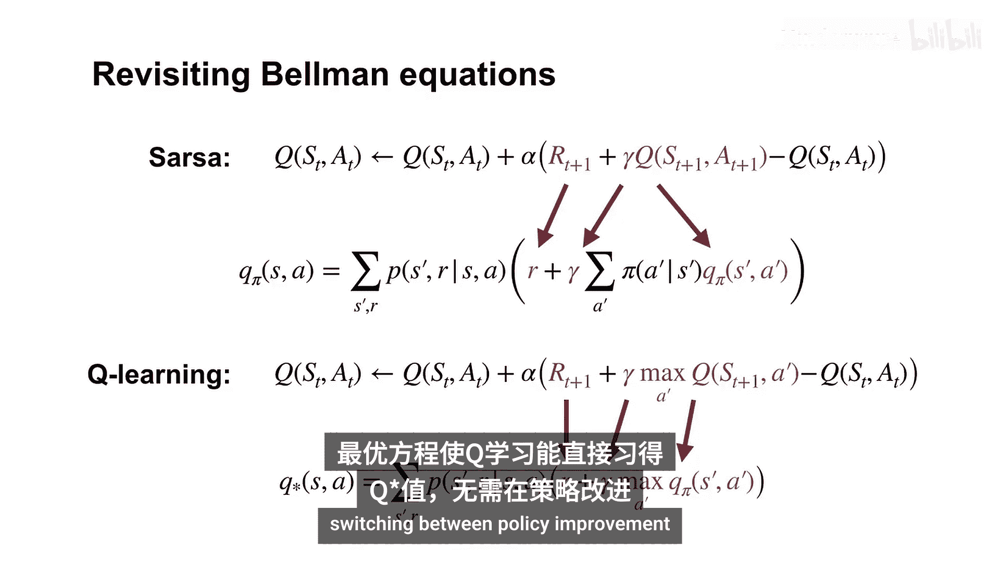

# 022：什么是Q-学习

在本节课中，我们将学习Q-学习算法，并解释它与贝尔曼最优方程之间的关系。

## Q-学习算法简介

Q-学习算法于1989年被提出，是最早的主要在线强化学习算法之一。近年来，许多强化学习的应用，例如学习玩雅达利游戏、控制交通信号灯，甚至自动配置网络系统，都建立在这一单一算法之上。

## Q-学习伪代码解析

以下是Q-学习算法的伪代码格式，其中包含了一些我们已经熟悉的元素。

智能体在一个状态中选择一个动作，执行该动作，然后观察下一个状态和奖励。接着，智能体进行一次更新，并重复这个循环。

在众多熟悉的元素中，Q-学习的新颖之处在于其动作价值更新方式。

在更新中，目标值是 `Rt+1 + γ * max(Q(St+1, a))`。这与SARSA算法不同，SARSA在其目标值中使用的是下一个“状态-动作”对的价值。

## Q-学习与贝尔曼最优方程

为什么Q-学习使用最大值，而不是下一个“状态-动作”对的价值？这种联系可以追溯到动态规划的内容。

观察SARSA的更新方程，它与动作价值的贝尔曼方程惊人地相似。实际上，SARSA是一种基于样本的算法，用于求解动作价值的贝尔曼方程。

Q-学习同样使用来自环境的样本来求解一个贝尔曼方程。但它使用的不是标准的贝尔曼方程，而是**动作价值的贝尔曼最优方程**。

最优方程使Q-学习能够直接学习最优动作价值函数 `Q*`，而无需在策略改进和策略评估步骤之间切换。

## Q-学习与值迭代

尽管SARSA和Q-学习都基于贝尔曼方程，但它们基于的是非常不同的贝尔曼方程。

SARSA是**策略迭代**的基于样本的版本，它使用依赖于固定策略的动作价值贝尔曼方程。

Q-学习是**值迭代**的基于样本的版本，它迭代地应用**贝尔曼最优方程**。

应用贝尔曼最优方程会严格改进价值函数，除非它已经是最优的。因此，值迭代会持续改进其价值函数估计，并最终收敛到最优解。

基于同样的原因，只要智能体持续探索并对状态-动作空间的所有区域进行采样，Q-学习也会收敛到最优价值函数。

## 总结

本节课中，我们一起学习了Q-学习算法，并描述了它与贝尔曼最优方程之间的紧密联系。Q-学习通过直接应用最优方程，能够高效地学习到最优策略。