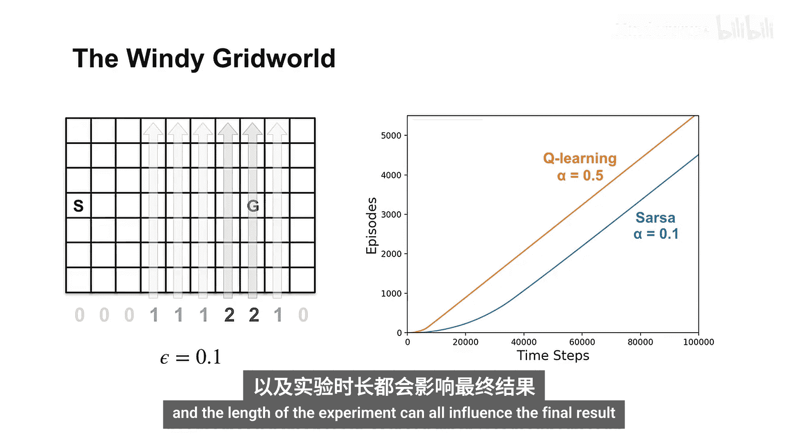

# 023：有风网格世界中的Q-学习

在本节课中，我们将学习如何将Q-学习算法应用于有风网格世界环境，并通过与SARSA算法的对比，深入理解两种算法的性能差异与特点。

## 概述

上一节我们介绍了Q-学习的基本概念。本节中，我们将在有风网格世界这个具体环境中演示Q-学习的应用，并分析其结果。通过本次学习，你将直观地理解Q-学习在一个简单马尔可夫决策过程中的表现，并洞察Q-学习与SARSA算法之间的核心区别。

## 实验环境：有风网格世界

我们回到有风网格世界环境。这是一个无折扣的网格世界，在某些“有风”的状态中，智能体移动时会受到向上的风力影响。网格每一列下方的数字代表了该列的风力强度。

智能体可以在四个方向移动，每一步都会获得-1的奖励。

## 对比基准：SARSA算法表现

为了进行对比，我们首先展示SARSA算法在参数ε=0.1（探索率）和α=0.5（学习率）下的表现。下图展示了学习曲线，其中Y轴是完成的幕数，X轴是时间步数。

SARSA在最初几幕学习缓慢，随后呈指数级改进，最后进入平台期。

## Q-学习实验与预测

现在，我们使用相同的参数设置（ε=0.1， α=0.5）来运行Q-学习算法。

在展示结果之前，让我们先思考一下可能会发生什么。SARSA的策略可能表现更好，因为它的价值函数考虑到了其ε-贪婪行为。Q-学习可能学得更快，因为它直接学习最优策略的价值函数。

你认为会发生什么？

## 结果分析：Q-学习 vs. SARSA

以下是实验结果。在开始时，两种算法以相似的速度学习。在后期，Q-学习似乎学到了一个更好的最终策略。

为什么Q-学习在这里表现得更好？在没有进行更有针对性的实验之前，我们无法完全确定。一种可能是Q-学习的更新目标更稳定。Q-学习对下一个动作的价值取最大值，因此只有当智能体学到某个动作确实优于其他动作时，更新才会发生改变。相比之下，SARSA使用下一个动作价值的估计值作为目标，每当智能体采取探索性动作时，这个目标就会改变。

或许你可以设计一个实验来彻底弄清这个问题。现在，让我们继续。

## 优化SARSA的表现

对于这个实验，步长参数α=0.5可能有点过高。当智能体采取探索性动作时，这些大幅度的更新可能会给SARSA带来麻烦。SARSA的最终策略显然不是最优的。

让我们将实验运行得更久一些，这次将α设置为0.1。我们预期SARSA在更小的α下会学得更慢，但能找到更好的策略。看看发生了什么。

预测得到了证实。SARSA学到了与Q-学习相同的最终策略，但速度更慢。我们知道两种算法都收敛到了相同的策略，因为两条线的斜率变得相等。相等的斜率意味着两个智能体以相同的速率完成每一幕。

## 参数选择的影响

这个实验也凸显了强化学习中参数选择的影响。学习率α、探索率ε、初始值以及实验的长度，都可能影响最终的结果。

## 总结

本节课中，我们一起在有风网格世界环境中评估了Q-学习算法。通过对比实验，我们深入了解了Q-学习与SARSA在这个简单MDP上的表现差异，并认识到算法参数对学习效果的重要影响。