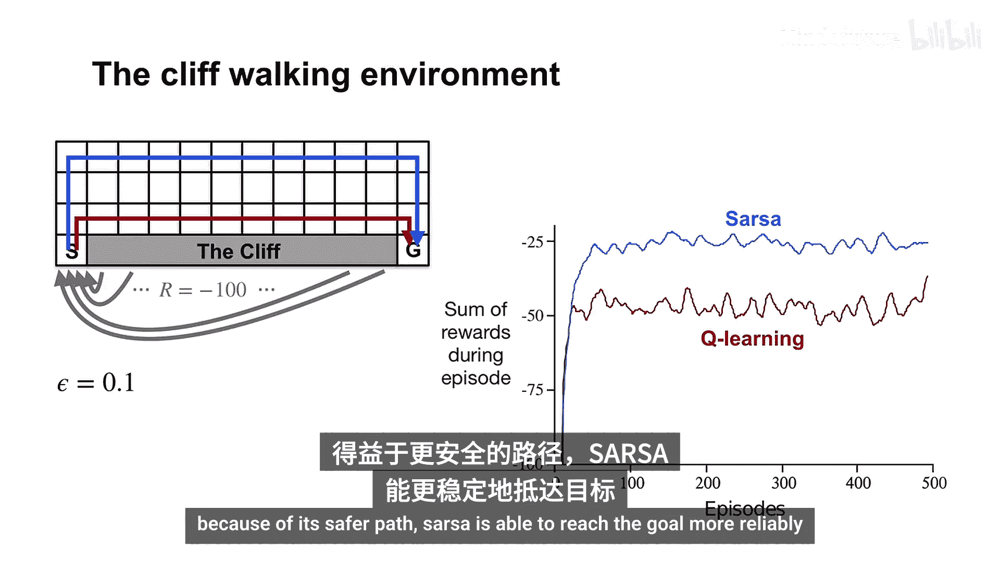

# 024：Q-学习如何成为离线策略算法

在本节课中，我们将要学习Q-学习算法如何在不使用重要性采样的情况下，实现离线策略学习。我们还将探讨在线策略与离线策略学习在控制任务中的性能差异。

上一节我们介绍了离线策略算法通常需要使用重要性采样来修正行为策略与目标策略之间的差异。本节中我们来看看Q-学习如何绕开这一步骤。

## Q-学习的离线策略本质

Q-学习是一种离线策略算法，但我们之前所见的离线策略算法都使用了重要性采样。Q-学习如何在不使用重要性采样的情况下实现离线策略学习？让我们深入探讨。

Q-学习之所以是离线策略的，核心在于其更新目标。在SARSA算法中，智能体根据其行为策略将要采取的下一个动作的价值进行自举更新。而Q-学习则根据其下一个状态中**最大的动作价值**进行自举更新。

这相当于从一个对最优策略的估计中采样动作，而不是从行为策略中采样。由于Q-学习学习的是它**可能采取的最佳动作**的价值，而不是它**实际采取的动作**的价值，因此它是在进行离线策略学习。

## 目标策略与行为策略

分析任何强化学习算法时，一个自然的问题是：它的目标策略和行为策略分别是什么？

*   **目标策略**：Q-学习的目标策略始终是相对于其当前价值函数的贪婪策略。
*   **行为策略**：Q-学习的行为策略可以是任何能在学习过程中持续访问所有“状态-动作”对的策略，例如ε-贪婪策略。

目标策略与行为策略之间的这种差异，证实了Q-学习是离线策略算法。

## 为何无需重要性采样

既然Q-学习是离线策略的，为什么我们看不到任何重要性采样比率呢？

原因在于，智能体是在一个**已知的策略（即贪婪目标策略）下估计动作价值**。它不需要重要性采样比率来修正动作选择上的差异。

动作价值函数 `Q(s, a)` 表示在给定状态下采取每个动作后获得的期望回报。智能体的目标策略 `π(a|s)` 表示在给定状态下采取每个动作的概率。将这两个要素结合，智能体可以计算其目标策略下从任何给定状态（特别是下一个状态 `S_{t+1}`）出发的期望回报。

Q-学习正是利用了这一技术进行离线策略学习。由于智能体的目标策略相对于其动作价值是贪婪的，所有非最大价值的动作概率为零。因此，从该状态出发的期望回报就等于该状态下的最大动作价值。其更新公式如下：

`Q(S_t, A_t) ← Q(S_t, A_t) + α [ R_{t+1} + γ * max_a Q(S_{t+1}, a) - Q(S_t, A_t) ]`

## 在线与离线策略的性能差异

之前我们提到，Q-学习不进行策略评估与策略改进的迭代，而是直接学习最优价值函数。直接学习最优价值函数和策略听起来很棒，但在某些特定情况下，其细微差别可能导致不尽人意的结果。

让我们通过“悬崖行走”的例子来理解其中的一些微妙之处。

悬崖行走环境是一个无折扣的分幕式网格世界，底部边缘是悬崖。在大多数步骤中，智能体获得-1的奖励。然而，掉下悬崖会使智能体回到起点，并获得-100的奖励。

我们在此环境中比较ε=0.1的Q-学习和SARSA算法的性能。

以下是两种算法的表现分析：

*   **Q-学习**：由于Q-学习直接学习最优价值函数，它很快学会最优策略是紧贴悬崖边缘行走。然而，由于其行为是ε-贪婪的，紧贴悬崖行走偶尔会导致掉下悬崖。
*   **SARSA**：SARSA学习其当前策略的价值，并考虑了ε-贪婪动作选择的影响。考虑到偶尔的探索性动作，它学会了走一条更长但更安全的路径，通常可以避免随机掉下悬崖。

由于其更安全的路径，SARSA能够更可靠地到达目标。

## 总结

本节课中我们一起学习了Q-学习如何在不使用重要性采样的情况下成为离线策略算法。我们还看到，根据具体任务的不同，在线策略学习与离线策略学习在控制性能上可能表现出差异。Q-学习直接追求最优路径，但可能因探索而承担风险；SARSA则学习当前策略下的价值，通常会找到更稳健的解决方案。

