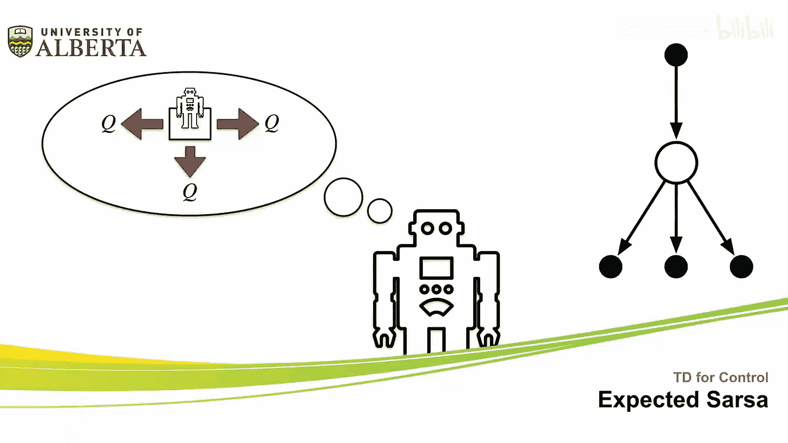
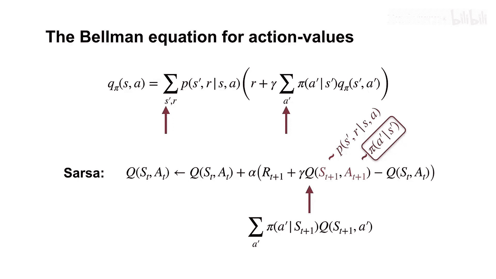
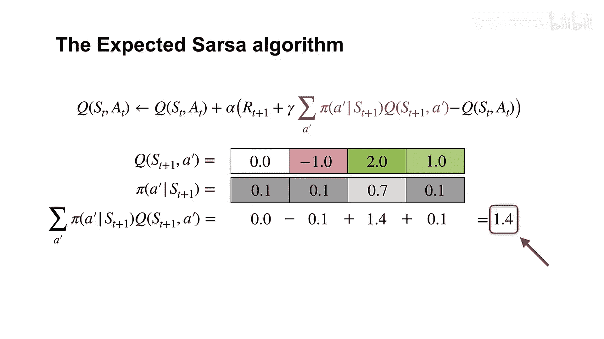
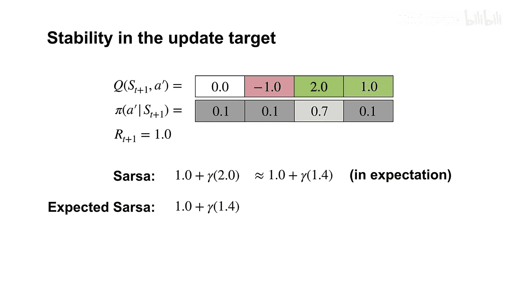
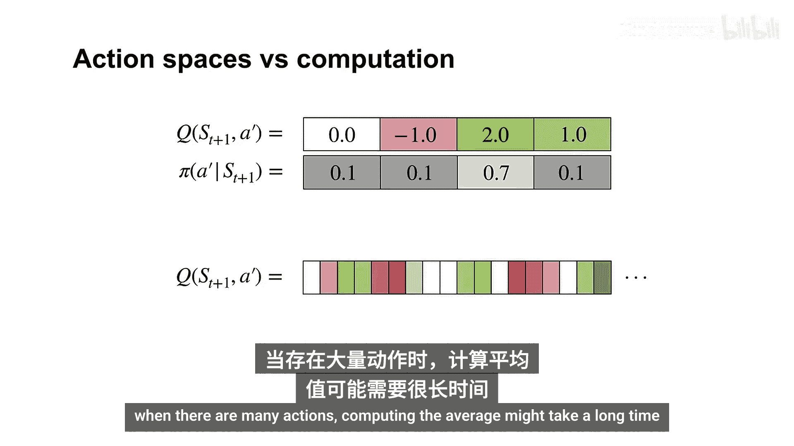
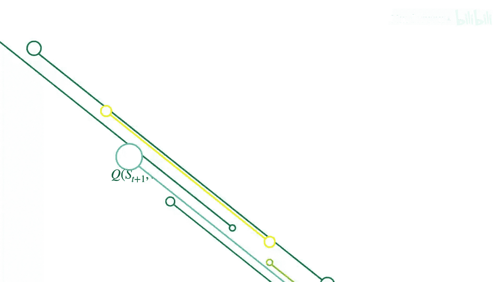

# 025：期望Sarsa 🧠

在本节课中，我们将学习第三种时序差分控制方法——期望Sarsa。我们将了解它与Sarsa和Q学习的区别，理解其核心思想，并分析其优缺点。

上一节我们介绍了Sarsa和Q学习这两种时序差分控制方法。本节中，我们来看看另一种方法：期望Sarsa。

回忆一下动作值函数的贝尔曼方程，其中包含了对下一个“状态-动作”对值的期望。将这个期望展开，我们可以看到它是对所有可能的下一状态和下一动作的求和。

Sarsa通过从环境中采样下一个状态，并从其策略中采样下一个动作来估计这个期望。但智能体已经知道自己的策略，为什么还要对动作进行采样呢？它应该可以直接计算这个期望。在这种情况下，我们可以对所有可能的下一动作的值进行加权求和，权重就是策略下采取每个动作的概率。

显式计算下一动作的期望，就是期望Sarsa算法背后的核心思想。

现在，让我们看看期望Sarsa的学习更新规则。

由于期望Sarsa仍然基于动作值函数的贝尔曼方程，它使用了我们熟悉的学习更新形式。该算法与Sarsa几乎完全相同，唯一的区别在于：时序差分误差使用的是下一动作值的期望估计，而不是下一动作值的样本。

这意味着在每一步，智能体都必须根据策略的概率，对下一状态的动作值进行加权平均。

以下是计算期望值的示例：

假设在某个状态下，策略和动作值如下：
*   采取动作A的概率是0.3，其动作值Q(s', A) = 1。
*   采取动作B的概率是0.7，其动作值Q(s', B) = 2。

那么，期望的下一动作值计算如下：
`期望值 = 0.3 * 1 + 0.7 * 2 = 1.7`

然而，显式计算期望有一个巨大的优势：期望Sarsa的更新目标比Sarsa更稳定。

让我们看一个例子来更清楚地说明这一点。在这个例子中，所有奖励都是确定性的。Sarsa和期望Sarsa都从下一状态的**真实**动作值开始。即使在这种理想情况下，Sarsa对下一个动作的采样也可能导致其更新方向错误。它依赖于在多次更新的期望中方向是正确的。相比之下，期望Sarsa的更新目标是完全正确的，不会将估计值从真实值上移开。

总的来说，期望Sarsa的更新目标方差比Sarsa低得多。但较低的方差也带来了一个缺点：随着动作数量的增加，计算下一动作的平均值会变得更加昂贵。当动作很多时，计算平均值可能需要很长时间，尤其是这个平均值必须在每个时间步都计算。

本节课中，我们一起学习了期望Sarsa算法。我们了解到，该算法通过显式计算其策略下的期望来更新动作值，这虽然比采样更耗费计算资源，但能获得更稳定、方差更低的更新目标。