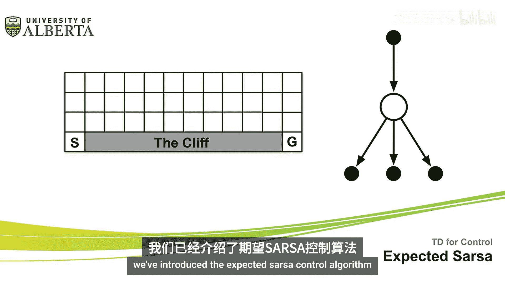
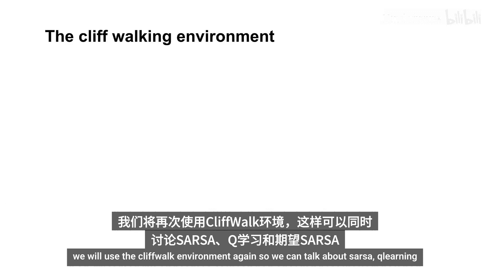
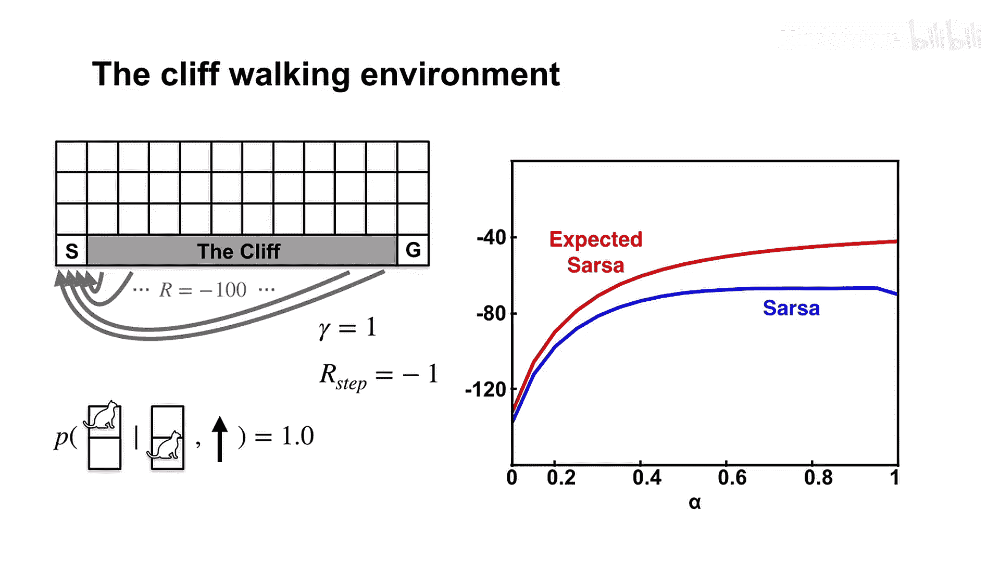
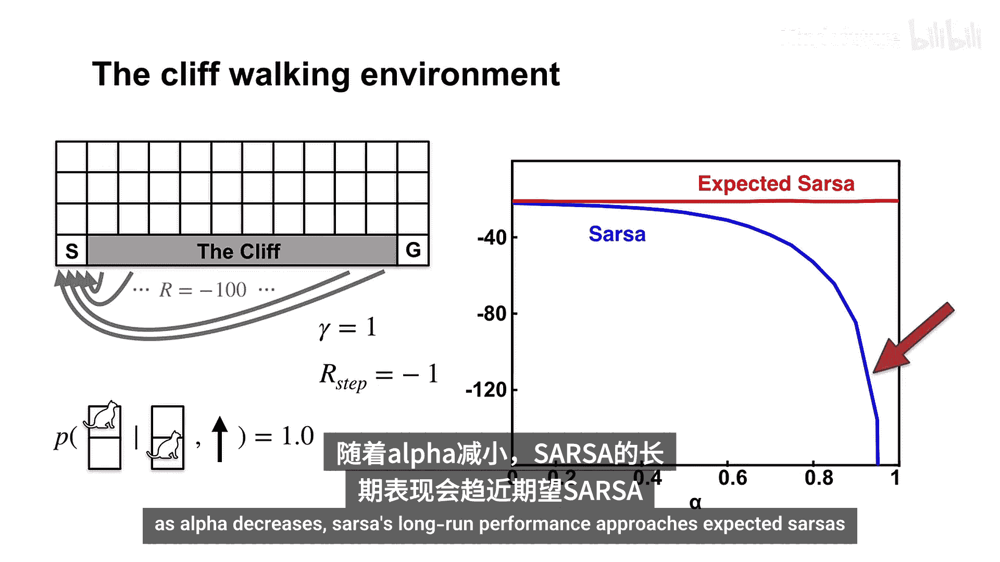

基于样本的学习方法：P26：悬崖世界中的期望Sarsa 🧗

在本节课中，我们将学习期望Sarsa控制算法，并通过一个具体的悬崖行走环境示例，观察其实际表现并与Sarsa算法进行经验性比较。

---

我们已经介绍了期望Sarsa控制算法。现在，是时候看看它的实际表现了。

在本节结束时，你将能够：
*   描述期望Sarsa在悬崖行走环境示例中的行为。
*   通过实验比较期望Sarsa和Sarsa算法。

我们将再次使用悬崖行走环境，以便可以同时讨论Sarsa、Q学习和期望Sarsa。

让我们回顾一下。这个环境是一个无折扣的分幕式网格世界，底部边缘有一片悬崖。走入悬崖会使智能体回到起点，并获得-100的奖励。在其他情况下，每一步的奖励为-1。Sarsa在这个领域表现优于Q学习，因为Sarsa的策略考虑到了自身的探索行为。

今天，我们将比较期望Sarsa与探索率ε=0.1的Sarsa算法。

下图是通过用不同的步长参数α值测试每个智能体而创建的。我们进行了100幕，并在50,000次独立运行中平均了所有结果。Y轴显示每幕的平均回报，X轴显示步长值。

Sarsa的性能随着步长值的增大而提高，但仅在一定范围内。此处Sarsa的最佳α值是0.9。期望Sarsa在几乎所有α值上都优于Sarsa。期望Sarsa能够更有效地利用较大的α值。这是因为它明确地平均了由其自身策略带来的随机性。这个环境是确定性的，因此没有其他随机性来源需要考虑。这意味着对于给定的状态和动作，期望Sarsa的更新是确定性的。而Sarsa的更新，则可能因下一个动作的不同而有显著差异。

现在，让我们看看在100,000幕之后每幕的平均回报。此时，每个算法都已学到了所有能学到的内容。

期望Sarsa的长期行为不受α影响。在这个例子中，它的更新是确定性的。因此，步长只决定了估计值接近其目标值的速度。Sarsa在这里的表现则大不相同。对于较大的α值，它甚至无法收敛。随着α减小，Sarsa的长期性能逐渐接近期望Sarsa。

---

在本节课中，我们一起学习了期望Sarsa算法在悬崖世界中的表现。我们看到，期望Sarsa能够在该环境中快速学习到一个良好的策略，并且相比Sarsa，它对较大的步长参数具有更强的鲁棒性。