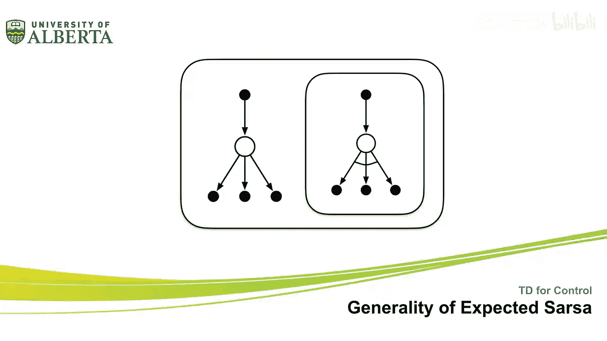
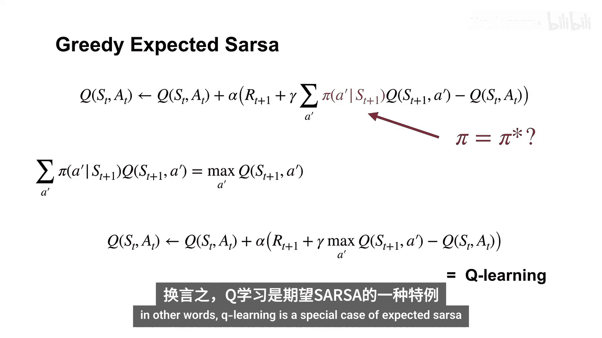

# 027：期望Sarsa的通用性

在本节课中，我们将要学习期望Sarsa算法与Q学习算法之间的关系。我们将看到期望Sarsa如何在不使用重要性采样的情况下进行离策略学习，并解释它如何推广了Q学习算法。

到目前为止，我们已经学习了三种用于控制的时序差分算法：Sarsa、Q学习和期望Sarsa。其中，Sarsa和期望Sarsa都近似于同一个贝尔曼方程。现在，让我们来看看期望Sarsa与Q学习有何关联。

## 期望Sarsa的离策略学习能力

上一节我们回顾了三种时序差分控制算法。本节中，我们来看看期望Sarsa算法的更新规则，并理解其离策略学习的特性。

考虑期望Sarsa的更新公式：
`Q(S, A) ← Q(S, A) + α [R + γ * E[Q(S‘, A’)] - Q(S, A)]`

在**同策略**的情况下，行为策略和目标策略是相同的。下一个动作`A‘`是从策略`π`中采样得到的。然而，请注意，对下一个状态`S‘`中所有可能动作的期望值`E[Q(S‘, A’)]`的计算，是独立于实际在下一个状态中选择的动作`A‘`的。

这意味着，目标策略`π`不一定非要等于行为策略。因此，期望Sarsa和Q学习一样，可以在不使用重要性采样的前提下进行**离策略**学习。

## 期望Sarsa与Q学习的关系

理解了期望Sarsa的离策略特性后，我们进一步探讨它与Q学习的具体联系。关键在于目标策略的选择。

如果目标策略`π`是**贪婪**的，即总是选择当前估计价值最高的动作，那么会发生什么？

在这种情况下，计算期望值时，只有价值最高的动作会被考虑，其概率为1，其他动作的概率为0。因此，期望值`E[Q(S‘, A’)]`就简化为在下一个状态`S‘`中对所有动作价值`Q(S‘, a)`取**最大值**。

这恰好就是Q学习更新目标中的`max`操作。换句话说，**Q学习是期望Sarsa在目标策略为贪婪策略时的一个特例**。

以下是两种算法更新目标的对比：
*   **期望Sarsa（贪婪目标策略）**：`R + γ * max_a Q(S‘, a)`
*   **Q学习**：`R + γ * max_a Q(S‘, a)`

可以看到，此时两者的更新目标完全一致。

## 总结

本节课中，我们一起学习了期望Sarsa算法的通用性。

我们展示了期望Sarsa和Q学习在更新目标中都使用了基于其目标策略的期望值计算，这一特性使得它们都能在不依赖重要性采样的条件下进行离策略学习。

更重要的是，我们明确了当期望Sarsa的目标策略是相对于其动作价值估计的贪婪策略时，它就完全等同于Q学习算法。因此，期望Sarsa是比Q学习更一般化的算法形式。