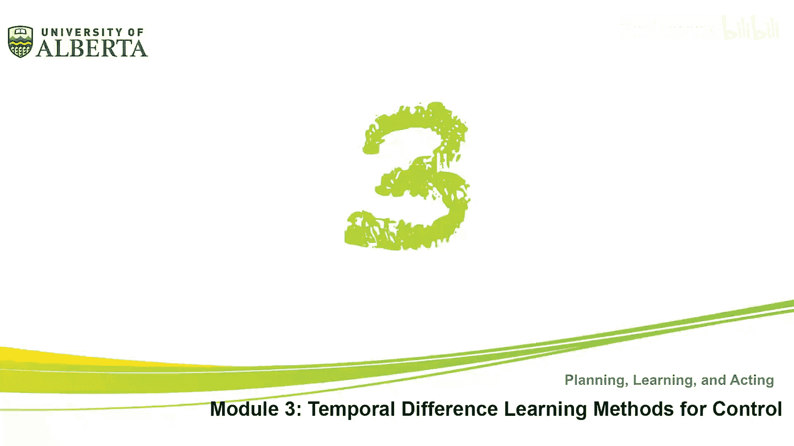
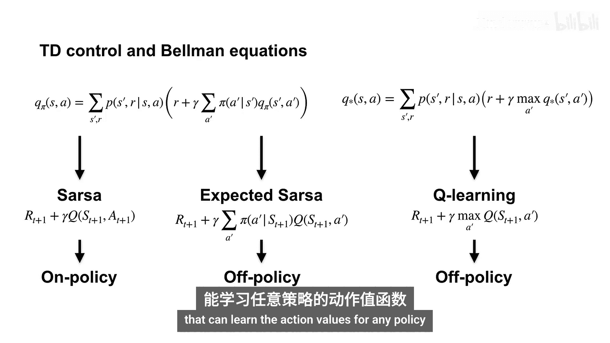
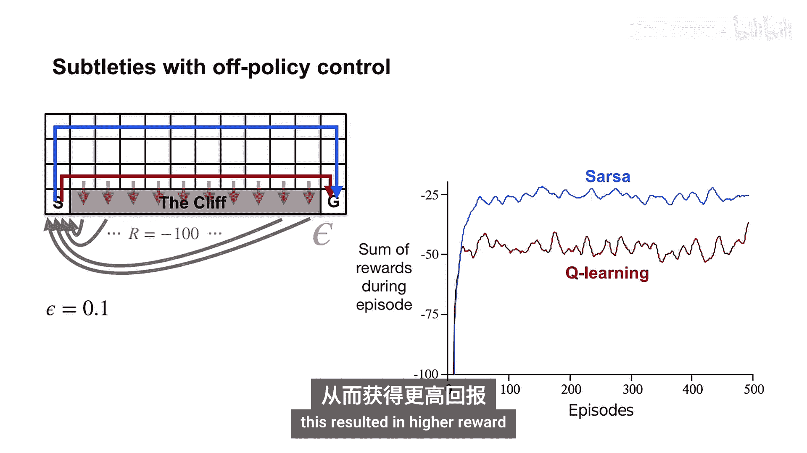
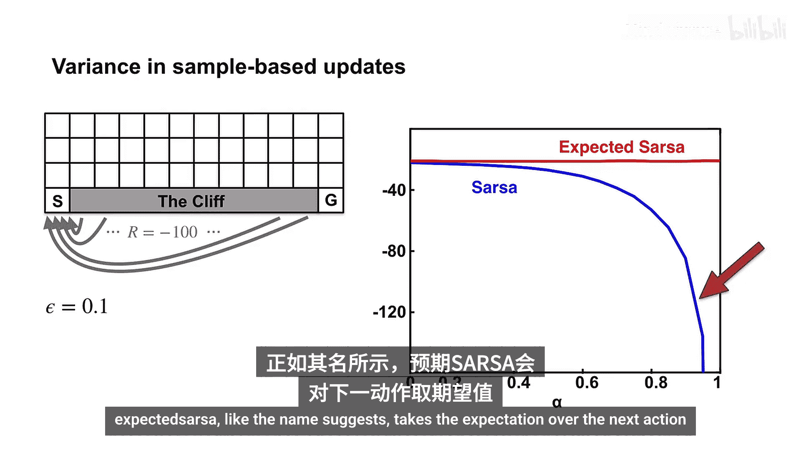

**基于样本的学习方法：第三周：时序差分控制方法总结**

在本节课中，我们将回顾第三周学习的核心内容：如何使用时序差分方法进行控制。我们将总结三种主要的TD控制算法，并比较它们的特性与性能。

上一节我们介绍了TD控制的基本思想，本节中我们来看看本周所学的具体算法及其总结。

---

### **📊 核心算法回顾**

TD控制算法均基于贝尔曼方程构建。本周我们重点学习了三种算法：

*   **SARSA**：使用基于样本的贝尔曼方程版本。它学习的是当前策略 **π** 下的动作价值函数 **Qπ**。
    *   更新公式：`Q(S, A) ← Q(S, A) + α [R + γ * Q(S', A') - Q(S, A)]`
*   **Q学习**：使用贝尔曼最优方程。它直接学习最优动作价值函数 **Q***。
    *   更新公式：`Q(S, A) ← Q(S, A) + α [R + γ * max_a Q(S', a) - Q(S, A)]`
*   **期望SARSA**：使用与SARSA相同的贝尔曼方程，但采样方式不同。它对下一个状态的所有可能动作的价值求期望。
    *   更新公式：`Q(S, A) ← Q(S, A) + α [R + γ * Σ π(a|S') * Q(S', a) - Q(S, A)]`

---

### **🔄 同策略 vs. 异策略学习**

以下是关于同策略与异策略学习的要点：

*   **SARSA** 是一种**同策略**算法。它学习的是其当前正在遵循的策略的动作价值。
*   **Q学习** 是一种**异策略**算法。它学习的是最优动作价值，而不依赖于当前遵循的策略。
*   **期望SARSA** 既可以是同策略的，也可以是异策略的。它可以学习任何给定策略的动作价值。

---

### **⚖️ 算法性能比较**

在衡量在线性能时，SARSA有时能表现得比Q学习更好。这是因为同策略控制方法会考虑自身的探索行为。

在“悬崖世界”示例中，我们观察到Q学习由于其探索性动作而频繁掉下悬崖。相反，SARSA学会了更长但更安全的路径，很少掉下悬崖，从而获得了更高的累积奖励。

---

### **🚀 期望SARSA的改进**

我们随后研究了SARSA的一种改进版本——期望SARSA。在“悬崖世界”中，在我们测试的所有步长参数值下，期望SARSA的表现都优于SARSA。

这是因为期望SARSA通过对下一个动作取期望值，有效降低了由策略本身带来的方差。

---

### **📝 本周总结**

本节课中我们一起学习了三种重要的时序差分控制算法：SARSA、Q学习和期望SARSA。我们理解了它们分别基于何种贝尔曼方程，以及它们在“同策略”与“异策略”学习上的区别。通过“悬崖世界”的例子，我们直观地比较了它们在在线性能上的差异，并看到了期望SARSA通过取期望来减少方差的优势。

本模块的内容到此结束。接下来，我们将学习如何将规划、学习和行动结合起来。下次见。