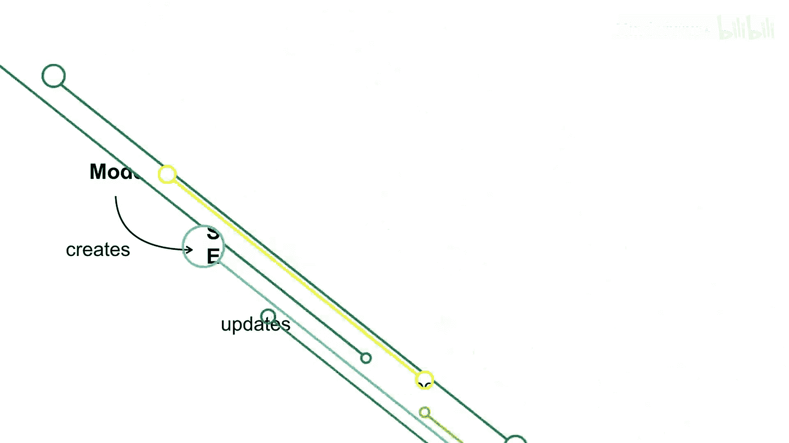
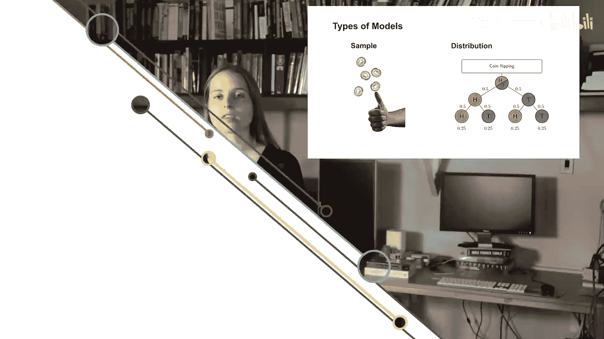
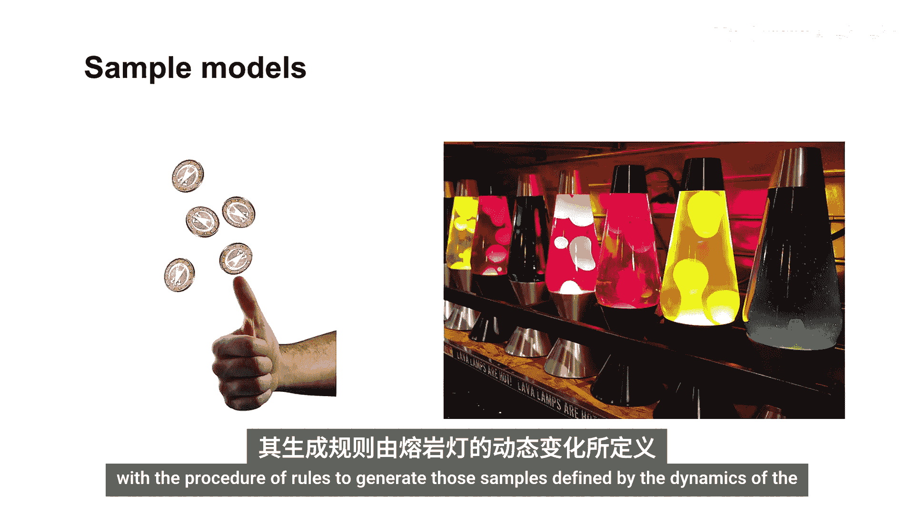
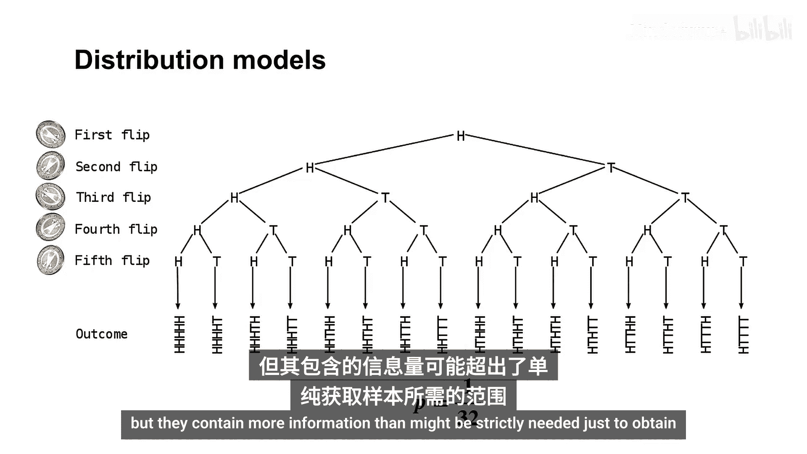

# 029：什么是模型

在本节课中，我们将要学习强化学习中的“模型”概念。我们将了解模型是什么，它如何帮助我们进行决策规划，以及两种主要的模型类型：样本模型和分布模型。

---

有时我们无需过多思考就能做出决定，例如决定如何开车去上班。而在其他时候，我们会基于对世界的理解，坐下来想象许多可能的情景。我们可以利用这些想象的结果来决定做什么或不做什么。例如，如果我们用一只手拿着一个易碎物品，我们可以想象它掉落并摔碎的情景，并据此做出选择。

上一节我们介绍了基于样本的方法（如TD）和基于完整模型的方法（如动态规划）。基于样本的方法仅从实际经验中学习，而动态规划则利用关于事物运作方式的完整信息进行规划，无需实际做出决策。如果能获得一种结合两者优点的中间方法，那将更为理想。本周，我们将通过Dah架构来统一这些策略。

本节中，我们来看看模型。在本视频结束时，你将能够描述模型及其使用方法，将模型分类为分布模型或样本模型，并识别何时使用分布模型或样本模型。

## 模型的定义与用途

模型用于存储关于环境动态的知识。当我们想象不同情景以辅助决策时，这植根于我们对世界运作方式的知识。给定一个特定的状态和动作，模型应该产生一个可能的下一个状态和奖励。这使我们能够看到动作的结果，而无需实际执行它。

模型允许进行规划。规划是指使用模型来改进策略的过程。使用模型进行规划的一种方法是模拟经验，并像这些经验真实发生一样执行价值函数更新。通过改进价值估计，我们可以做出更明智的决策。

模拟经验提高了样本效率。添加模拟经验意味着智能体需要更少与真实世界的交互，就能得出相同的策略。

## 模型的类型

以下是两种可能对我们有用的模型类型。

*   **样本模型**：根据某些底层概率，生成一个实际的结果。例如，抛硬币的样本模型可以生成一个随机的正面和反面序列。
*   **分布模型**：完全指定每个结果的可能性或概率。在抛硬币的例子中，它会说明正面可能出现50%的时间，反面可能出现50%的时间。它还可以利用这些信息计算出任何正面和反面序列的几率。

## 样本模型的特点

样本模型在计算上可能成本较低，因为可以根据一组规则生成随机结果。例如，要抛五次硬币，样本模型可以独立地随机选择0或1五次。它只需要为每次抛掷产生一个单一结果。

一个实践中样本模型的例子是，在2017年，Cloudflare公司使用从熔岩灯墙采样的随机模式来加密全球10%的互联网流量。这些样本是在给定时间点熔岩灯墙的随机配置，生成这些样本的规则程序由熔岩灯的动态定义。

## 分布模型的特点

分布模型包含更多信息，但可能难以指定，并且可能变得非常庞大。让我们回到抛五次硬币的例子。一个分布模型将枚举五次抛掷中你可能获得的所有可能的正面和反面序列，并为每个序列分配一个概率。对于这个简单的问题，这将包括完整描述32种可能的结果。

分布模型可以通过根据每个结果的明确概率抽取结果，来用作样本模型。但它们包含的信息可能比仅仅为了获取样本而严格需要的信息更多。

---

本节课中，我们一起学习了模型如何通过一个称为“规划”的过程来改进策略。我们讨论了两种不同类型的模型：样本模型和分布模型。下次我们将更深入地探讨这些模型之间的差异。