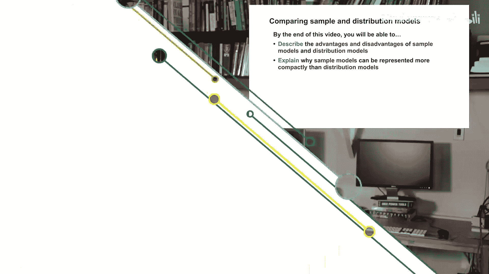
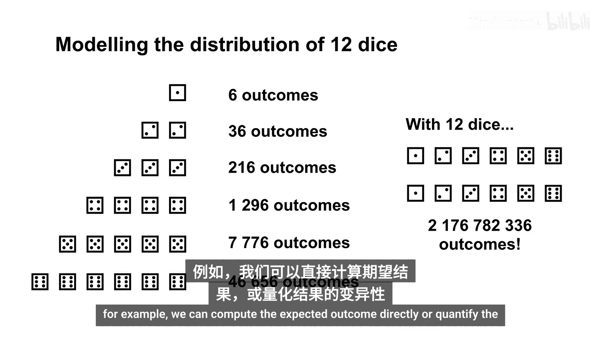

# 030：比较样本模型和分布模型

在本节课中，我们将学习模型如何表示世界运作的知识，并重点通过一个具体示例来阐明样本模型与分布模型之间的核心区别。

模型代表了我们对世界运作方式的知识。我们已经讨论过两种类型的模型：样本模型和分布模型。本节我们将聚焦于一个具体示例，以阐明样本模型与分布模型之间的关键差异。

## 🎲 一个具体的例子：掷骰子



让我们考虑掷12个骰子的问题。只要有足够的耐心，用一个骰子重复掷12次就可以轻松完成。

**掷一个骰子12次**是样本模型的一个例子。在程序中，这意味着生成12次1到6之间的随机数。这种方法非常紧凑，并且**不考虑联合概率**。

```python
# 样本模型示例：模拟掷一个骰子12次
import random
samples = [random.randint(1, 6) for _ in range(12)]
```

**为掷12个骰子建立完整的联合分布模型**则工作量巨大。我们必须考虑12个骰子的每一种可能结果，并为每个结果分配一个概率。

*   掷1个骰子，有6种结果。
*   掷2个骰子，有36种结果。
*   掷3个骰子，有216种结果。
*   掷4个骰子，有1,296种结果。
*   当掷到12个骰子时，我们需要考虑超过20亿种可能的结果。

然而，分布模型的一个有用之处在于，它可以**精确计算某个结果的概率**。例如，我们可以直接计算期望结果，或者量化结果的变异性。



## ⚖️ 两种模型的优缺点


上一节我们通过掷骰子的例子看到了两种模型的基本形式。现在，我们来总结每种模型类型的优势。

以下是样本模型的主要优点：
*   **所需内存更少**：只需存储生成样本的规则（如随机数生成器），而非所有可能结果的完整概率表。

以下是分布模型的主要优点：
*   **可计算精确期望值**：通过对所有可能结果按其概率加权求和，可以直接计算出精确的期望结果。请注意，样本模型只能通过平均大量样本来近似这个期望值。
*   **具备风险评估的灵活性**：了解确切的概率分布使我们能够灵活评估风险。例如，医生在开药时，会考虑多种可能的副作用及其发生的概率。

## 📝 课程总结

本节课中，我们一起学习了样本模型与分布模型的核心区别。

我们描述了**样本模型如何比分布模型更紧凑**，以及**分布模型中明确的概率信息如何在某些情况下（如计算期望值）非常有用**。理解这两种模型的特性，有助于我们在不同场景下选择最合适的建模方法。