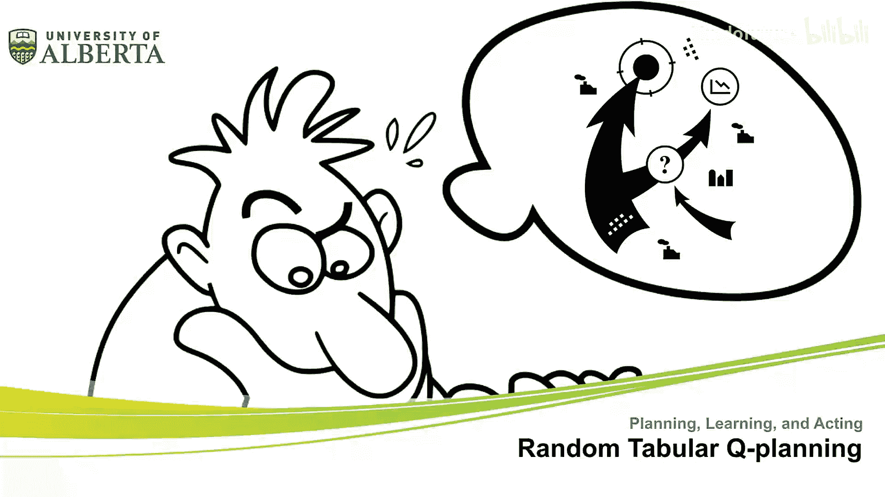
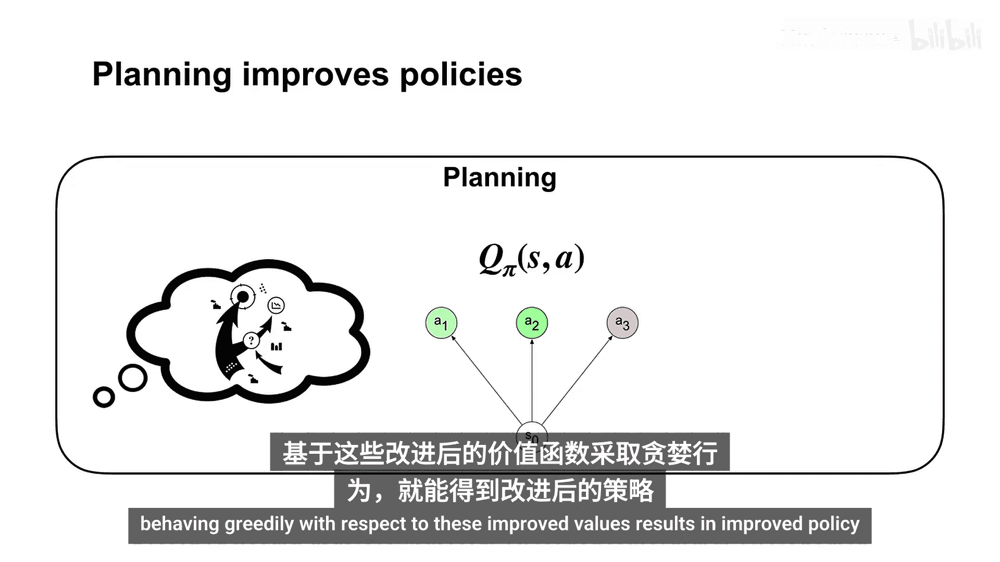
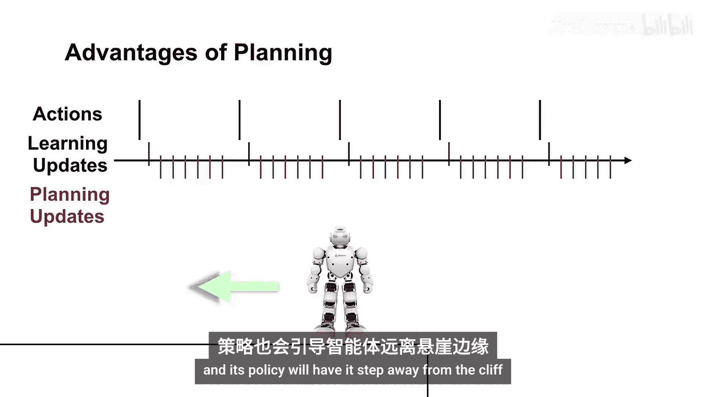

# 031：随机表格Q规划

在本节课中，我们将要学习如何利用模型进行规划，以改进强化学习中的策略，而无需与环境进行实际交互。我们将重点介绍一种具体的规划方法——随机单步表格Q规划。

## 什么是模型规划？🤔

上一节我们介绍了模型的概念。本节中我们来看看如何在强化学习中使用模型。

规划是一个过程，它以模型作为输入，并输出一个改进后的策略。规划的一种可能方法是先从模型中采样经验。这类似于根据你对世界运作方式的理解，想象世界中可能发生的情景。然后，这些生成的经验可以像真实发生在世界中的交互一样，用于更新价值函数。基于这些改进后的价值函数采取贪婪行为，就能得到一个改进的策略。

## 从Q学习到Q规划 🔄

回顾一下，Q学习利用来自环境的经验，执行更新以改进策略。

在Q规划中，我们使用来自模型的经验，并执行类似的更新来改进策略。随机单步表格Q规划就体现了这一思想。

该方法假设我们有一个关于状态转移动态的**采样模型**。它还假设我们有一个采样相关状态-动作对的策略。一种可能的选择是均匀地采样状态和动作。

以下是随机单步表格Q规划的算法步骤：

1.  **随机采样**：从所有状态和动作的集合中，随机选择一个状态-动作对 `(S, A)`。
2.  **查询模型**：用这个状态-动作对 `(S, A)` 查询采样模型，以生成下一个状态 `S‘` 和奖励 `R` 的样本。
3.  **执行更新**：对这个模型转移样本执行一次Q学习更新。更新公式为：
    `Q(S, A) ← Q(S, A) + α [R + γ * max_a Q(S‘, a) - Q(S, A)]`
4.  **改进策略**：根据更新后的动作价值函数，采取贪婪策略（例如，`π(S) = argmax_a Q(S, a)`）。

## 规划的优势与实践 💡

一个关键点是，这种规划方法只使用想象或模拟的经验。所有这些更新都可以在不与世界交互的情况下完成，或者与交互循环并行执行。

想象一下，智能体只能在特定的时间点采取行动，但学习更新可以相对快速地执行。这导致从学习更新完成到采取下一个动作之间有一段等待时间。我们可以用规划更新来填充这段等待时间。

设想我们有一个站在悬崖边的机器人。假设它的模型知道掉下悬崖的后果，但这在其价值函数或策略中没有得到准确反映。它可以生成掉下悬崖的模拟经验，并对这些转移执行多次规划步骤。它的价值函数现在能更好地反映掉下悬崖是坏事，其策略也会让它远离悬崖。

## 总结 📝

本节课中我们一起学习了规划方法如何利用模拟经验来改进策略。我们具体介绍了随机单步表格Q规划，它使用采样模型随机生成经验，然后使用Q学习更新来改进价值函数。这种方法允许智能体在“思考”中学习和改进，而无需承担实际交互的风险或成本。