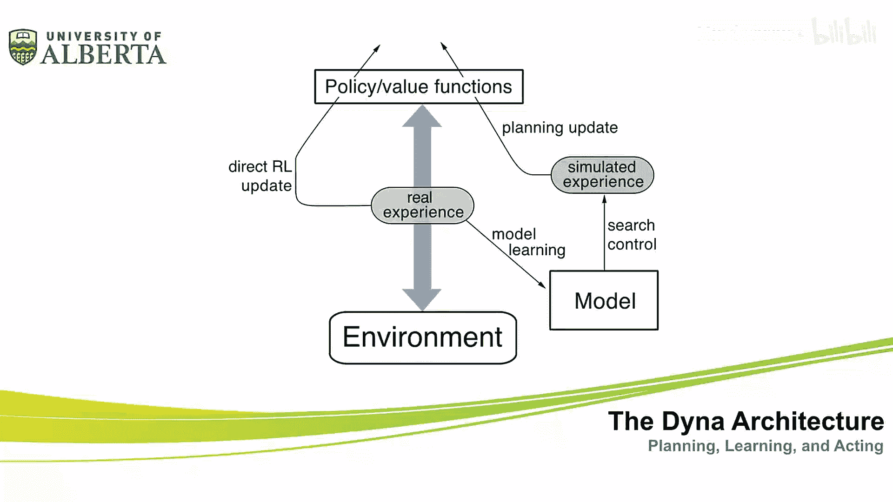
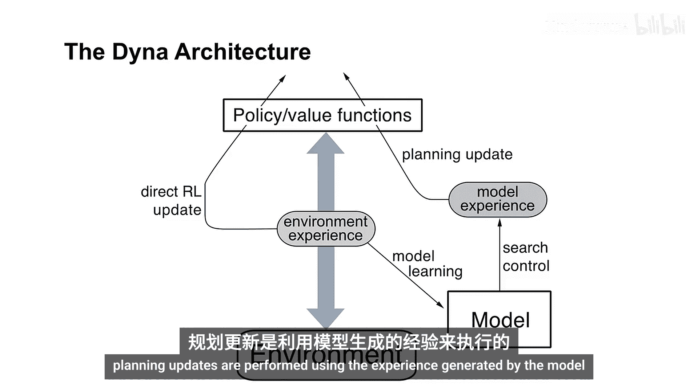
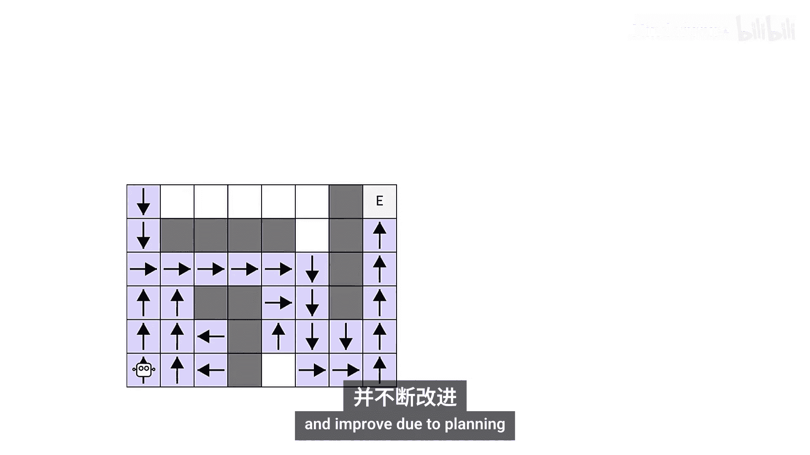

# 032：Dyna架构

## 概述
在本节课中，我们将要学习如何结合直接强化学习与规划，介绍一种名为Dyna的架构。我们将了解从模型生成的模拟经验与从环境交互获得的真实经验有何不同，并理解Dyna如何混合使用这两种经验来更新价值函数。

## 经验来源：环境与模型
到目前为止，我们讨论过两种经验来源：环境和模型。

在直接强化学习中，智能体通过与真实世界交互产生的经验进行学习，例如在Q学习中。

智能体也可以从模型中生成模拟经验，并将其用于规划。

## 结合直接强化学习与规划：Dyna架构
本节中我们来看看如何将这两种思想结合起来，即Dyna架构。

以下是Dyna架构的主要组成部分：
*   **环境与策略**：它们生成一系列真实经验流。
*   **直接强化学习更新**：使用上述真实经验进行更新。
*   **模型**：用于规划。模型本身需要通过学习获得。
*   **模型学习**：使用环境经验来学习模型。
*   **搜索控制**：控制模型如何生成模拟经验，即决定智能体从哪些状态开始规划。
*   **规划更新**：使用模型生成的模拟经验进行更新。

## Dyna工作原理图解
上一节我们介绍了Dyna的组件，本节中我们通过一个简单的迷宫示例来具体看看Dyna是如何工作的。

假设有一个迷宫和一个试图找到出口的机器人。这是一个折扣问题，机器人在目标处获得+1奖励，其他情况奖励为0。

机器人初始时一无所知。它随机地在迷宫中移动，直到第一次偶然碰到目标。

我们的机器人只更新了一个动作价值（用蓝色表示），这是唯一产生非零奖励的状态转移。这个更新是由直接强化学习完成的。

Dyna利用第一个回合中产生的所有经验来学习环境模型。图中黄色状态对应第一个回合中访问过的状态。

Dyna在每个时间步都会进行规划。然而，在第一个回合中，规划对策略没有影响，即使模型在每个时间步都变得更准确。

第一个回合结束后，规划才能真正发挥作用。在示意图中，思想气泡代表机器人脑海中进行的规划。气泡中的网格代表机器人对世界的模型，黄色状态代表模型知道接下来会发生什么的状态，即机器人在第一个回合中访问过的所有状态。

让我们看看如果在第二个回合开始时运行规划循环会发生什么。Dyna可以从智能体在第一个回合中访问过的任何状态-动作对模拟状态转移。在这种情况下，有很多这样的状态-动作对。

规划过程回放这些模拟转移，就好像它们发生在真实世界中一样。规划的每一步只是将Q学习更新应用于一个模拟转移，并更新价值函数。

通过足够多的规划步骤，智能体可以改进在第一个回合中访问过的所有状态的策略。在这个例子中，规划产生了一个相当好的策略。但这个策略并不完美，你能看出它在哪些地方采取了次优动作吗？在之前未访问过的状态，策略仍然是随机的，我们用白色方块表示这些策略未更新的状态。

现在，让我们看看这个规划出的策略在真实世界中的表现。机器人现在仅通过一个回合就知道如何快速到达目标。相比之下，Q学习需要许多回合才能达到类似的性能。

Dyna在每一步进行了更多的计算，但更有效地利用了有限的经验。请注意，这只是一个示意图。实际的Dyna行为会与此略有不同，机器人在第二个回合的每一步会继续探索和规划，因此策略偶尔会采取随机动作，并且策略会因规划而持续变化和改进。

## 总结
本节课中我们一起学习了Dyna架构，它使用直接强化学习和规划更新，从环境和模型两种经验中学习。我们通过迷宫示例直观地理解了Dyna如何更高效地利用早期经验来加速学习。