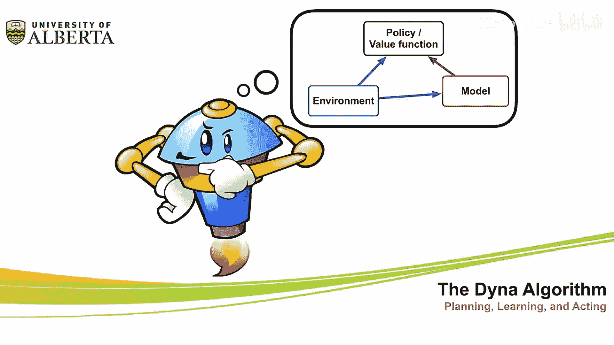
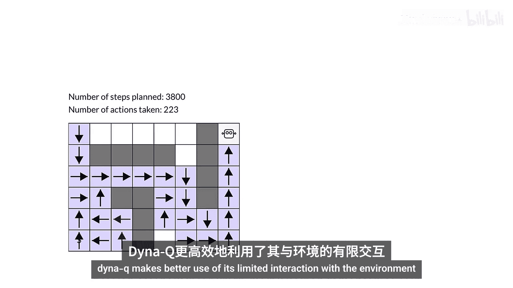

# 033：Dyna算法详解

在本节课中，我们将学习Dyna架构的一个具体实例——表格型Dyna-Q算法。我们将了解它如何将规划、学习和行动统一起来，并详细解析其工作原理。

## 概述

上一节我们讨论了Dyna如何统一规划、学习和行动，并引入了模型学习和搜索控制等概念。本节中，我们将深入探讨这些部分如何协同工作，具体分析表格型Dyna-Q算法。

## 表格型Dyna-Q算法

表格型Dyna-Q算法假设环境转移是确定性的。例如，当智能体在状态A选择向右移动的动作时，结果只有一个：以零奖励转移到状态B。同样，在状态B选择向右移动，则总是以奖励1保持在状态B。在状态B选择向左移动，则总是以零奖励转移到状态A。

智能体经历这些转移后，模型就知道了这些状态-动作对的结果。由于转移是确定性的，只要发生过一次，未来就会以相同方式发生，模型可以对此确信无疑。

## 算法步骤详解

让我们详细查看Dyna-Q算法的步骤。首先，算法包含通常的智能体-环境交互循环。

在当前状态下，智能体根据其ε-贪婪策略选择一个动作，然后观察得到的奖励和下一个状态。接着，它使用这个转移进行Q学习更新，这一步称为**直接强化学习**。

如果算法在此停止，那么得到的就是标准的Q学习算法。Dyna-Q的不同之处在于，它会利用这个转移进行一步**模型学习**。具体做法是，算法会记忆给定状态-动作对所产生的下一个状态和奖励。这之所以可行，是因为我们假设环境是确定性的。

随后，Dyna-Q会执行多步**规划**。每个规划步骤包含三个部分：搜索控制、模型查询和价值更新。

以下是规划步骤的详细过程：

1.  **搜索控制**：算法随机选择一个智能体之前访问过的状态-动作对。这必须是一个已见过的状态-动作对，否则模型不知道接下来会发生什么。
2.  **模型查询**：给定这个状态-动作对，我们查询模型以获取预测的下一个状态和奖励。这样就生成了一个模拟的转移。
3.  **价值更新**：Dyna-Q使用这个模拟的转移执行一次Q学习更新。

规划步骤会重复多次。最重要的是要记住，Dyna-Q会对每一次环境转移执行多次规划更新。

这就是表格型Dyna-Q，它是Dyna架构的一个简单实例。

## 直观理解：机器人示例

让我们通过一个机器人朋友的例子来更好地理解Dyna-Q算法。请注意，这只是一个用于建立直观理解的示意图。

和之前一样，机器人最初对环境一无所知。它通过与环境的交互逐步构建模型。在第一个回合中，机器人用了184步才到达目标，在此期间，智能体只改变了目标旁边状态-动作对的价值。

如果不进行规划，接下来的几个回合可能同样漫长。现在，我们观察下一个回合，并研究在每一步执行100次规划步骤所带来的影响。

在仅仅一步之后，规划就更新了另外两个状态的价值。现在，智能体知道了在最后一条走廊中的正确动作。

让我们再运行Dyna-Q一段时间。规划的影响是相当显著的。Dyna-Q将奖励信息传播到了整个状态空间。最终，智能体知道了从大多数状态导航到目标的有效策略。

经过规划计算出的策略，在仅仅两个回合后，只需要18步就能到达目标。这比第一个回合的步数缩短了10倍以上。

表格型Dyna-Q对价值函数执行了比不进行规划时多得多的更新。它更好地利用了与环境的有限交互。

## 总结

本节课中，我们一起学习了表格型Dyna-Q如何通过价值函数将规划、学习和行动结合起来。我们还研究了Dyna-Q在一个小型网格世界中如何更新其价值函数。